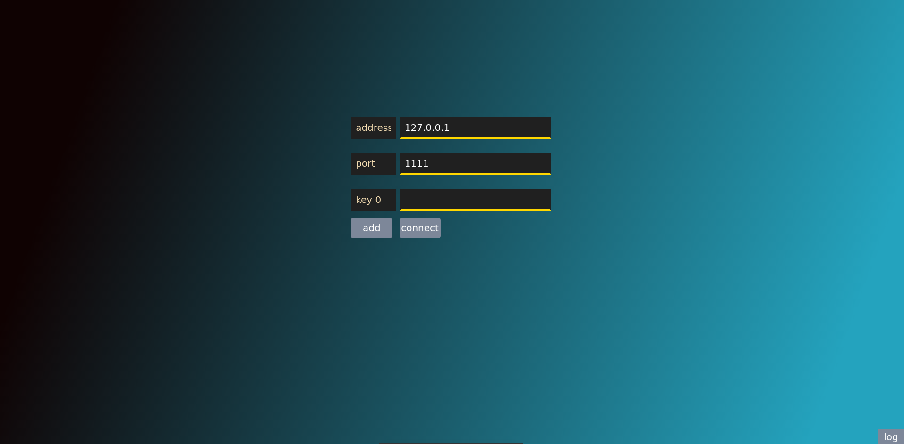
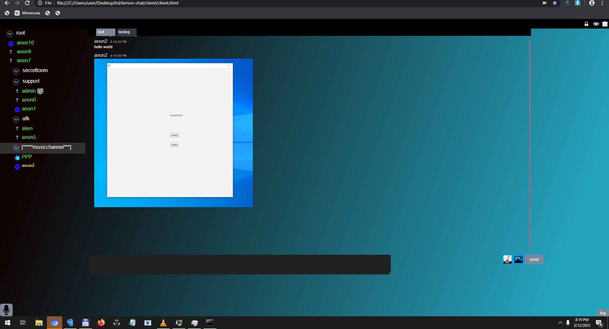
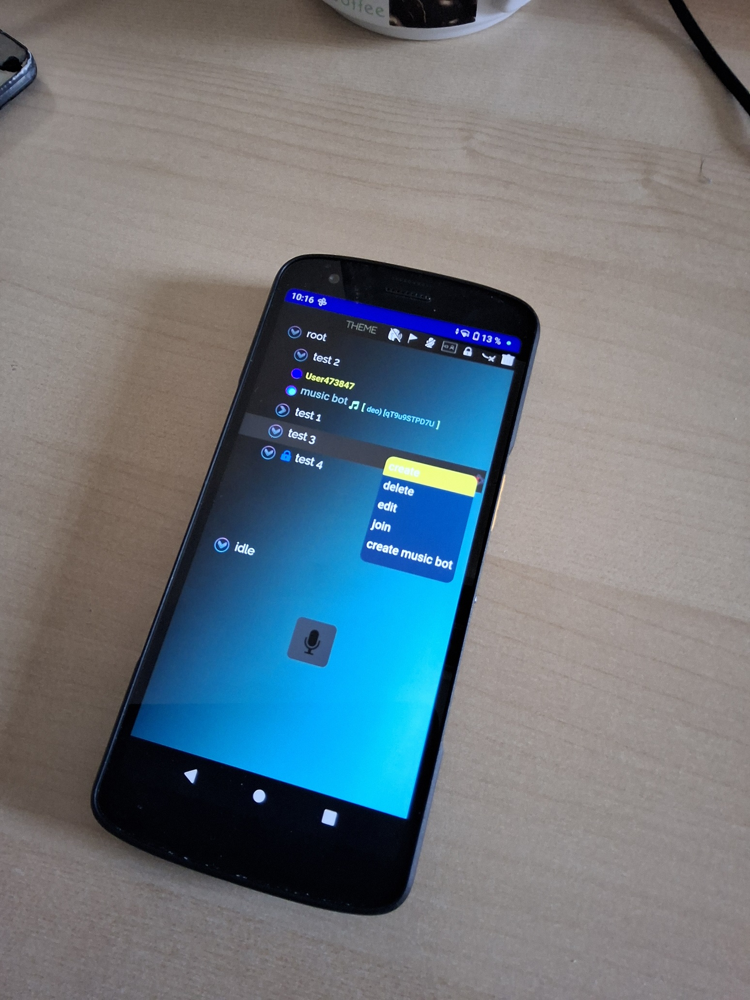

# A chat system you can host yourself

## Features:

- lightweight C server! built to run on different operating systems and CPUs
- a client in a single .html file!  
  open it from your desktop like an app, or serve it from a website  
- user management! (change usernames, kick, ban)
- channel management! (create, delete, and edit channels)
- direct messages (text and pictures)
- channel messages (text and pictures)
- permission system
- sending files
- voice chat in channels
- end-to-end encryption
- Android app
- screen sharing

 

## Other fun features

- select an MP3 file from your computer and play it in a channel
- choose a theme
- rearrange the interface
- change the font size and color of messages for both you and the people receiving them
- add groups to other users
- create music bots

## Live demo -> https://fruitybackendtesting.com/client.html
 

## How to start the server:
- watch `how-to-build-and-use-video.mkv`
- or download a prebuilt release

## How to start the client:
- The simplest way is to open client.html in your browser
- An Android app and a native desktop client is also supported

See the [documentation index](docs/README.md) for all guides.

 
 

## Example pictures

 

### To support further development of this project, consider giving it a ⭐
 
 
 

## More technical notes

I made this communication system to be similar to tools such as TeamSpeak or Mumble, which is evident from its interface. 
It supports optional voice chat or even video streams, and all messages—including text, images, and audio / video data—are end-to-end encrypted for both direct and channel communication. 
This chat does not rely solely on TLS/SSL and applies its own encryption on top if TLS/SSL is used, making it extremely difficult—even for the hosting admin—to view messages that do not belong to them. 
WebSocket is used for text and images, while WebRTC data channels are used for audio (only the data channel part is used; communication is client → server like WebSocket, so clients cannot leak IP addresses). 
The `client.html` contains everything embedded. It can be used like a regular `.exe` by clicking it, entering the IP address and port, and connecting to a server, or it can be packaged into an actual `.exe` using a tool like Electron if needed.  
The server should be easy to build (if the system has the correct build tools installed). Every dependency for building the server is already in this repository; there are no extra C/C++ libraries to download. For even more information, read the [docs](docs/README.md).

 
 

 

## Can the client.html file be used on a website?

Yes, just follow the setup instructions when you start the server.

 
 

# Thanks to these projects and people for providing some of the source code this project uses:

### Client:
cryptico -> https://github.com/wwwtyro/cryptico
 
aes-js -> https://github.com/ricmoo/aes-js
 
js-sha256 -> https://github.com/emn178/js-sha256
 
SHA-256 by Angel Marin and Paul Johnston, from WebToolkit -> [source](client-source-code/client-development/browser/main/scripts/vendor/sha256.js)
 
minimp3-wasm -> https://github.com/bashi/minimp3-wasm
 
minimp3 -> https://github.com/lieff/minimp3
 
Opus -> https://opus-codec.org/
 
Speex resampler -> https://github.com/xiph/speexdsp
 
ws-audio-api -> https://github.com/Ivan-Feofanov/ws-audio-api
 
Node.js Mobile (Android app) -> https://github.com/nodejs-mobile/nodejs-mobile

### Server:
wsServer -> https://github.com/Theldus/wsServer
 
cJSON -> https://github.com/DaveGamble/cJSON
 
libdatachannel -> https://github.com/paullouisageneau/libdatachannel
 
libviolet -> https://github.com/paullouisageneau/violet
 
libjuice -> https://github.com/paullouisageneau/libjuice
 
usrsctp (used by libdatachannel) -> https://github.com/sctplab/usrsctp
 
plog (used by libdatachannel) -> https://github.com/SergiusTheBest/plog
 
mbedtls -> https://github.com/Mbed-TLS/mbedtls
 
LibTomMath -> https://github.com/libtom/libtommath
 
tiny-AES-c -> https://github.com/kokke/tiny-AES-c
 
Opus -> https://opus-codec.org/
 
dr_mp3 -> https://github.com/mackron/dr_libs
 
libmaxminddb -> https://github.com/maxmind/libmaxminddb
 
cvector -> https://github.com/eteran/c-vector
 
log.c -> https://github.com/rxi/log
 
SHA-256 by ITH -> [source](server-source-code/third-party/ITH-sha/sha256.c)
 
Base64 by zhicheng -> https://github.com/zhicheng/base64

### Optional HTTPS/WSS:
stunnel -> https://www.stunnel.org/
 
OpenSSL -> https://www.openssl.org/
