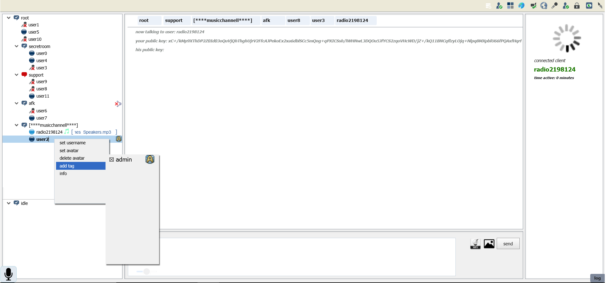
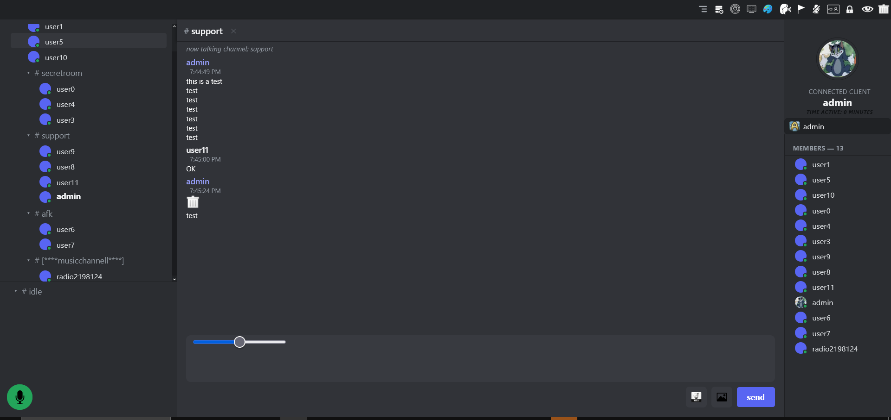

# A chat system you can host yourself

## Features:

- lightweight C server! built to run on different operating systems and CPUs
- a client in a single .html file!  
  open it from your desktop like an app, or serve it from a website  
- user management! (change usernames, kick, ban)
- channel management! (create, delete, and edit channels)
- direct messages (text and pictures)
- channel messages (text and pictures)
- permission system
- sending files
- voice chat in channels
- end-to-end encryption
- Android app
- screen sharing

 

## Other fun features

- select an MP3 file from your computer and play it in a channel
- choose a theme
- rearrange the interface
- change the font size and color of messages for both you and the people receiving them
- add groups to other users
- create music bots

## Live demo -> https://fruitybackendtesting.com/client.html
 

## How to start the server:
- watch `how-to-build-and-use-video.mkv`
- or download a prebuilt release

## How to start the client:
- The simplest way is to open client.html in your browser
- An Android app and a native desktop client is also supported

See the [documentation index](docs/README.md) for all guides.

## Clean build files

To reclaim space after building, close the running clients, server and build tools,
then run `tools\clean.bat` on Windows or `sh tools/clean.sh` on Linux/macOS from the repository
root. Python 3 and Git must be installed. Both scripts use the same cleanup rules.

Preview the files first with `tools\clean.bat --dry-run` or `sh tools/clean.sh --dry-run`.
For example, a compiled WebAssembly file in a project's `build` directory is
removed, but its source, published module and `prebuilt-backup` copy are kept.
The next browser build can compile it again from source.

The scripts also remove recognized server, desktop and Android build output,
compiler caches and unchanged packaged assets. Tracked files, downloaded build
tools, dependencies, settings, keys and saved music remain. Modified live themes,
fonts and sounds are kept; unknown files in build folders are listed as `KEEP`.
Directory links are never followed. This deliberately preserves files that cannot
be identified safely as build output.

## Code formatting

The C and C++ sources are formatted with clang-format 23.1.5, the JavaScript sources
with js-beautify 2.0.3. The scripts are in the `tools` folder and need Python 3. When a
tool is missing, they offer to download it for Windows, Linux or macOS.
`tools\install-clang-format.bat` and `sh tools/install-clang-format.sh` only download
clang-format.

**Before every commit, run `tools\format-before-commit.bat` on Windows or
`sh tools/format-before-commit.sh` on Linux and macOS.** It formats the changed C, C++
and JavaScript files with the project rules in `tools/before-commit.clang-format` and
`tools/before-commit.jsbeautifyrc`, so that the commit keeps the project style and
contains no formatting changes. Add the changed files again with `git add` afterwards.
Do not change the two rules files. The script reads them as they are in the last commit
and only uses these tool versions, so the result is the same on every system. The steps
and the JavaScript rules are in [docs/committing.md](docs/committing.md).

To work in your own style, change `tools/.clang-format` and run
`tools\format-codebase.bat` or `sh tools/format-codebase.sh`. It asks whether to format
`server-source-code`, `client-source-code` or both. Folders named `third-party` and
other bundled libraries are skipped. Run the format before commit afterwards, as
described above.

These are the C and C++ project rules.

- Indentation with 4 spaces, no tabs.
- Every opening brace on its own line, after functions, `if`, `else`, loops, `switch`,
  `case` labels, structures, unions and enumerations. `else` starts a new line.
- Braces around every body of `if`, `else` and loops, also around a single statement.
- No function, block, `if`, loop or `case` on a single line.
- Column limit 2000. A statement stays on one line, and a call wrapped by hand is
  joined into one line.
- `case` labels at the indentation of their `switch`. Preprocessor directives and
  `goto` labels are not indented.
- `*` next to the name, as in `char *name`.
- A space between `if`, `for`, `while` or `switch` and the parenthesis. No space
  between a function name and its parenthesis, after a cast or inside parentheses
  and brackets.
- One space before a comment at the end of a line. Such comments, assignments and
  declarations are not aligned with the lines around them.
- At most one empty line in a row, and no empty line at the start of a block.
- Include order, comments and string literals stay as written.

 
 

## Example pictures

 

### To support further development of this project, consider giving it a ⭐
 
 
 

## More technical notes

I made this chat to be similar to TeamSpeak and Mumble, which you can see in the interface. 
Voice chat is optional and can be enabled by the admin in each channel. Text, pictures, and audio sent between users are end-to-end encrypted. 
This chat does not rely on TLS/SSL alone. Messages are encrypted between users even when TLS/SSL is not used, and the server relays them without having the keys to read them. 
WebSocket is used for text and pictures. Audio and video can use either WebSocket or WebRTC DataChannel. WebRTC is optional, and the server can choose WebSocket only. 
Clients connect to the server, not to each other, so they do not share their IP addresses with other users through WebRTC. 
Lemon Chat runs its own STUN service using Violet. See [Audio and video connections](docs/webrtc.md) for the WebSocket and WebRTC choices, required ports and encryption layers. 
The `client.html` file has everything embedded in it. Open it in your browser, enter the server's IP address and port, and connect. It can also be packaged into a desktop app using a tool like Electron if needed. 
The server should be easy to build if the correct build tools are installed. The C/C++ libraries needed to build it are already included in this repository. 
Use the `.bat` build script on Windows or the `.sh` script for your system.

 
 

 

## Can the client.html file be used on a website?

Yes, just follow the setup instructions when you start the server.

 
 

# Thanks to these projects and people for providing some of the source code this project uses:

### Client:
cryptico -> https://github.com/wwwtyro/cryptico
 
aes-js -> https://github.com/ricmoo/aes-js
 
js-sha256 -> https://github.com/emn178/js-sha256
 
SHA-256 by Angel Marin and Paul Johnston, from WebToolkit -> [source](client-source-code/client-development/browser/main/scripts/vendor/sha256.js)
 
minimp3-wasm -> https://github.com/bashi/minimp3-wasm
 
minimp3 -> https://github.com/lieff/minimp3
 
Opus -> https://opus-codec.org/
 
Speex resampler -> https://github.com/xiph/speexdsp
 
ws-audio-api -> https://github.com/Ivan-Feofanov/ws-audio-api
 
Node.js Mobile (Android app) -> https://github.com/nodejs-mobile/nodejs-mobile

### Server:
wsServer -> https://github.com/Theldus/wsServer
 
cJSON -> https://github.com/DaveGamble/cJSON
 
libdatachannel -> https://github.com/paullouisageneau/libdatachannel
 
libviolet -> https://github.com/paullouisageneau/violet
 
libjuice -> https://github.com/paullouisageneau/libjuice
 
usrsctp (used by libdatachannel) -> https://github.com/sctplab/usrsctp
 
plog (used by libdatachannel) -> https://github.com/SergiusTheBest/plog
 
mbedtls -> https://github.com/Mbed-TLS/mbedtls
 
LibTomMath -> https://github.com/libtom/libtommath
 
tiny-AES-c -> https://github.com/kokke/tiny-AES-c
 
Opus -> https://opus-codec.org/
 
dr_mp3 -> https://github.com/mackron/dr_libs
 
libmaxminddb -> https://github.com/maxmind/libmaxminddb
 
cvector -> https://github.com/eteran/c-vector
 
log.c -> https://github.com/rxi/log
 
SHA-256 by ITH -> [source](server-source-code/main-server/third-party/ITH-sha/sha256.c)
 
Base64 by zhicheng -> https://github.com/zhicheng/base64

### Optional HTTPS/WSS:
stunnel -> https://www.stunnel.org/
 
OpenSSL -> https://www.openssl.org/
