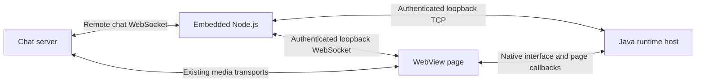

# How the Android client communicates

Suppose Maya sends you a message while your phone's chat screen is closed. The Android service can
still receive it because the remote chat connection belongs to embedded Node.js. The page does not
have to stay alive in an invisible window. Java supplies Android lifecycle, settings, permissions,
notifications and file saving; the shared JavaScript supplies the chat protocol.

## Who owns each part

| Part | Responsibility |
|---|---|
| Chat server | Routes encrypted messages, membership and other server protocol messages. |
| Embedded Node.js | Owns the remote chat-control WebSocket, RSA generation, protocol state, recovery, notification events and pending delivery to the page. |
| WebView page | Renders conversations and owns its existing outgoing content encryption, channel/media keys, microphone/camera capture and media connections. |
| Java | Owns the committed identity/settings record, process runtime host, native lifecycle, permissions, call notifications and Downloads publication. |

The page is more than a renderer: it needs keys for content and media operations. Node's RSA private
key is not included in page replay. Bootstrap settings omit the identity passphrase; Android identity
import, export and resizing use the native identity owner.

## Starting and reconnecting

Java's `AndroidRuntimeHost` owns the bridge for the process lifetime. A recreated foreground service
attaches a new listener instead of starting another embedded Node runtime or abandoning the endpoint.
Node connects to Java before waiting for its page WebSocket listener to become available.

The Java connection uses a random token followed by bounded UTF-8 JSON lines. Node decodes complete
lines, preserving characters split across TCP chunks. Invalid commands are rejected separately; one
malformed command does not prevent processing the following complete line. Java has bounded
authentication workers, one ordered writer and a watchdog for a stalled write.

Settings describe the committed configuration. Unchanged settings and page attachment do not override
an explicit Disconnect. Connect and Disconnect are separate local commands. Disconnect ends Node's
remote session while the page can keep its local status connection.

If you press Connect just as the Java–Node socket fails, entering the writer queue is not enough.
Java keeps that action's `command_id` until Node returns its matching `connect_intent_result`. A newer
Connect or Disconnect replaces the pending action. Node recognizes a retried ID, so a lost receipt
cannot make the old Connect undo a later Disconnect from the page. This pending state lasts only for
the current process; it is not a saved preference to reconnect forever.

An attempt waiting for identity or metadata-key initialization has a cancellation scope. Target or
identity replacement and Disconnect invalidate it. Socket events have a separate transport generation,
checked again after asynchronous queueing. A late close from socket A cannot reset replacement B.

## Opening the page again

The page authenticates to the loopback listener with its token. Only the current authenticated page
can forward requests or complete operations; replacing the page immediately revokes its predecessor.
The WebSocket implementation is the pinned, packaged `ws` dependency behind `websocket-adapter.js`.

For a currently authenticated remote session, Node sends public identity before replaying login,
channels, clients, current policy and maintainer/key state. Maintainer generation is included. During
recovery, old lists and a cached login frame do not authorize a successful-login display: the page
receives the actual connection phase.

Remote packets cannot introduce local-only status, media-key, identity-result, delivery or pre-opened
attachment events. That distinction is assigned by the receiving transport before forwarding. A JSON
field supplied by the server cannot grant local authority.

## A message arrives while the screen is closed

Node processes Maya's message and emits an event identifying its actual sender. Java can notify you
without a WebView. The loopback adapter retains pending content within explicit count and byte limits.
The next ready page receives it and acknowledges successful processing. Socket attachment and a
successful frame write do not acknowledge the message.

Unread state belongs to the peer's identity. If Maya reconnects in another numeric server slot, her
unread count and local ignore/mute choices remain hers. If Sam takes her former slot, her existing
private conversation cannot select Sam's encryption key. Reading a conversation reports the latest
delivery processed by the page; an older read cannot clear newer unseen content.

Pending content includes its original sender's identity. If Maya has left when you reopen the page,
her message opens her saved history instead of using whoever now occupies her old slot. Retained
channel content is already decoded by the Node client, so a later channel-key rotation does not make
it unreadable. Local-only validation prevents a server packet from claiming to be that decoded output.

This retention is in memory. Process death can lose it. The server currently removes queued offline
ciphertext before recipient acknowledgement, so durable offline delivery requires additional server
acknowledgement and/or protected local storage. Exhausting the pending queue is an explicit failure,
not silent eviction of unread content.

## Accepting a call

Node creates an unpredictable call ID, binds it to the current session and sets an expiry. Java carries
that record through the notification and call screen. Accept opens the activity, which forwards the
validated action before ordinary foreground resume. Java and Node reject missing, expired or replaced
call IDs. Node uses its retained channel, not an arbitrary channel from an incoming Intent.

When Android reuses the call activity, `onNewIntent` refreshes the caller display and stored action
together. Declining can preserve idle presence while still reporting that the activity is visibly open.
Visibility does not mark every conversation read.

If the control connection breaks while you accept or decline, Java retains that one scoped action
until its matching result or original expiry. Reconnection replays the retained presence before the
action. A repeated result request does not repeat an ordinary join; if an older forced-idle snapshot
was replayed first, Node restores the accepted presence. A newer explicit task removal cancels a
still-pending Accept, so retry cannot undo your later choice to close the task.

## Replacing an identity

Import validates the exact passphrase and RSA size, then commits a canonical native record before
publishing success. Node closes the old session before replacing its key. Generation results carry a
request ID and revision; stale success or failure cannot complete a newer import. Public generation
results reach the page even when the remote server is unavailable.

The record preserves the active generation size independently of the next-identity preference.
Conflicting legacy records remain available for explicit recovery. Missing historical key sizes are
not silently guessed. See [identity files](../../../../docs/identity-files.md) for the file contract.

## Uploads, downloads and native access

An upload chunk waits for capacity at the remote Node-to-server socket. Acceptance by the fast local
socket alone is insufficient. Replacing its page or session cancels an outstanding upload. Picture
preparation failure releases its own lock and preserves a retryable draft. Direct-file decryption
failure reaches the page's receiving card.

For a large prepared download, Node first asks the current page to reserve a bounded transfer. It then
sends chunks of at most 64 KiB of base64, with at most four awaiting acknowledgement. The page checks
session, sequence, length and encoding before accepting each chunk. Completion of those chunks is
separate from successful message processing; only the latter removes the retained delivery. Admission
failure, expiry and cancellation settle the receiving file/image indicator instead of leaving it pending.
There can be at most eight transfers, with separate per-transfer and aggregate byte limits.

The file header stays available until the complete attachment is accepted. A replacement page needs
both the header that creates its card and the body that fills it. A missing card is a failed delivery,
and asynchronous decoding must finish before acceptance. Later edits and deletions wait for their
own original message to reach the page; unrelated messages can continue.

The file path still has whole-file crypto, JSON/base64 and native decode allocations. Transport limits
are not a device heap guarantee; this is not streaming decryption or streaming native saving. A native
save succeeds only after its Downloads entry is published. Failure cleans up the pending entry.

The privileged WebView remains on the bundled page. Navigation/frame restrictions and origin/resource
checks protect its native interface. Permission and picker callbacks belong to the current activity,
page and request; a cancelled request cannot complete its successor's operation.

## Source and checks

| Area | Source |
|---|---|
| Runtime lifetime and TCP | `app/src/main/java/com/lemonchat/AndroidRuntimeHost.java`, `NodeBridge.java`, `BridgeProtocol.java` |
| Native settings and identity | `app/src/main/java/com/lemonchat/ChatSettings.java` |
| WebView boundary | `MainActivity.java`, `TrustedWebViewClient.java`, `JavascriptJavaBridge.java` |
| Node control and page delivery | `../nodejs-client/android-bridge-client.js`, `loopback-ui-server.js` |
| Local download chunks | `../nodejs-client/loopback-transfer.js`, `../../browser/main/scripts/app/workers/local-transfer.js` |
| WebSocket dependency and limits | `../nodejs-client/websocket-adapter.js`, `transport-limits.js`, `vendor/ws-lock.json` |
| Shared client state and workers | `../../browser/main/scripts/app/connection/`, `workers/`, `crypto/`, `mobile/` |

Build with `gradlew.bat assembleDebug` here. The build regenerates browser and Node assets from declared
inputs. Run `node test/run.cjs` from `../nodejs-client` for transport and full-bundle regressions.
Compilation and desktop Node tests do not replace Android checks of lock-screen calls, service
recreation, permissions and large transfers.

Run `python test/run.py` here for the portable native regressions and `python test/verify_apk.py` for
the built debug APK's managed assets and ABI inventory.

`node --test test/webview-policy.test.cjs` checks the template policy and, with Playwright/Chromium
available under Node 20 or later, its frame/object restrictions and worker/Wasm compatibility in a real
browser. It supplements, rather than replaces, an installed Android WebView check.
