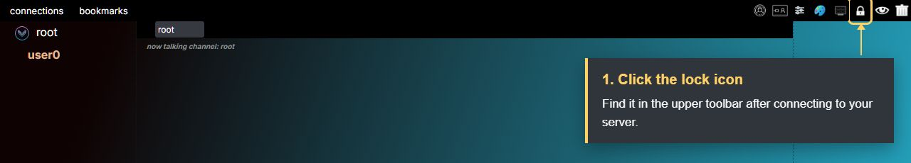
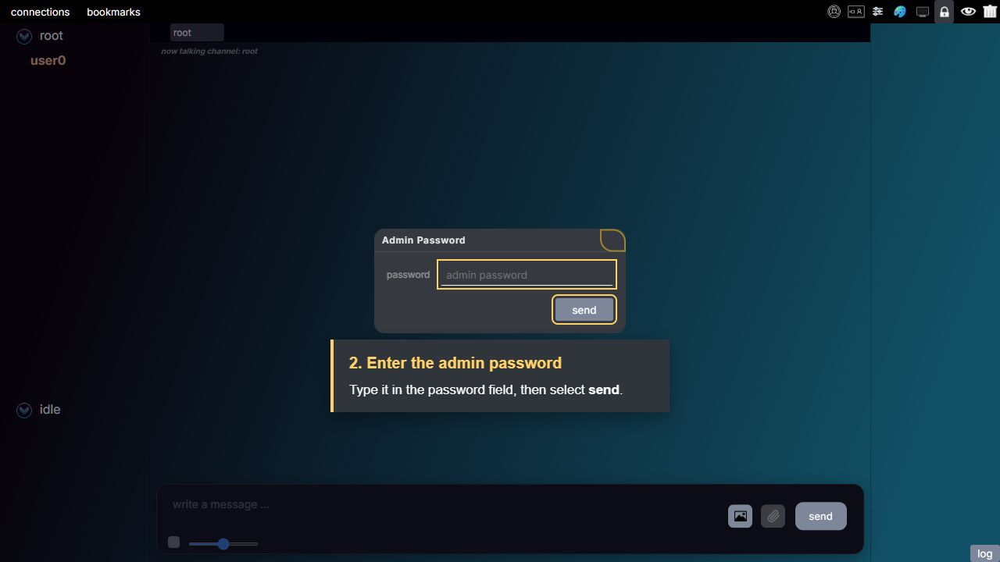
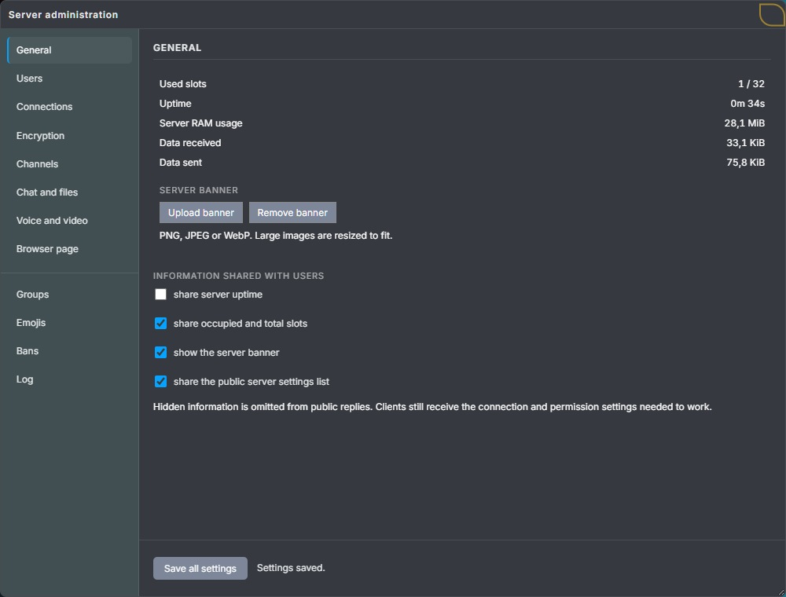
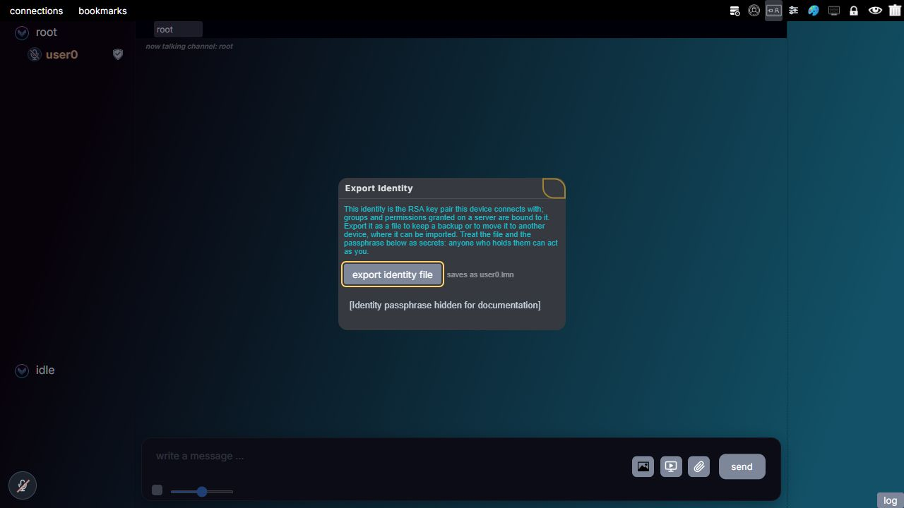
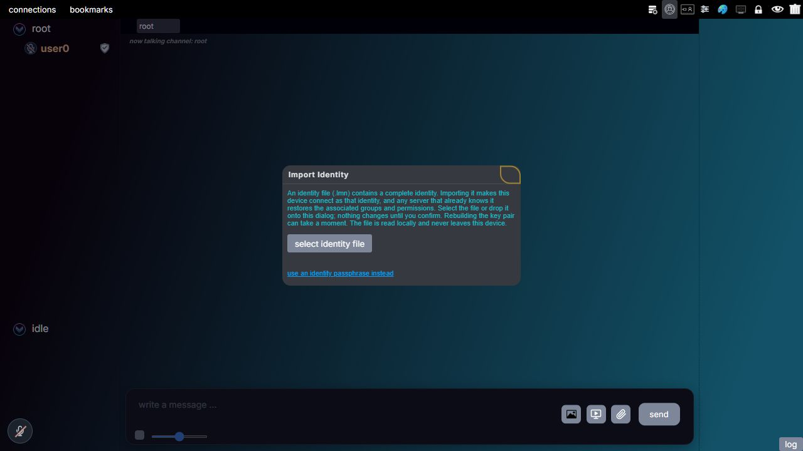
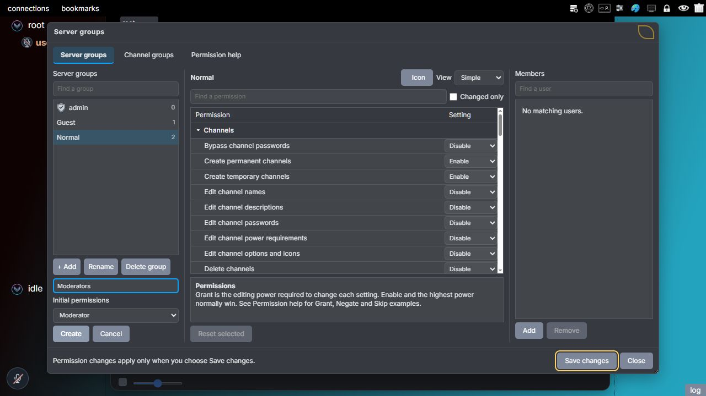
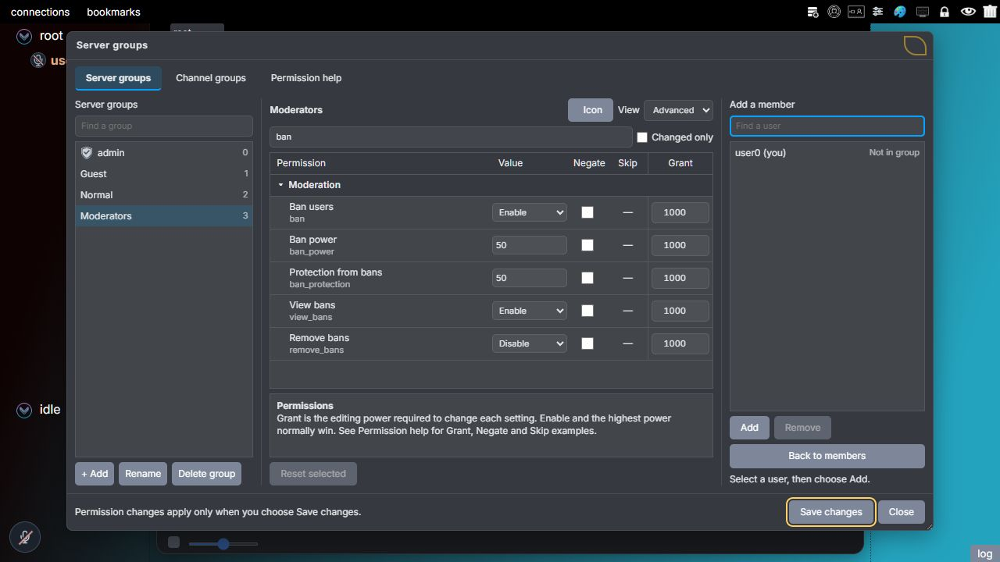

# Administration

You have started a Lemon Chat server and can connect to it. Now you want to choose what users can do, create channels that stay after a restart, and give a trusted person moderation rights. These controls are available inside the connected client after you obtain admin access.

This guide starts with the admin password chosen during server setup. If the server is not running yet, follow the [selfhosting guide](../selfhosting-tools/README.md) first. The [server settings reference](server-settings.md) explains the individual options in more detail.

## Which password to use

During first-time setup, the server asks **Set the server admin password:** and then asks you to enter it again. Use that password for your first admin login. If an administrator has changed it since setup, use the replacement password.

The first startup summary also prints the setup admin password. Later starts do not print it again. There is no shared default admin password to enter.

Several different secrets appear in Lemon Chat. They have separate purposes:

| Secret | What it lets you do |
| --- | --- |
| Server connection key | Connect to a server that requires that key. It does not grant admin access. |
| Admin password | Obtain full administration access on the connected server. |
| Channel password | Enter a particular password protected channel. |
| Identity passphrase or exported identity file | Connect as the same identity, including its saved groups and permissions. |

Knowing the admin password does not skip the normal connection requirements. Connect to the correct server first, then submit its admin password from inside the client.

## Open the admin settings with the password

**The admin-password login is the lock icon in the upper toolbar of the connected chat window.** Click that icon to open **Admin Password**. This is where you enter the server's admin password before opening Server administration.

These steps use the **Default** theme. If your theme hides the administration buttons, choose **theme**, then **Default**. For example, Pocket hides both the admin-password and server-settings buttons.

### 1. Find the lock icon in the upper toolbar

Connect to your server and wait until the channel list appears. Look at the **upper toolbar**, along the top of the chat window. In the Default theme, the small **lock icon is near the right end**, immediately to the left of the eye icon. Click the lock highlighted below.

*The highlighted lock opens the admin-password login. The callout was added to this screenshot to identify the button.*

### 2. Enter the password in the Admin Password dialog

Clicking the lock opens the **Admin Password** dialog shown below. Type your server's admin password into the **password** field, then click **send**. If this is the first successful password login after setup, complete the password-change prompt described in the next section.

*Enter the password in the highlighted field, then select **send**. The screenshot deliberately leaves the field empty.*

### 3. Open Server administration after signing in

After the server grants admin access, the **server administration icon** becomes available in the upper toolbar. In the Default theme it looks like a server stack with a small cog. Select it to open **Server administration**, with **General** selected. You can now change the server's general options or choose another administration page.

*Choose a page on the left, or use the **Section** dropdown on a narrow screen. **Save all settings** stays in the footer while you scroll the settings.*

The password dialog closes as soon as you select **send**, even when the password is wrong. Its disappearance is not a success confirmation. The server must grant admin access before you can open Server administration. The current client does not show a dedicated wrong-admin-password message.

If your current identity already has full admin access, you can open the server administration icon directly without submitting the password again.

The **local** button opens settings for your own device. The **server settings** button on the connection screen configures the connection. Neither is the connected administration window described here. The root channel's **server info** menu also shows public information rather than editing controls.

### Replace the setup password on first login

The initial password was displayed in the server's startup console. On the first successful admin-password login, the client therefore asks you to set a new admin password.

Enter a new, nonempty password and confirm the prompt. The current request accepts up to 50 UTF-8 bytes: 50 plain ASCII characters, but fewer if you use characters such as accented letters or emoji that occupy several bytes. Keep the replacement password somewhere you can retrieve it: future password logins use this new value.

The server hashes the replacement and immediately attempts to save it; this change does not wait for **Save all settings**. Check the result: **Admin password changed.** confirms that the replacement was saved. If saving fails, the server reports that the password was not changed and keeps the previous password working, including after a restart. The stored `admin_password` value is a hash, not the password to copy into the login dialog.

Canceling the prompt or submitting an empty value leaves the password unchanged. This is a one-time prompt: the server clears its initial-password flag when it sends the prompt, so do not rely on reconnecting to make it appear again. The current administration window has no separate password-change field. The authenticated [change-admin-password request](messages.md#client-request-change_admin_password) is documented for clients and administration tools that need to change it later.

Changing the password does not remove existing Admin group memberships or revoke admin access from clients that already have it.

## Make and check your first change

Suppose you want people in a meeting channel to share their screen. Video is disabled in the server defaults, and the browser's channel-creation form also starts with streaming disabled. Changing only one of these settings would therefore leave screen sharing unavailable.

1. Open **Server administration → Voice and video**.
2. Enable **allow video streaming**.
3. Choose the allowed **audio and video connections**. For an HTTP tunnel such as Tailscale Funnel, choose **WebSocket only**. Other deployments can allow both methods; see [audio and video connections](server-settings.md#audio-and-video-connections).
4. Select **Save all settings** in the fixed footer.
5. Close and reopen the administration window to load the server's accepted values. Check that video is still enabled.
6. Open the meeting channel's settings and check **Enable Streaming** in its **Audio & video** tab. Video must be allowed there too. With groups enabled, the user's streaming power must also meet the channel's requirement. The [channel screenshots](channels.md#audio-video-and-attachments) show this second control.

The server applies accepted changes while it is running and saves them for its next start. Closing the window does not submit unsaved settings. Reopening it keeps those edits. Check the save result in the footer: if saving fails, your edits remain so you can correct them and try again.

Only one screen share or video stream can run in a channel at a time. If someone is already sharing, another user must wait for that stream to stop.

## Find the right administration tab

| Page | What you manage there |
| --- | --- |
| **General** | Current usage, banner and information shared with users. |
| **Users** | Country flags, name changes, and avatar or group-icon size limits. |
| **Connections** | Reserved slots, country restrictions, shared IP addresses, login limits, reconnects and connection checks. |
| **Encryption** | Connection passwords and ciphers, DH exchanges, session encryption and minimum RSA key size. |
| **Channels** | Channel limit, temporary channels, hidden members and channel-key reuse. |
| **Chat and files** | Private messages, typing, link previews, file and picture uploads, size limits and attachment blocking choices. |
| **Voice and video** | Audio, video, connection methods, music-bot audio and saved playlists. |
| **Browser page** | Serving the browser client and embedding connection details. |
| **Groups** | Shows a short introduction and an **Open Groups** button. That button opens the window for editing server and channel groups, permissions, memberships and icons. Hidden when groups are disabled. |
| **Emojis** | Add or remove the reaction emojis supplied by this server. |
| **Bans** | Review bans and remove a ban when a user should be allowed back. |
| **Log** | Choose which administration events to record, read recent entries, and configure log size and retention. |

For a new server, review **allow private messages between clients**, file and picture uploads, their size limits, and **allow more than one client from the same IP address**. Two people on the same home or office network may share a public IP address, so a one-client-per-IP rule can prevent the second person from connecting.

Review audio and video separately from text chat. The main chat connection always uses WebSocket; the audio-and-video selector controls those media connections only. The upload fields and media settings are explained in [Server settings](server-settings.md).

## Save changes so they survive a restart

An action taking effect now does not always mean it has been saved. For example, creating a permanent meeting channel makes it available immediately, but you still need to save the configuration to keep that channel after restarting the server.

| Change | How to keep it |
| --- | --- |
| Settings across all eight pages | Select **Save all settings** in the fixed footer. It saves changes from all eight pages together. |
| Permanent channels and their settings | Select **Save all settings** after arranging or editing them. Temporary channels are excluded. |
| Music bots and uploaded playlists | Under **Voice and video**, select **include music bots and uploaded playlists in this save**, then **Save all settings**. This snapshot is for the next startup; save another snapshot before a later restart. |
| Server group permission edits | Select **Save changes** in the group editor to submit and save them. |
| Server group creation, deletion, names, icons or memberships | Accepted changes affect the running server immediately. Select **Save changes** in the group editor to keep them after a restart. |
| Channel group definitions and assignments | Accepted changes are saved as part of their requests. Submit definition edits with **Save changes**. Assignments in temporary channels disappear with those channels. |
| Emoji uploads and deletions | Changes affect the running server immediately. Select **Save changes** in **Emojis** to keep the list. |
| Logging options | Select **save log settings** in **Log**. **Save all settings** does not submit unsaved log controls. |
| Bans and ban removals | The server writes accepted changes immediately. |
| Admin password replacement | The server writes the accepted replacement immediately. |

Closing an editor does not undo changes already accepted by the server. For example, closing the group window does not undo a membership you just added. Remove that membership explicitly if it was a mistake.

*The **Save all settings** button stays in the footer of the eight settings pages. It saves their changes together, including permanent channels.*

Saving needs permission to read and replace `server_settings.json` and to write temporary files in its directory. If saving fails or settings are missing after restarting, check the server console and filesystem permissions. A failed save leaves the previous settings in use.

The settings file has a **64 MiB** read/write limit. An oversized save is rejected before replacing the previous file. On Linux and other POSIX systems, successful saves create an owner-only file (`0600`), because it contains connection passwords and other private server state.

For example, if you keep adding custom reaction images, their encoded image data can fill the emoji collection's **32 MiB** budget even though each image meets the individual upload limit. The server then refuses another image and asks you to delete some first. Delete unwanted images, add the replacement, and select **Save changes**. Existing older saved collections above this budget still load, but further additions remain blocked until space is available.

### Keep music bots for the next startup

Suppose you have a radio bot with two uploaded songs and want both songs available after restarting the server. Under **Server administration → Voice and video**, select **include music bots and uploaded playlists in this save**, then select **Save all settings**. Wait for a successful save before stopping the server. A normal save without that checkbox does not create a new music snapshot.

At startup, the server loads the saved channels first, then restores each bot to its saved channel. The snapshot includes bot names, playlists, the uploaded MP3 bytes and the paused state. It does not retain the exact playback position. Keep the snapshot file beside the same `server_settings.json` and start the server from that working directory.

After restoration, the saved file stays on disk. The next startup can restore it again, including
after a crash. Save music again when you want to keep later playlist changes.

Select **Clear from disk** to overwrite and delete the saved copy. This does not remove songs
already in RAM. If overwriting or deletion fails, the server shows an error.

Configured connection keys encrypt the snapshot. With no connection keys configured, the snapshot is not encrypted. If restoration fails, check the **music bot snapshot** status in server settings. A damaged snapshot, changed keys or a missing channel can prevent restoration; the file is retained for recovery. Use **Retry restoration** with the original keys in their original order when needed. If the current file is missing but a previous snapshot survives, the server preserves it for an explicit recovery attempt instead of automatically loading the older playlist.

## Keep your admin identity

Suppose you administer the server from a browser today and want to use another computer tomorrow. Typing the same display name on the second computer does not make it the same user. Groups belong to the cryptographic identity used by the client, not the display name.

In the Default toolbar, open the control whose tooltip starts **export identity**. The **Export Identity** dialog offers **export identity file** and displays the identity passphrase. Save the file privately. On the other device, choose **import identity**, load that file or passphrase, and reconnect as the same identity.

*Choose **export identity file** on the original device. The real dialog also displays your secret passphrase; it is hidden in this documentation image.*

*On the other device, open **import identity**, then choose **select identity file**. The link below it opens the passphrase alternative. Review and confirm the import before reconnecting.*

Anyone with the exported file or passphrase can act as that identity. Keep it with your private credentials rather than sending it to ordinary server users. Backing up the server settings alone does not back up your client's secret identity.

With groups enabled, the built-in **Admin** group grants full admin access. Successful password login adds this membership when `is_display_admin_group_active` is enabled. For it to return after a server restart, the membership must be saved with the identity, and identity storage must be enabled. Select **Save all settings** after establishing your admin identity.

If groups are disabled, saved Admin membership does not grant admin access. Use the admin password. If password login did not assign an Admin membership, do not assume your identity will automatically regain administration on a new connection.

## Give another person the rights they need

Suppose a trusted user should move people between channels and remove disruptive users, while you continue to manage the server's configuration. A Moderator group is intended for that situation.

1. Open **Server administration → Groups**, then select **Open Groups**.
2. Choose **+ Add** below the group list, enter a name such as `Moderators`, choose **Moderator** under **Initial permissions**, and select **Create**. You can also select an existing group instead.
3. Review its permissions before assigning it. The Moderator preset includes moving users, channel moderation, server kicks and bans, with moderation powers starting at 50.
4. Keep that group selected on the left. In the **Members** panel on the right, select **Add** to open **Add a member**, select the user's identity, then select **Add** again.
5. Select **Save changes** to submit permission edits and persist the group and membership.

*The name and **Initial permissions** are separate fields. The preset supplies the starting permissions for the new group.*

*Choose the user in **Add a member**, then select **Add**. This example lists only the demonstration identity; on your server, select the intended person's identity. To remove a member later, return to **Members**, select that member and choose **Remove**.*

Permissions decide whether an action is allowed. Power decides whether the user can perform it against a particular target. For example, a moderator with ban power 50 cannot ban a user with ban protection 75, even when **Ban users** is enabled. See the [complete permissions reference](permissions.md) for every action, power and protection value.

To give someone full server administration, assign the built-in **Admin** group while groups are enabled. Its ID is `0`. Creating a new group from the **Admin preset**, naming a group Admin, or giving someone power 1000 does not grant full server administration. The preset gives group permissions; the built-in Admin membership also permits full server settings.

New identities receive **Guest** automatically when they have no other server group. Review Guest before inviting users, since its permissions determine what a newcomer can do. When you assign another server group, Guest is removed; removing the last other group restores it.

If **Groups** is missing, check `is_permission_system_enabled` in the settings file. This is a startup option: stop the server before changing it, then start the server again. The admin password still works with groups disabled.

## Create channels that stay

A permanent channel is suitable for a meeting room that should still exist tomorrow. A temporary channel is suitable for a conversation that should end when its owner leaves.

Right-click an existing channel and choose **create** to create a channel beneath it, or choose **edit** to change that channel. Check its type in the **Channel** tab, and set its name, description, password and user limit as needed. The [illustrated channel window](channels.md#the-channel-window) shows these fields and the other tabs. Then use **Save all settings** to preserve permanent channels for the next start.

A temporary channel is deleted when its owner leaves or disconnects; its remaining members move to root. Temporary channels are not saved, even if you select **Save all settings**. The [channel guide](channels.md) explains ownership, converting channel types and channel permissions.

When editing an existing channel, an empty password field keeps its current password. Use **remove** to remove that password. The root channel cannot have a password or be deleted.

## Handle disruptions and read the log

Open a user's menu to choose an available moderation action. The confirmation identifies the target, so check that it is the intended user before submitting it.

| Action | Result |
| --- | --- |
| Kick from channel | Moves the user to root without disconnecting them from the server. |
| Kick from server | Disconnects the user. A kick alone does not prevent reconnecting. |
| Ban from server | Saves the ban, then disconnects the user and blocks reconnecting. If saving fails, the ban is not applied and the user remains connected. |
| Temporary channel mute | Stops the selected kind of audio in that channel for the chosen duration. It follows the identity across reconnects, but is cleared by a server restart. |

Review active bans under **Server administration → Bans** and use the remove control to lift one. Bans can match an IP address or identity, so consider users sharing an address when reviewing a ban. If you ban two users who share an IP, each identity has its own record. Removing one record does not remove the other, so the shared IP can remain blocked. A failed removal save keeps the ban in effect. The address-based `remove_ban` request used by administration tools removes all records matching that IP together.

Under **Server administration → Log**, enable the event categories you need, choose **max log size (MB)** and **keep entries for**, then select **save log settings**. Select **refresh** to fetch current entries. **clear log** removes the current history.

A failed admin login records the event, username and IP address. It never records the attempted password.

The log entries live in server RAM. Retention settings limit how much history is kept during a run; they do not make that history survive a restart. Save any diagnostic information you need before stopping the server.

### What administration does not reveal

Admin access does not let you read other users' direct-message content or edits sent by the updated client. Clients encrypt that content for the recipient, and the server relays ciphertext and routing information. The administration log is not a readable copy of private conversations.

Link previews submit the URL to the server for lookup. Older clients also used an insecure edit command that exposed replacement text to the server. Ask members to update their clients: the updated client encrypts edits and ignores the legacy edit response. The [JSON message reference](messages.md#edit-control-body) describes the encrypted body; [Encryption](encryption.md#editing-a-message) explains how editing is protected.

## Back up the server and change startup options

The server reads `server_settings.json` from its **working directory**, meaning the directory from which the server process is launched. Keep using the same directory when restarting. Starting elsewhere can make the server look for a different settings file and enter first-time setup.

Before updating the server or editing startup-only options:

1. Save the changes you want to keep in the administration windows.
2. Stop the server.
3. Copy the current `server_settings.json` to a private backup location.
4. Edit only the intended fields in the original file, preserving valid JSON and the rest of the configuration.
5. Start the server from the same working directory and check that its saved channels, groups and settings return.

The settings file includes more than switches: it also contains saved channels, groups, icons, emojis, bans and identity records according to the enabled storage options. Replacing the whole file with a small example can discard that saved state. It does not contain the client's secret identity or the in-memory administration log.

Ports, total client slots and enabling the group system are examples of options managed during setup or in this file. They are not controls in the connected administration window. Connection passwords can be changed under **Server administration → Encryption**. See the [selfhosting guide](../selfhosting-tools/README.md) for connection addresses, ports and tunnel configuration.

## When something does not work

| Situation | What to check |
| --- | --- |
| The admin-password button is missing | Switch to **theme → Default** and look for the padlock in the connected toolbar. Pocket hides it. |
| The password dialog closes but Server administration is unavailable | Check that you used this server's current admin password, not its connection key or a channel password. Closing the dialog does not confirm acceptance. |
| Repeated password attempts stop working | The server allows five admin-password attempts per IP address in a 60-second window. Wait for the window to expire before trying again; people sharing an IP share this limit. |
| A group named Admin cannot open server settings | Check for membership in the built-in Admin group, not a custom group made from the Admin preset. |
| Admin access is lost on another device or after a restart | Check the imported identity, saved Admin membership, identity storage and whether groups are enabled. The admin password remains the way to obtain access when membership cannot restore it. |
| A permanent channel or group disappears after restart | Check that you saved it and restarted from the working directory containing the correct `server_settings.json`. |
| Settings return to their previous values | Check the save result in the footer and the server console for a failed write or rejected value. Unsaved edits are kept when reopening the window. |
| Text works but voice or video does not | Check both server and channel switches, the user's permissions and power, and the allowed media connection methods. For Funnel, use WebSocket only. |

If you have forgotten the admin password, an identity with saved built-in Admin membership can still provide access while groups are enabled. Another full administrator can also manage the server. Preserve those identities and your existing configuration; deleting the settings file to get a setup prompt also discards saved server state. The stored password hash is not a usable login password.
