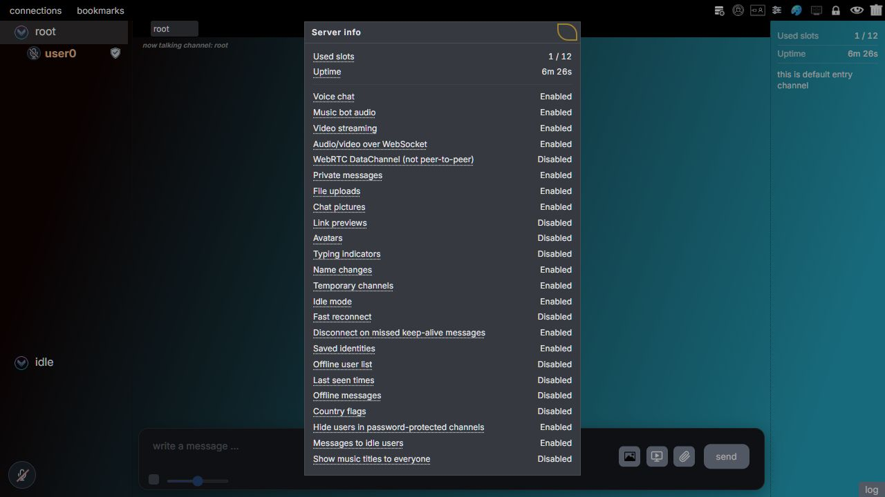
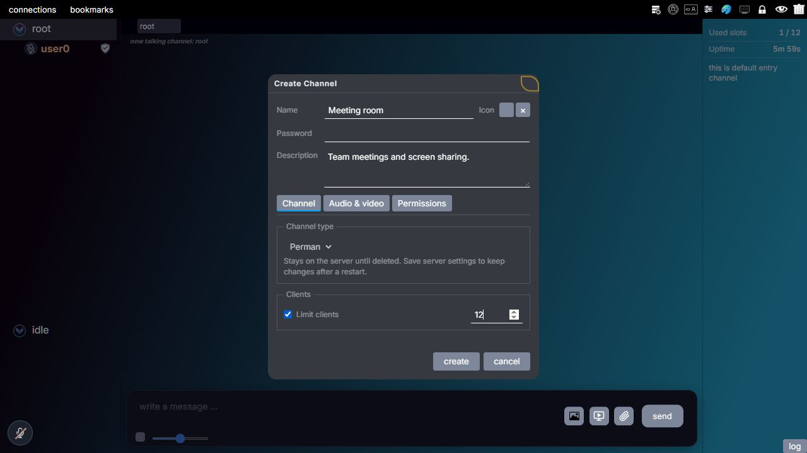
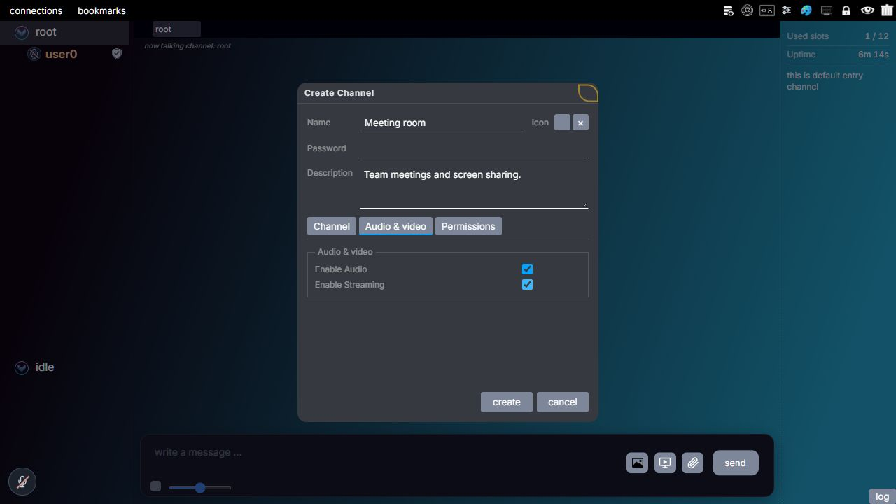

# Channels

Channels separate conversations on the server. Users join a channel to exchange text, pictures, files, audio and video with its other members.

Direct messages go to individual users separately from the channel conversation.

## Joining a channel

New connections start in **root**, the main channel at the top of the list. Selecting another channel moves the user into that channel.

A successful **fast reconnect** resumes an existing session and keeps its channel. The [connection settings](server-settings.md#connection-handling) explain when a session can be resumed.

Each channel can have a password and a user limit. The server checks these when someone tries to join. With the limit enabled, a value of 0 prevents entry by users without full server admin access. Turning the limit off removes that restriction.

Full server admins can join without the password and can enter a full channel. Groups can also give permission to [bypass a channel password](permissions.md#bypass-channel-passwords), but that permission does not bypass the user limit.

Channels can be placed inside other channels in the list. These child channels keep their own members and conversations. Joining Games, for example, does not also join a Chess channel placed beneath it.

The root channel cannot be deleted or have a password. It can show a server banner, the time the server has been running, and the number of connected users. The admin chooses which information to share. Open the root channel's menu and select **server info** to see the public server settings.

*Right-click **root**, then choose **server info**. This window reports the information the server shares; changing settings requires the separate administration window.*

## Creating and editing channels

Channel creation and editing are controlled by [permissions](permissions.md). Full server admins can use these controls, and groups can give other users access to specific actions. Editing a description and changing a password have separate permissions.

To create a meeting room, right-click the channel that should contain it and choose **create**. To change an existing room, right-click that room and choose **edit**. Both actions open the channel window below.

Permanent channels remain on the running server when their creator leaves. Selecting **Save all settings** in Server administration also keeps them for the next server start.

Temporary channels belong to an owner and remain only while that owner stays in the channel. When the owner leaves or disconnects, the server deletes the channel and moves its remaining members to root.

Each user can own one temporary channel at a time and can edit or delete it. Temporary channels cannot contain child channels or music bots, and are not saved for the next server start.

When groups are enabled, group permissions control temporary channel creation. When groups are disabled, the server's temporary channel setting controls it.

With groups enabled, the parent channel can also require a minimum power: a channel is created inside another channel only when the user's channel create power reaches that channel's **Create channels inside** requirement. A channel can likewise require a minimum power to see who is in it and to read its description from outside. Both requirements are in the **Permissions** tab of the channel window and are explained in [Channel requirements](permissions.md#channel-requirements).

On creation, the server first checks **Create permanent channels**. If that permission is enabled, the new channel is permanent. Otherwise, it checks whether the user can create a temporary channel. Having both permissions therefore creates a permanent channel. Its type can be changed later under the rules below.

### The channel window

The name, password, description and icon appear above these tabs:

| Tab | Settings |
| --- | --- |
| **Channel** | Permanent or temporary channel, and the user limit. |
| **Audio & video** | Whether users can send audio and video in this channel. |
| **Permissions** | The power needed to speak, send text, send pictures, or share a screen or video. |

*Here the new room is named **Meeting room** and has **Limit clients** enabled with a maximum of 12. The creation form determines the channel type from your permissions; edit the channel afterward if you need to change its type. Choose **create**, then save the server settings to keep a permanent room after a restart.*

The Permissions tab sets the minimum power needed for each action. The server compares the user's power with this number. If talk power 50 is required, power 25 is too low and power 50 is enough.

The [channel requirement example](permissions.md#channel-requirements) shows the **Permissions** tab with a talk-power requirement of 75 and explains which users can speak with that setting.

All four channel requirements start at **0**. Audio, video and other server settings still apply even when the user has enough power. See [Channel requirements](permissions.md#channel-requirements).

To keep the current password, leave the password box empty. To replace it, enter a new password. To delete it, select **remove**.

You can change an existing channel between permanent and temporary without moving its members. Making a channel temporary makes you its owner. You must be in that channel and must not already own another temporary channel. The required permissions and other limits are listed under [Changing channel type](permissions.md#changing-channel-type).

## Audio, video and attachments

Audio and video have switches on both the server and the channel. Both must allow the feature before a user can send it. Enabling video in a channel therefore does not override video being disabled on the server.

*For the meeting room, select **Audio & video** and check **Enable Streaming** to allow screen or video sharing. The browser starts new channels with streaming off; this example has switched it on. **Enable Audio** controls the channel's audio separately. Submit the channel form to apply these choices.*

Only one user can share a screen or video in a channel at a time. Other users must wait for that stream to stop. If the person sharing leaves the channel, their stream stops.

Audio and video use either **WebSocket** or **WebRTC DataChannel**, according to the methods allowed by the server. If both are allowed, the client can choose. Both connect each client to the server. The [WebRTC guide](webrtc.md) explains how the server forwards audio and video without direct connections between users.

Pictures and files follow the server's upload settings. The server can also let each user block incoming channel pictures or files in their own local settings. See [Server settings](server-settings.md).

## The channel maintainer

Channel conversations are encrypted with keys shared by the channel's members. One client creates those keys and sends them to the others. This client is called the **maintainer**.

The server chooses the maintainer automatically, giving equal priority to **channel admins**, server admins, and the owner of that temporary channel. If any available clients have one of these roles, it chooses **at random from those clients**. Otherwise, it chooses **at random from the other available clients**. Being the maintainer gives no permission to edit the channel or manage the server.

Available clients are connected users who have completed login, are in that channel and are not idle. Music bots cannot be chosen. During replacement, the server also excludes the client that left or was removed from the role.

A channel admin has the built-in **Channel Admin** role in that channel. Custom permissions to edit a channel do not give this priority for maintainer selection.

In an empty channel, the first user becomes the maintainer because there is no other client to choose. Its client creates four random encryption keys and keeps a copy for itself.

It then sends a separate encrypted copy to every other member who is not idle or a music bot. Each delivery uses that member's public key so the matching private key is needed to read it. The server forwards these private messages without receiving readable copies of the channel keys.

If a channel admin, server admin, or the owner of that temporary channel joins while a regular member is the maintainer, the server selects someone with one of those roles to take over. The selected maintainer's client automatically generates new channel keys and sends them to the other members. If the current maintainer already has one of those roles, another user with the same priority joining does not replace it.

Changing one of these roles while the user is already in the channel does not itself choose a new maintainer. The server uses the current roles the next time it makes a selection.

If the maintainer leaves, the server chooses another available client with one of these roles at random, or another available member at random if none remain. The replacement creates new keys. An empty channel has no maintainer.

Each assignment or removal changes `maintainer_generation`, the number sent with the maintainer announcement. Clients check the sender, channel and this number before accepting keys. This prevents a delayed delivery from a previous maintainer from replacing the current keys.

### When the maintainer does not send keys

Clients can ask the server to replace a maintainer that has not sent their keys. A waiting client does this automatically after about five seconds and repeats the request while the keys are still missing.

The server counts each client's request as one vote. Repeating the request does not add votes from that client.

The server replaces the maintainer only when **more than half** of the logged-in members in that channel have voted. Music bots are not counted. The maintainer is counted as a member but cannot vote to replace itself. Clients in idle mode cannot send a vote.

For example, a channel with four people needs three votes. Two votes are not enough. In a channel with two people, the one client waiting for keys cannot replace the maintainer by voting alone.

A vote belongs to the client's current channel and `maintainer_generation`. Changing channels or changing the maintainer removes that vote from the count.

Once enough votes arrive, the server selects a replacement using the priority rule above. If the maintainer is a channel admin, server admin, or the owner of that temporary channel, a vote can replace them only with another available user who has one of those roles. If nobody else has one of those roles, the maintainer stays even when enough members vote. This restriction applies to voting; if the maintainer leaves, another member can take over.

The server announces the replacement, whose client must create and send new keys. If it also fails to send them, clients still have to wait for keys or another replacement. A vote changes only who distributes the keys; it does not grant or remove permissions.

## Keys in large channels

Channel keys normally change when someone joins or leaves. The maintainer creates a new set and sends a separate encrypted copy to every other active member.

This repeats the key creation and delivery work for every membership change. In a channel with hundreds of users, that can delay messages and audio. The server can therefore allow larger channels to keep their existing keys after a join or departure.

The default rules are:

| Change | When the same keys can be kept |
| --- | --- |
| A user joins | At least **50 active users** remain after the join. |
| A user leaves, disconnects or enters idle mode | At least **100 active users** remain after the change. |

Here, active users are connected channel members who are not in idle mode. Music bots are not counted. The admin can change either minimum, but cannot set it below 30. The admin can also disable either rule.

For example, a channel has 49 active users. A new user joins, making 50. With the default settings, the maintainer can send the new user a copy of the existing keys. It does not need to send new keys to all 50 users. When the maintainer changes, new keys are still required.

Keeping keys also affects which content a user could read:

- A new member who gets a copy of older data encrypted with those same keys may be able to read it.
- A member who leaves still has those keys. If they get a copy of later data encrypted with the same keys, they may be able to read it until the keys change.

The server does not keep sending channel messages to a user who has left.

Read [Encryption](encryption.md) for more about the keys, or [Channel keys in large channels](server-settings.md#channel-keys-in-large-channels) for the server settings.

## Relevant source files

- [Channel state and maintainer selection](../server-source-code/main/core/channel.c)
- [Incoming channel requests](../server-source-code/main/msg/client/client_msg_channel.c)
- [Channel announcements](../server-source-code/main/msg/server/server_msg_channel.c)
- [Client key handling](../client-source-code/client-development/browser/main/scripts/app/crypto/keys.js)
