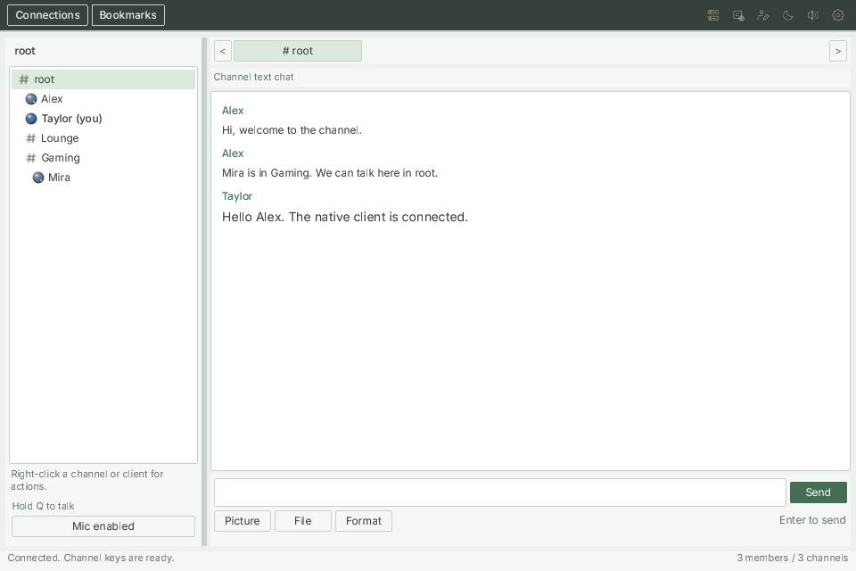
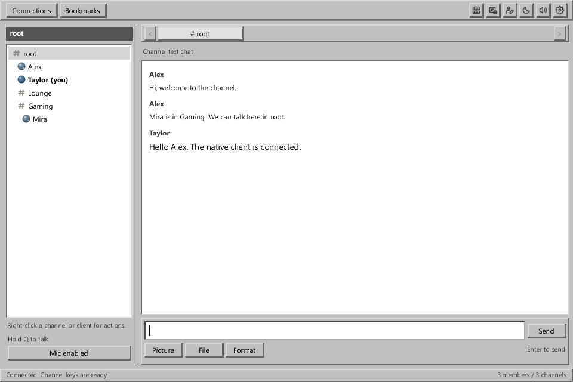
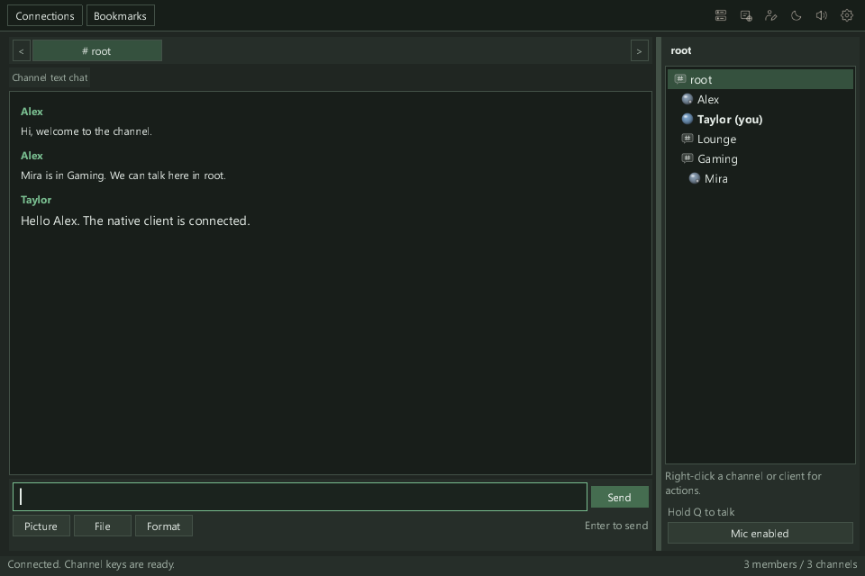
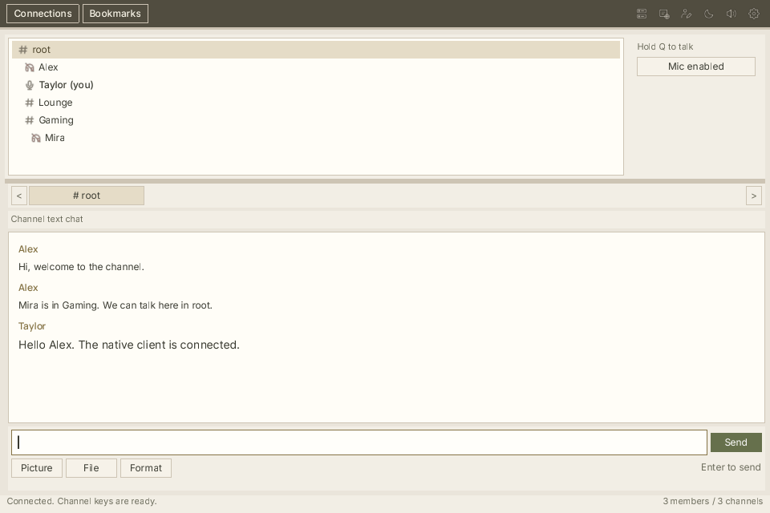
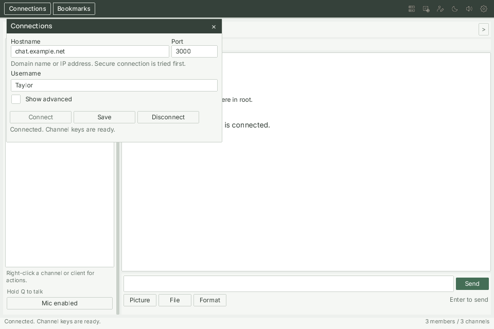

# Native desktop client

If you want to use Lemon Chat as a desktop app, the browser's `client.html` can already be used
that way. You do not need the native client just to have a separate chat window.

The native client is a separate application written in C. Its main purpose is to keep the work
needed for chat and voice small, particularly while playing games where performance matters.
It also has an optional display inside supported games which shows the channel members and who
is speaking.

The native client is **experimental** and still being developed.
It does not yet contain every feature of the browser client.

## The desktop window

The application has a channel and user list, a conversation area and controls for messages and voice.
It supports channel and private text messages, pictures and files.
Voice chat can use push-to-talk or start when the microphone detects speech.

The message field and **Send** share one row. Select **Format** below the field to show
the font, colour and text-size controls.

Here it is connected to a local test server. Alex and Taylor are in `root`, and Mira is in `Gaming`:

Right-click a channel or user to open its actions. Some actions need permission from the server.
Some grey menu entries are features that are not yet implemented in the native client.

## Change the appearance

To use the **Windows 95** theme, open settings with the gear button, then choose
**Appearance, chat and attachments**. Under **Theme**, select **Windows 95** and click **Save changes**.

This theme uses grey controls, raised button borders, inset white fields and grey selections.
The client keeps your choice when you reopen it. You can choose another theme from the same list.

Themes also change where the channel list appears:

| Themes | Channel list |
| --- | --- |
| Classic and Windows 95 | On the left of the chat. |
| Slate and Midnight | On the right of the chat. |
| Ivory and Amber | Above the chat. |

Drag the divider to change the space given to the channel list. Changing themes keeps your
open conversation and the message you are writing.

The same connected client with the Windows 95 theme:

Slate puts the channel list on the right:

Ivory puts the channel list above the chat:

## Open and connect

On Windows, open `lemon-chat-desktop.exe` from the built package.
Keep the other files in that package beside it: the program also uses its libraries,
interface files and fonts.

Open **Connections** and enter the server's hostname or IP address, port and your username.

The Connections window, shown with example entries:

If the server operator configured server encryption keys, select **Show advanced**, then add those
keys in the same order and with the same types as on the server.
If the operator did not configure any, leave the list empty.

Choose **Connect** to join. The client tries WSS first and falls back to WS if WSS is unavailable.
**Save** keeps the connection details without connecting.

Open **Audio settings** to choose your microphone and speakers, then choose push-to-talk
or voice activation. The default push-to-talk key is **Q** and also works while another
application has focus.

The microphone starts enabled. Use **Mic enabled** to mute it and **Mic off** to enable it again.
Push-to-talk still requires holding the selected key; voice activation still waits for speech.

To mute both the speakers and microphone, open **Audio settings**, find **Advanced**, select
**Deafen**, and save. A small **Audio off** notice then appears at the bottom of the window.
Select **Enable audio** beside it to turn audio back on. This keeps your microphone mute setting.

## Current limits

The desktop application can be built for Windows, Linux and macOS.
Its voice connection currently uses WebSocket, so the server must allow audio over WebSocket.
The native client does not currently provide the browser client's WebRTC connection option.

The optional game display is called the **overlay**. It is disabled by default and currently
supports Windows games using Direct3D 11. It does not support Direct3D 9, Direct3D 12,
OpenGL or Vulkan games. The normal desktop window can be used without enabling it.

## Build it

Open `client-source-code/client-development/desktop` and run `build.bat` on Windows,
or `sh build.sh` on Linux or macOS. The Windows script can download missing build tools.

The [build guide](building.md#native-desktop-client) explains the package locations and platform requirements.
