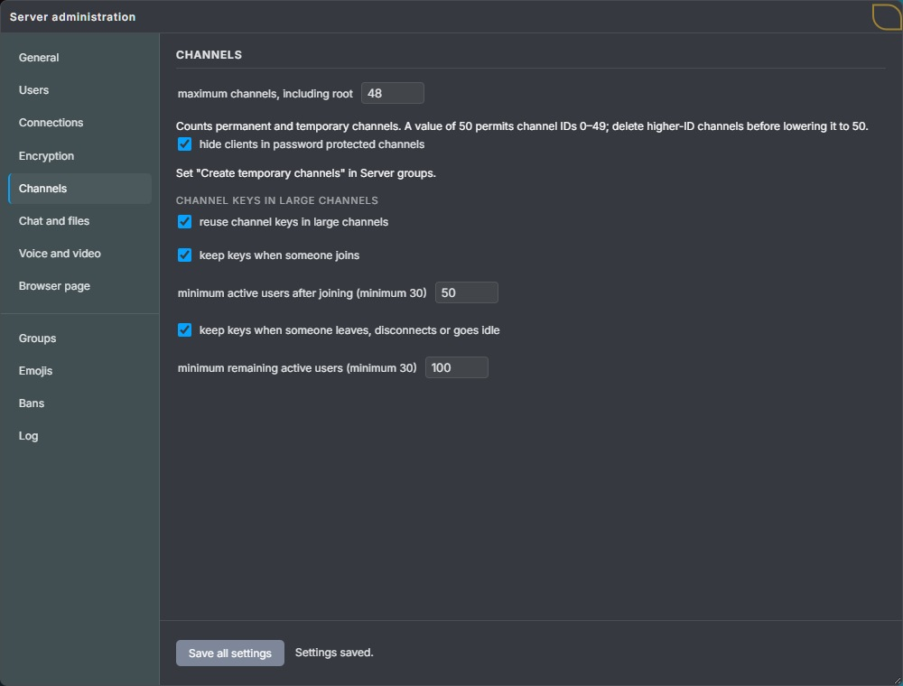
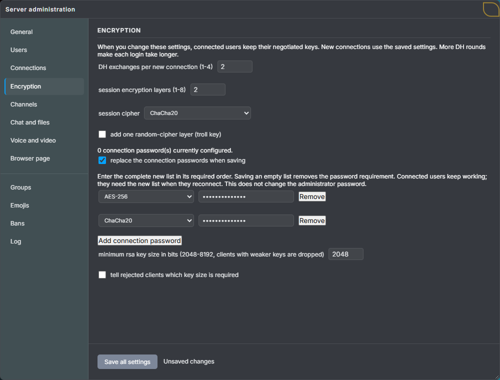

# Encryption

Encryption in Lemon Chat has multiple layers.

I think it's best if the documentation starts by explaining the smallest part:
how a simple direct message is encrypted. Then it can work its way upwards.

This documentation has these sections:

- [1. Direct messages](#1-direct-messages)
    - [1.1. Direct text messages](#11-direct-text-messages)
        - [1.1.1. What is inside `message_keys`?](#111-what-is-inside-message_keys)
        - [1.1.2. What is inside `message_value`?](#112-what-is-inside-message_value)
    - [1.2. Direct images](#12-direct-images)
        - [1.2.1. Uploading the image](#121-uploading-the-image)
        - [1.2.2. Delivery to the recipient](#122-delivery-to-the-recipient)
    - [1.3. Direct files](#13-direct-files)
        - [1.3.1. Uploading the file](#131-uploading-the-file)
        - [1.3.2. Delivery to the recipient](#132-delivery-to-the-recipient)
- [2. Channel messages](#2-channel-messages)
    - [2.1. The maintainer](#21-the-maintainer)
        - [2.1.1. Choosing the maintainer](#211-choosing-the-maintainer)
        - [2.1.2. Sending channel keys](#212-sending-channel-keys)
        - [2.1.3. When clients join or leave](#213-when-clients-join-or-leave)
        - [2.1.4. How the client knows what to do](#214-how-the-client-knows-what-to-do)
        - [2.1.5. When channel keys do not arrive](#215-when-channel-keys-do-not-arrive)
        - [2.1.6. Large channels](#216-large-channels)
    - [2.2. Channel text messages](#22-channel-text-messages)
        - [2.2.1. What is inside `message_value`?](#221-what-is-inside-message_value)
        - [2.2.2. Delivery to the channel](#222-delivery-to-the-channel)
    - [2.3. Channel images](#23-channel-images)
        - [2.3.1. Uploading the image](#231-uploading-the-image)
        - [2.3.2. Delivery to the channel](#232-delivery-to-the-channel)
    - [2.4. Channel files](#24-channel-files)
        - [2.4.1. Uploading the file](#241-uploading-the-file)
        - [2.4.2. Delivery to the channel](#242-delivery-to-the-channel)
- [3. Audio and video data](#3-audio-and-video-data)
    - [3.1. Voice and video from users](#31-voice-and-video-from-users)
    - [3.2. Music bots](#32-music-bots)
    - [3.3. WebSocket and WebRTC](#33-websocket-and-webrtc)
- [4. Metadata](#4-metadata)
    - [4.1. Static server keys](#41-static-server-keys)
    - [4.2. Session keys and Diffie–Hellman](#42-session-keys-and-diffiehellman)
    - [4.3. Choosing the ciphers and number of keys](#43-choosing-the-ciphers-and-number-of-keys)
    - [4.4. Encrypting the whole request](#44-encrypting-the-whole-request)
    - [4.5. How the server remembers each connection's keys](#45-how-the-server-remembers-each-connections-keys)
    - [4.6. Changing the settings while the server is running](#46-changing-the-settings-while-the-server-is-running)
    - [4.7. Keys embedded in `client.html`](#47-keys-embedded-in-clienthtml)

## 1. Direct messages

The term "direct message" here encompasses various types of data
that are sent from one client to another through the server.

These include:

* a direct text message, aka a PM (it has subtypes; more on that later)
* a direct image
* a direct file

They have different json data layout, but in general, these things apply for them:

**The sender:**

* generates four random 256-bit AES keys (CTR mode) and four random IVs.
* uses them to encrypt the message content.
* uses the public RSA key of the recipient to encrypt the keys themselves and their IVs.
* appends the encrypted keys and encrypted message value to the JSON message about to be sent.

**The receiver:**

* uses his private RSA key to decrypt the symmetric cipher keys.
* uses the decrypted AES keys and their IVs to decrypt the message content itself.
* processes the received data and decides what to do next based on its type and content.

This kind of hybrid encryption, where a public key is used to encrypt other keys, is used because RSA is slow for encrypting large amounts of data, such as images.
It was useful to have one encryption mechanism for different types of data, so text messages are encrypted this way too.

### 1.1. Direct text messages

Below is the JSON layout of the `direct_chat_message` message type.
Metadata fields such as `type`, `receiver_id` and `local_message_id` are readable to the server
because it needs these fields to send the message to the recipient.

It's also worth noting that the direct message itself (`"type": "direct_chat_message"`)
has multiple sub-message types. They are part of `message_value` itself, so the server cannot read them.
They are used by the receiver of the message.

`message_keys` and `message_value` are visible to the server, but their contents are encrypted.
The outer `value` field is a JSON string, shown expanded below.

```json
{
    "message":
    {
        "type": "direct_chat_message",
        "receiver_id": 8,
        "local_message_id": 41,
        "value":
        {
            "message_keys": "<encrypted AES keys and their IVs for the recipient>",
            "message_value": "<encrypted message content, in Base64>"
        }
    }
}
```

#### 1.1.1. What is inside `message_keys`?

The unencrypted content of `message_keys` looks like this:

```json
{
    "keys":
    [
        {
            "key_bytes": "<32 bytes for AES key 1>",
            "iv_bytes": "<16 bytes for its IV>"
        },
        {
            "key_bytes": "<32 bytes for AES key 2>",
            "iv_bytes": "<16 bytes for its IV>"
        },
        {
            "key_bytes": "<32 bytes for AES key 3>",
            "iv_bytes": "<16 bytes for its IV>"
        },
        {
            "key_bytes": "<32 bytes for AES key 4>",
            "iv_bytes": "<16 bytes for its IV>"
        }
    ]
}
```

Each direct message uses four new AES keys, each with its own random 16-byte IV.

#### 1.1.2. What is inside `message_value`?

`message_value` contains encrypted JSON in Base64 form.

When a user sends `Hello` to another client, the unencrypted content looks like this.
The JSON string in its `value` field is shown expanded:

```json
{
    "type": "direct_chat_message",
    "value":
    {
        "reaction_id": "0123456789abcdef0123456789abcdef",
        "reply_to": null,
        "font": "custom-font-usage-default",
        "font_size": 12,
        "font_color": "#ffffff",
        "value": "Hello"
    }
}
```

These are the subtypes mentioned earlier: `direct_chat_message`, `message_seen`
and `channel_keys_from_maintainer`.

This `type` is inside the encrypted content, where only the recipient can read it.
Do not confuse it with the outer `type` the server sees,
which is `direct_chat_message` for all three subtypes.

Here are the other two subtypes in their unencrypted form:

**Message seen (`message_seen`)**

When a client marks a message as seen, it sends this subtype back to the sender.
Here, `"73"` is the server's ID for that message, stored as a string.

```json
{
    "type": "message_seen",
    "value": "73"
}
```

**Channel keys (`channel_keys_from_maintainer`)**

This subtype sends channel keys to another client in a direct message.
Channel keys and the maintainer are explained in [Channel messages](#2-channel-messages).

```json
{
    "type": "channel_keys_from_maintainer",
    "channel_id": 5,
    "maintainer_generation": 12,
    "value": "<channel keys and their IVs as a JSON string>"
}
```

### 1.2. Direct images

Direct pictures are similar to direct text messages.

When the user sends a picture to user `8`, the image is converted to a Base64 string
and then encrypted using a similar mechanism to a direct message.

For a PNG picture, that string looks like this:

```text
data:image/png;base64,<picture bytes in Base64>
```

It encrypts that whole string with four new AES keys
and protects the keys and their IVs for the recipient.

The resulting picture data has this layout:

```json
{
    "message_keys": "<encrypted AES keys and their IVs for the recipient>",
    "message_value": "<encrypted picture string, in Base64>"
}
```

Unlike text messages, decrypting this `message_value`
gives the picture string directly, rather than JSON.

#### 1.2.1. Uploading the image

The server can see that the user is uploading an image, but it cannot read the image contents.

The client converts the JSON shown above into one long string. It contains `message_keys`
(the encrypted AES keys and their IVs) and `message_value` (the encrypted image in Base64).

The client splits this complete JSON string into small parts and puts each part
in `data_part_base64` of a `file_send` message.

It uploads one part at a time. This lets it wait when the connection is busy
and update the upload progress.

Once the upload is complete, the sender tells the server to deliver it.
The server sends the data to the recipient in parts too.
The recipient joins the parts and decrypts the image.

Each part can hold up to 16,384 bytes. This 24,000-byte example needs two parts:
16,384 bytes followed by 7,616 bytes.

First part, including the upload metadata:

```json
{
    "message":
    {
        "type": "file_send",
        "total_bytes_length": 24000,
        "data_part_base64": "<first 16384 bytes of the complete JSON string>",
        "is_new_file": true,
        "file_send_intent": "direct_chat_picture_file",
        "file_send_intent_extra_data":
        {
            "receiver_id": 8,
            "local_message_id": 41
        }
    }
}
```

Second and final part:

```json
{
    "message":
    {
        "type": "file_send",
        "total_bytes_length": 24000,
        "data_part_base64": "<remaining 7616 bytes of the complete JSON string>",
        "is_new_file": false
    }
}
```

`total_bytes_length` is the size of this complete JSON string in bytes.
It stays the same in every part.

The server joins the parts in the order they arrive.

Once all 24,000 bytes arrive, the server replies to the sender:

```json
{
    "message":
    {
        "type": "file_send_success"
    }
}
```

The client then sends `file_send_completed` to tell the server to deliver the image:

```json
{
    "message":
    {
        "type": "file_send_completed",
        "file_send_intent": "direct_chat_picture_file",
        "file_send_intent_extra_data":
        {
            "receiver_id": 8,
            "local_message_id": 41
        }
    }
}
```

`receiver_id` selects the recipient; `local_message_id` is the sender's ID for this message.

The native desktop client also includes an `offer_id` string
in the extra data of the first part and completion request.

#### 1.2.2. Delivery to the recipient

The server first tells user `8` that an image is arriving from user `3` (`Alex`).
It gives the image ID `73`. `size` is the number of uploaded bytes.

```json
{
    "message":
    {
        "type": "direct_chat_picture_metadata",
        "sender_username": "Alex",
        "sender_id": 3,
        "picture_id": 73,
        "size": 24000
    }
}
```

The server then sends the uploaded data in parts using `file_receive_chunk`:

```json
{
    "message":
    {
        "type": "file_receive_chunk",
        "value": "<next part of the same JSON string>",
        "sender_id": 3,
        "server_chat_message_id": 73
    }
}
```

After the last part:

```json
{
    "message":
    {
        "type": "file_receive_completed",
        "receive_type": "direct_chat_picture",
        "sender_id": 3,
        "server_chat_message_id": 73
    }
}
```

The recipient joins the parts back into the same JSON string. It decrypts `message_keys`,
then uses those keys and IVs to decrypt the image in `message_value`.

### 1.3. Direct files

When the user sends a file (if the server has file uploads enabled),
it is similar to sending an image: the file bytes are converted to Base64
and put into the file body JSON.

The client encrypts that whole JSON body, then sends the encrypted result in parts.

However, because the user is sharing a file, the recipient needs its name and size
before downloading it, so he knows what file is arriving.

The sender therefore encrypts two things separately: a small file header and the file body.
Each gets its own four new AES keys and their IVs, protected for the recipient in `message_keys`.

After the upload and the `file_send_completed` request,
the server sends the encrypted header to the recipient before the file body.

The progress bar uses the encrypted transfer size, which the server sends separately.

Both the encrypted header and the encrypted body use this layout.
Here, `message_value` is a JSON string, shown expanded for readability:

```json
{
    "message_keys": "<encrypted AES keys and their IVs for the recipient>",
    "message_value":
    {
        "data": "<encrypted file header or body, in Base64>",
        "tag": "<file verification value, in Base64>"
    }
}
```

`tag` is the file format's existing HMAC-SHA256 check.
The receiver derives a secret checking key from the four file keys and their IVs,
then uses it to calculate the check over the encrypted data again.
If it does not match, the receiver rejects that header or body.

The file encryption keys are also derived from the four supplied keys and their IVs.
They use those same four IVs when encrypting the file header or body.

For a file named `note.txt` containing `Hello`, the decrypted header is:

```json
{
    "name": "note.txt",
    "size": 5,
    "mime": "text/plain"
}
```

The decrypted body contains the same details and adds the file bytes in Base64:

```json
{
    "name": "note.txt",
    "size": 5,
    "mime": "text/plain",
    "data": "SGVsbG8="
}
```

Decoding `SGVsbG8=` gives the five bytes of `Hello`.

#### 1.3.1. Uploading the file

The upload follows the same sequence as a picture.
For a larger file, suppose the encrypted body JSON is 24,000 bytes.

`file_header` is the complete encrypted header JSON shown above, stored as a string. It has its own
`message_keys`, encrypted `data` and `tag`.

First part:

```json
{
    "message":
    {
        "type": "file_send",
        "total_bytes_length": 24000,
        "data_part_base64": "<first 16384 characters of the encrypted file body JSON>",
        "is_new_file": true,
        "file_send_intent": "direct_chat_file",
        "file_send_intent_extra_data":
        {
            "receiver_id": 8,
            "local_message_id": 42,
            "file_header": "<serialized encrypted header JSON, including message_keys and message_value>"
        }
    }
}
```

Second and final part:

```json
{
    "message":
    {
        "type": "file_send",
        "total_bytes_length": 24000,
        "data_part_base64": "<remaining 7616 characters of the encrypted file body JSON>",
        "is_new_file": false
    }
}
```

`total_bytes_length` counts the complete encrypted body JSON, including its `message_keys`; it
excludes the separate `file_header`.

The server joins the parts in order, then replies to the sender:

```json
{
    "message":
    {
        "type": "file_send_success"
    }
}
```

The sender then repeats the same recipient details and encrypted header:

```json
{
    "message":
    {
        "type": "file_send_completed",
        "file_send_intent": "direct_chat_file",
        "file_send_intent_extra_data":
        {
            "receiver_id": 8,
            "local_message_id": 42,
            "file_header": "<same serialized encrypted header JSON as in the first part>"
        }
    }
}
```

The server can read the intent, recipient, local message ID and encrypted upload length.

It also receives `file_header`, but its file name, original size, file type and keys
are encrypted for the recipient.
The body contents and their keys are encrypted too.

#### 1.3.2. Delivery to the recipient

After `file_send_completed`, the server assigns a file ID, here `74`,
and sends the recipient the encrypted header:

```json
{
    "message":
    {
        "type": "direct_chat_file_metadata",
        "sender_username": "Alex",
        "sender_id": 3,
        "file_id": 74,
        "file_header": "<same serialized encrypted header JSON>",
        "encrypted_size": 24000
    }
}
```

The recipient can decrypt the header before the body arrives.

`encrypted_size` is the body transfer length used for download progress.

The server sends the body in parts:

```json
{
    "message":
    {
        "type": "file_receive_chunk",
        "value": "<next part of the encrypted file body JSON>",
        "sender_id": 3,
        "server_chat_message_id": 74
    }
}
```

After the last part:

```json
{
    "message":
    {
        "type": "file_receive_completed",
        "receive_type": "direct_chat_file",
        "sender_id": 3,
        "server_chat_message_id": 74
    }
}
```

The recipient joins the parts, checks the file tag, then decrypts the body.

## 2. Channel messages

Channel chat messages are a step up from direct messages.
The clients in a channel share the same keys so they can read each other's messages.
Here is how it works.

### 2.1. The maintainer

Lemon Chat uses a mechanism in which one client in each channel generates four random AES keys
and sends those same keys to the other active clients in separate encrypted direct messages.
These are called **channel keys**, and the client that creates and sends them is called the **maintainer**.

#### 2.1.1. Choosing the maintainer

The server chooses a **maintainer** from the clients in that channel, giving equal priority to
**channel admins**, server admins, and the owner of that temporary channel.
If several clients with these roles are available, it chooses one of them at random.
If none are available, it chooses another client at random.
It announces its choice to the clients in the channel.

A channel admin has the built-in **Channel Admin** role in that channel.
Permission to edit a channel alone does not give this priority.
Only logged-in clients in that channel can be chosen. Idle clients and music bots cannot be chosen.

Being the maintainer does not make the user a channel admin or give him permission to manage the server.
The role is to create and share the channel keys.

#### 2.1.2. Sending channel keys

The maintainer generates four random AES keys and their IVs. It keeps a copy
and sends the keys to each other active client in a separate direct message.
This uses the `channel_keys_from_maintainer` subtype mentioned earlier.
Idle clients and music bots do not receive these key messages.

For channel `5`, the unencrypted content of that direct message looks like this.
The JSON string in `value` is shown expanded, with byte arrays shortened to placeholders:

```json
{
    "type": "channel_keys_from_maintainer",
    "channel_id": 5,
    "maintainer_generation": 12,
    "value":
    [
        {
            "key_bytes": "<32 bytes for channel AES key 1>",
            "iv_bytes": "<16 bytes for its IV>"
        },
        {
            "key_bytes": "<32 bytes for channel AES key 2>",
            "iv_bytes": "<16 bytes for its IV>"
        },
        {
            "key_bytes": "<32 bytes for channel AES key 3>",
            "iv_bytes": "<16 bytes for its IV>"
        },
        {
            "key_bytes": "<32 bytes for channel AES key 4>",
            "iv_bytes": "<16 bytes for its IV>"
        }
    ]
}
```

`maintainer_generation` identifies the server's maintainer announcement.
The recipient checks the sender, channel and this number before accepting the keys.

The channel keys are the content of this direct message. Separate, fresh direct-message keys
protect their delivery, using the recipient's public RSA key as explained in section 1.
The server forwards the message but cannot read the channel keys.

#### 2.1.3. When clients join or leave

There are some rules when it comes to maintainers:

* If a user is the first to join an empty channel, he becomes the maintainer.
* If a channel admin, server admin, or the owner of that temporary channel joins while a regular
  member is the maintainer, the server selects someone with one of those roles to take over.
  The selected maintainer's client automatically generates new channel keys and sends them to the other members.
* If the maintainer already has one of those roles, another user with the same priority joining
  does not replace him.
* If the maintainer leaves, the server chooses a replacement using the same priority rule.
  If nobody with one of those roles remains, a regular member can become the maintainer.
  The new maintainer creates new channel keys.
* Normally, when somebody joins, the maintainer generates new keys for that user and the clients
  already in the channel, so the new user does not receive the keys used for earlier messages.
* Normally, when somebody leaves, the maintainer generates new channel keys and sends them to the remaining clients.

The large-channel settings explained below can allow the existing keys to be kept
when somebody joins or leaves.

Changing one of these roles while the user is already in the channel does not itself replace the maintainer.
The new role is taken into account the next time the server chooses a maintainer.

#### 2.1.4. How the client knows what to do

The client needs to know whether it is the maintainer before it can generate channel keys.
The server tells the clients in the channel who it chose by sending `channel_maintainer_id`.
For example, this tells the clients in channel `5` that client `3` is the maintainer:

```json
{
    "message":
    {
        "type": "channel_maintainer_id",
        "channel_id": 5,
        "maintainer_id": 3,
        "maintainer_generation": 12,
        "has_maintainer": true
    }
}
```

Client `3` compares `maintainer_id` with its own ID, sees that they match,
and automatically generates and sends new channel keys. The other clients wait for those keys.
`maintainer_generation` is the number of this maintainer selection. The server increases it
when it selects a maintainer again, so clients can reject keys from an earlier selection.

The server also reports connections (`client_connect`), channel moves (`channel_join`),
and disconnections (`client_disconnect`). Going idle and returning are reported as
`client_going_to_idle_mode` and `client_coming_back_from_idle_mode`.
The clients update their member lists when these messages arrive.
The maintainer then counts the active people in its channel and decides whether it must
create new keys or may keep the current ones.

The rules for doing this are part of both `client.html` and the native desktop client.
The server admin chooses whether clients may keep the existing keys and the minimum channel sizes.
The server sends these settings at login in `authentication_status`, and sends changes
in `server_policy`. Changing these settings does not require rebuilding the client.

This is a `server_policy` update with the default key settings. The server also sends
other settings in this message; only the five relevant fields are shown here:

```json
{
    "message":
    {
        "type": "server_policy",
        "is_channel_key_reuse_enabled": true,
        "is_channel_key_reuse_on_join_allowed": true,
        "is_channel_key_reuse_on_leave_allowed": true,
        "channel_key_reuse_join_min_clients": 50,
        "channel_key_reuse_leave_min_clients": 100
    }
}
```

The first setting allows clients to keep the existing keys. The next two allow this separately for joins and departures.
The last two set the minimum number of active people after that change.
The first setting and the setting for that change must both be enabled.
The channel must also have reached that minimum before the maintainer may keep the existing keys.

Once the maintainer has sent the keys to all required recipients, it stops that distribution.
It waits for another change that requires keys to be sent. It does not keep generating
new channel keys in the background.

If the client loses the maintainer role, changes channel, goes idle, or disconnects,
it cancels unfinished delivery. It checks that each recipient still belongs to the channel
before sending that recipient's keys. A newly selected maintainer always starts with fresh keys.
Changing these settings also cancels unfinished delivery and makes the current maintainer
send a fresh set under the new settings.

#### 2.1.5. When channel keys do not arrive

A client without channel keys cannot send or decrypt channel messages.
In the browser client, trying to send a text message displays this popup:

> no channel keys from channel maintainer, cant send the message

Received messages that cannot be decrypted are not displayed.
A connection problem, a slow or faulty client, or a modified client that deliberately
does not send the keys can cause this.

Lemon Chat has an automatic mechanism built in to handle this.
The browser client waits about five seconds for keys; the native desktop client waits about fifteen seconds.
If the keys do not arrive, they automatically vote to replace the maintainer.
They repeat the request while the keys are missing,
but the server counts only one vote per client.

More than half of the logged-in members in that channel must vote for replacement.
Music bots are not counted. The maintainer is counted but cannot vote to replace itself,
and idle clients cannot vote.

For example, in a two-person channel, the one client waiting for keys cannot replace
the maintainer by voting alone.

If the maintainer is a channel admin, server admin, or the owner of that temporary channel,
votes can replace him only with another available user who has one of those roles.
If he is the only available user with one of those roles, he stays the maintainer even if a majority votes to replace him.
If that maintainer does not send keys, the vote cannot fix the problem.

Once enough votes arrive and a replacement is allowed, the server chooses a new maintainer
using the priority rule above. That client generates and sends the new keys.
The vote only changes the maintainer; it never grants or removes permissions.

#### 2.1.6. Large channels

You might ask: in a channel with 100 or more clients, isn't it a lot of work to send new keys
to everyone each time somebody joins or leaves?

Yes. In **Server administration → Channels**, the server admin can allow large channels
to keep their existing keys. When a new user joins, the maintainer then sends him
the existing keys without generating new keys for everyone.

By default, the maintainer keeps the existing channel keys when there are at least this many
active users. Newcomers receive those same keys:

| Change | Minimum number of active users |
| --- | --- |
| Somebody joins | 50, counted after the join |
| Somebody leaves, disconnects or goes idle | 100 remaining after the change |

Idle users and music bots are not counted. Below the relevant minimum, new keys are required.
On the **Channels** page, the server admin can set either minimum from 30 to 1,000,000.
These numbers control when the existing keys may be kept. They do not set the server's capacity.
Keeping keys on joins and keeping them on departures can be enabled or disabled separately.

For example, with the default settings, a channel with 49 active users reaches 50 when
someone joins. The maintainer keeps the current keys and sends them only to that new user.
The users already in the channel keep their copies.

If a channel has 100 active users and one leaves, 99 remain. That is below the default
departure minimum of 100, so the maintainer generates new keys for the remaining users.

A new maintainer always generates new keys, regardless of these settings.
Saved changes to the settings are sent to connected clients immediately.



Keeping the same keys has two consequences:

* A new member can decrypt earlier messages if he obtains a copy encrypted with those same keys.
* A member who leaves can decrypt later messages if he obtains a copy encrypted with those keys,
  until the keys change.

The server does not continue sending channel messages to users who have left.

### 2.2. Channel text messages

When a user sends a text message to channel `5`, his client encrypts the content
with the four channel keys received from the maintainer.
The server forwards the same encrypted content to the other clients in that channel.

The clients already have the channel keys, so the message does not need `message_keys`.
Its encrypted content is stored in `message_value`:

```json
{
    "message":
    {
        "type": "channel_chat_message",
        "receiver_id": 5,
        "local_message_id": 41,
        "value":
        {
            "message_value": "<Base64 packet containing the encrypted IV and encrypted text>"
        }
    }
}
```

`value` is a JSON string, shown expanded above.
The server can read `type`, `receiver_id` and `local_message_id`, but cannot read the text.

Here, `receiver_id` is a channel ID, rather than a user ID.
The server sends the message to the sender's current channel.

#### 2.2.1. What is inside `message_value`?

For a user sending `Hello`, the unencrypted content looks like this:

```json
{
    "reaction_id": "0123456789abcdef0123456789abcdef",
    "reply_to": null,
    "font": "custom-font-usage-default",
    "font_size": 12,
    "font_color": "#ffffff",
    "value": "Hello"
}
```

The client converts this JSON to UTF-8 bytes and adds zero bytes if it is shorter than 1,024 bytes.
It then encrypts those bytes with the four channel keys.

Channel keys are used for more than one message. AES-CTR uses the keys and starting IVs to
produce bytes that it combines with the message. Repeating those keys and starting IVs
produces the same bytes again, which can expose the message contents.

For example, suppose one message contains `Hello` and the next contains `Lunch` at the same
position. If both use the same keys and starting IVs, someone who knows the first word and
has both encrypted messages can work out the five bytes used to encrypt `Hello`.
They can then use those same bytes to read `Lunch`, without knowing the AES keys.

The client therefore generates a fresh random 16-byte message IV for each message.
This changes the AES starting values while the channel keys stay the same, so knowing
`Hello` no longer reveals the bytes used to encrypt `Lunch`.

The client combines the new message IV with each key's own IV using XOR, byte by byte:

```text
starting_iv[byte] = key.iv_bytes[byte] XOR message_iv[byte]
```

The recipient needs that same random 16-byte message IV to repeat the XOR calculation above.
It must therefore travel with the encrypted text. Lemon Chat also encrypts this IV
so that the server cannot read it.

The text encryption already needs this IV. Using that same process to encrypt the IV
would leave the recipient needing the IV before it could recover it.
Instead, the client encrypts the 16-byte IV as one AES block with a separate AES-256 key.
This operation does not need a starting IV.

Both clients calculate this separate key from the four channel keys and their IVs,
which they already have. The calculation is called **HKDF-SHA256**.
It produces keys from existing secret data, always giving the same result for the same inputs.
This lets both clients calculate the same key without sending another key between them.

The recipient first calculates that key and decrypts the message IV.
It then uses the recovered IV in the XOR calculation above to decrypt the text.

Base64-decoding `message_value` gives these bytes:

| Byte position | Contents |
| --- | --- |
| 0 | `0`, identifying text or picture content |
| 1–16 | The encrypted 16-byte message IV |
| 17 onward | The encrypted text JSON |

The IV is part of this Base64 value, encrypted alongside the content.
It is not a readable JSON field sent to the server.

#### 2.2.2. Delivery to the channel

The server assigns the message an ID, here `73`, and tells the sender which local message it belongs to:

```json
{
    "message":
    {
        "type": "server_chat_message_id_for_local_message_id",
        "server_chat_message_id": 73,
        "local_message_id": 41
    }
}
```

The other clients in channel `5` receive the message from user `3` (`Alex`):

```json
{
    "message":
    {
        "type": "channel_chat_message",
        "sender_username": "Alex",
        "sender_id": 3,
        "channel_id": 5,
        "server_chat_message_id": 73,
        "value":
        {
            "message_value": "<the same Base64 packet>"
        }
    }
}
```

Again, `value` is a JSON string, shown expanded.
Each recipient recovers the message IV, decrypts the content with the channel keys,
removes the zero padding and reads the text JSON shown above.

### 2.3. Channel images

When a user sends a picture to channel `5`, the client first converts it to a Base64 data URL,
just as it does for a direct picture. For a PNG picture, that string looks like this:

```text
data:image/png;base64,<picture bytes in Base64>
```

It encrypts this whole string with the four channel keys and a fresh message IV.
The IV calculation and packet layout are the same as for channel text messages.
Decrypting the content gives the picture string directly.

The resulting picture data has this layout:

```json
{
    "message_value": "<Base64 packet containing the encrypted IV and encrypted picture string>"
}
```

#### 2.3.1. Uploading the image

The server can see that the user is uploading a channel picture, but cannot read the picture contents.

The client converts the JSON shown above into one long string and splits that complete string
into parts of at most 16,384 bytes. Each part goes in `data_part_base64`.
The encrypted IV is inside `message_value`, so it travels as part of that same upload.

For a complete JSON string of 24,000 bytes, the first part is:

```json
{
    "message":
    {
        "type": "file_send",
        "total_bytes_length": 24000,
        "data_part_base64": "<first 16384 bytes of the complete JSON string>",
        "is_new_file": true,
        "file_send_intent": "channel_chat_picture_file",
        "file_send_intent_extra_data":
        {
            "receiver_id": 5,
            "local_message_id": 42
        }
    }
}
```

Second and final part:

```json
{
    "message":
    {
        "type": "file_send",
        "total_bytes_length": 24000,
        "data_part_base64": "<remaining 7616 bytes of the complete JSON string>",
        "is_new_file": false
    }
}
```

`total_bytes_length` counts the complete uploaded JSON string, rather than the original picture bytes.
It stays the same in every part.

Once all parts arrive, the server replies:

```json
{
    "message":
    {
        "type": "file_send_success"
    }
}
```

The sender then tells the server to deliver the picture:

```json
{
    "message":
    {
        "type": "file_send_completed",
        "file_send_intent": "channel_chat_picture_file",
        "file_send_intent_extra_data":
        {
            "receiver_id": 5,
            "local_message_id": 42
        }
    }
}
```

The browser puts its channel ID in `receiver_id`. The server delivers to the sender's current
channel when it processes completion. In this example, the sender is still in channel `5`.

#### 2.3.2. Delivery to the channel

The server first tells the other receiving clients in channel `5` that a picture is arriving.
It assigns picture ID `74`. `size` is the uploaded JSON string's length:

```json
{
    "message":
    {
        "type": "channel_chat_picture_metadata",
        "sender_id": 3,
        "channel_id": 5,
        "picture_id": 74,
        "size": 24000
    }
}
```

It then sends the uploaded string in parts:

```json
{
    "message":
    {
        "type": "file_receive_chunk",
        "value": "<next part of the same uploaded JSON string>",
        "sender_id": 3,
        "server_chat_message_id": 74
    }
}
```

After the last part:

```json
{
    "message":
    {
        "type": "file_receive_completed",
        "receive_type": "channel_chat_picture",
        "sender_id": 3,
        "server_chat_message_id": 74
    }
}
```

`picture_id` and `server_chat_message_id` refer to the same picture.
Each recipient joins the parts back into the JSON string, recovers the IV from `message_value`
and decrypts the picture with the channel keys.

### 2.4. Channel files

The server must have file uploads enabled, and the user must have permission to send channel files (`send_channel_files`).
When group permissions are enabled, this is controlled by the user's server groups.
The default Guest group already grants this permission.

Channel files are encrypted with channel keys obtained from the maintainer, just like channel messages.

To let the recipient see the file name and size while the file is still arriving,
the sender sends a small file header before the file body.

The client encrypts the header and body separately using the channel's four key/IV pairs.
Each gets its own fresh random 16-byte message IV.

For `note.txt` containing `Hello`, the unencrypted header is:

```json
{
    "name": "note.txt",
    "size": 5,
    "mime": "text/plain"
}
```

The unencrypted body adds the file bytes in Base64:

```json
{
    "name": "note.txt",
    "size": 5,
    "mime": "text/plain",
    "data": "SGVsbG8="
}
```

The recipient also needs to check whether the encrypted header or body was changed.
For this, the sender adds a checking value beside the encrypted data.
The calculation uses a secret key, so somebody without the channel keys cannot
change the data and calculate a matching check for it.

File encryption and this check use different keys. The client calculates them using
**HKDF-SHA256**, the key calculation explained in [section 2.2.1](#221-what-is-inside-message_value).
This time, it uses the four channel keys, their IVs and the fresh message IV of the header or body
to calculate four AES keys for encrypting that data and one key for checking it.
Their different message IVs produce different sets of keys for the header and body.
Both clients can calculate them, so these extra keys do not need to be sent.

The client converts the header and body JSON strings to UTF-8 bytes.
It adds zero bytes to reach at least 1,024 bytes for the header and 4,096 bytes for the body.
It encrypts each with its four calculated AES keys. Each AES starting IV is the corresponding
channel key's IV XOR that header or body's message IV, as with channel text.

After encryption, the sender uses the checking key to calculate the checking value.
This calculation is called **HMAC-SHA256**. It covers the message IV and encrypted data,
with the fixed text `lemon-attachment-v2` identifying the file format in the calculation.
The resulting 32-byte check travels with the encrypted data.

On receiving the header or body, the client first recovers its message IV in the same way
as for channel text. It can then calculate the same encryption and checking keys.
It calculates the check again and compares it with the received check.
If they differ, it rejects that header or body. If they match, it decrypts the data.

The header and body each have this encrypted layout:

```json
{
    "message_value": "<Base64 packet containing the encrypted IV, file check and encrypted header or body>"
}
```

Base64-decoding either `message_value` gives:

| Byte position | Contents |
| --- | --- |
| 0 | `1`, identifying file content |
| 1–16 | The encrypted 16-byte message IV |
| 17–48 | The 32-byte HMAC-SHA256 file check |
| 49 onward | The encrypted header or body JSON |

The message IV is encrypted in the same way as for channel text and pictures.
The channel keys themselves are not included in the upload.

#### 2.4.1. Uploading the file

The client splits the complete encrypted body JSON string into parts of at most 16,384 bytes.
It sends the encrypted header separately in `file_header`.

For a larger file whose encrypted body JSON is 24,000 bytes, the first part is:

```json
{
    "message":
    {
        "type": "file_send",
        "total_bytes_length": 24000,
        "data_part_base64": "<first 16384 bytes of the encrypted body JSON string>",
        "is_new_file": true,
        "file_send_intent": "channel_chat_file",
        "file_send_intent_extra_data":
        {
            "receiver_id": 5,
            "local_message_id": 43,
            "file_header": "<serialized encrypted header JSON containing its own message_value>"
        }
    }
}
```

Second and final part:

```json
{
    "message":
    {
        "type": "file_send",
        "total_bytes_length": 24000,
        "data_part_base64": "<remaining 7616 bytes of the encrypted body JSON string>",
        "is_new_file": false
    }
}
```

`total_bytes_length` counts the complete encrypted body JSON string. It excludes `file_header`.

Once all parts arrive, the server replies:

```json
{
    "message":
    {
        "type": "file_send_success"
    }
}
```

The sender repeats the same channel details and encrypted header to start delivery:

```json
{
    "message":
    {
        "type": "file_send_completed",
        "file_send_intent": "channel_chat_file",
        "file_send_intent_extra_data":
        {
            "receiver_id": 5,
            "local_message_id": 43,
            "file_header": "<same serialized encrypted header JSON as in the first part>"
        }
    }
}
```

As with channel pictures, the server delivers to the sender's current channel at completion.
The sender is still in channel `5` here.

The server can read the upload type, channel, local message ID and encrypted transfer size.
It receives `file_header`, but the file name, original size and file type inside it are encrypted.
The file body is encrypted too.

#### 2.4.2. Delivery to the channel

The server assigns file ID `75` and sends the encrypted header to the other receiving channel members:

```json
{
    "message":
    {
        "type": "channel_chat_file_metadata",
        "sender_id": 3,
        "channel_id": 5,
        "file_id": 75,
        "file_header": "<same serialized encrypted header JSON>",
        "encrypted_size": 24000
    }
}
```

Recipients can decrypt the header before the body arrives.
`encrypted_size` is the body transfer length used for download progress.

The server sends the uploaded body string in parts:

```json
{
    "message":
    {
        "type": "file_receive_chunk",
        "value": "<next part of the encrypted body JSON string>",
        "sender_id": 3,
        "server_chat_message_id": 75
    }
}
```

After the last part:

```json
{
    "message":
    {
        "type": "file_receive_completed",
        "receive_type": "channel_chat_file",
        "sender_id": 3,
        "server_chat_message_id": 75
    }
}
```

`file_id` and `server_chat_message_id` identify the same file.
Each recipient joins the parts, recovers the body's message IV, checks the file HMAC
and decrypts the body with the keys calculated from the channel keys and that IV.

## 3. Audio and video data

### 3.1. Voice and video from users

When you speak in a channel, your client sends the audio in small packets.
It encrypts their content with the same four AES keys that the maintainer distributed for channel messages.
This content encryption is the same whether WebRTC or WebSocket carries the audio.
If the WebSocket connection uses `wss://`, TLS adds encryption between the client and server on top of this.

Other members use their copies of those channel keys to decrypt the audio.
The client does not generate a new set of keys for every audio packet.

The browser client's screen sharing and video file streaming use those channel keys too.
If you choose to include sound with the stream, that sound is encrypted with the same keys.
The stream belongs to the channel, and other members can choose to watch it.

A counter increases for each packet. The client combines it with the sender's ID and each key's IV
to change the AES starting values while using the same keys.
The channel keys and their IVs are not sent openly with the packets.
When the channel gets new keys, those keys are used for audio and video too.

### 3.2. Music bots

A music bot works differently because it runs on the server.
The server reads the uploaded music and creates the audio packets itself, so it already knows their content.
Giving the bot the channel keys would also give the server the keys used for users' messages, voice and video.

Instead, the server creates four separate AES keys for each music bot.
It uses these keys to encrypt the bot's audio and sends them to active clients in the bot's channel
through their protected chat connections. A listener uses the bot's keys to decrypt that bot's audio,
and the channel keys to decrypt other users' audio.

The bot does not receive the channel keys. Its separate keys protect the music while it is sent,
but do not hide that music from the server that plays it.

### 3.3. WebSocket and WebRTC

The content encryption described above is used whether the packets travel over WebSocket or WebRTC DataChannel.
In both cases, they go through the Lemon Chat server. The clients do not connect directly to each other.

The packets are also encrypted with the configured server connection keys, if the operator has set any,
and with the session keys established between each client and the server.
The server removes this connection encryption from the sender's packet, then encrypts it for each recipient's connection.
The users' voice and video inside remain encrypted with the channel keys.

Using `wss://` adds TLS protection to that WebSocket connection. WebRTC uses DTLS for its own connection.
These protect the connection in addition to Lemon Chat's packet encryption.

The server can allow WebSocket, WebRTC or both for audio and video.
The native desktop client's voice connection uses WebSocket, so the server must allow that method for it to work.
See [Audio and video connections](webrtc.md) for choosing a method and setting it up.

## 4. Metadata

The client and server encrypt the metadata. This means that all the JSON messages already
presented here, and those not presented, including the encrypted data they contain,
are encrypted on top with additional keys.

Some of these keys are negotiated when a client connects to the server and are unique
to that connection. The exact number depends on the server settings, but there is at least
one negotiated encryption key for each direction.

Other keys are optionally defined by the server operator and can be changed at any time.
These static, non-negotiated keys act as server passwords and connection encryption keys.

In other words, there are two kinds of keys:

- Optional static server keys chosen by the operator.
- Negotiated session keys created between the server and each connecting client.

The server keeps track of the keys for each client. When the static settings change while
the server is running, new connections use the new keys and existing connections keep
their original keys.

### 4.1. Static server keys

If the operator wants clients to need connection passwords, he configures them on the server.
For each password, he also chooses a cipher, which is the encryption algorithm that will use it.
Clients need the same passwords, with the same cipher types, in the same order.

For example, the operator can choose one password using AES-256 and another using ChaCha20.
Both are then used to encrypt requests between the client and server.
These passwords are separate from the administrator password used to open server settings.

The client and server each apply SHA-256 to the password text to obtain 32 bytes of key data.
They store those bytes with the chosen cipher type. These are called static keys here because
the same configured keys are used across connections until the operator changes them.

Static keys are optional. With no connection passwords configured, the client and server
still create session keys during login.

The server accepts up to 100 configured password keys.
The native desktop client currently accepts up to eight, so a server requiring more than eight
cannot be used with that client.

### 4.2. Session keys and Diffie–Hellman

The client and server also need keys for their own connection, even when no static keys were configured.
They must obtain the same secret without sending that secret over the network.
They do this using **Diffie–Hellman**, often shortened to **DH**.

For one exchange:

1. The client creates a new random private value. The server creates its own new random private value.
2. Each side calculates a public value from its private value and sends the public value to the other side.
3. Each combines its own private value with the other side's public value to calculate the same shared secret.

Their private values and the resulting shared secret are not sent.
A new connection performs a new exchange; clients do not all receive one common session key.

One DH exchange produces one shared secret. It does not limit the connection to one encryption key.
If several DH exchanges are configured, the client and server first combine their shared secrets.

They use **HKDF-SHA256** to calculate the encryption keys from that secret data.
For example, to create two AES keys for sending to the server, they use the same secret data
with two different labels: one identifies the first key, and the other identifies the second.
Each calculation produces a different 32-byte AES key. Both sides use the same inputs,
so they calculate matching keys without sending those keys over the network.

The calculation also includes the agreed settings, identity public key and exchanged public values,
so the keys belong to that particular login.

They calculate separate keys for sending from client to server and from server to client.
They also calculate separate keys for checking whether a request or response was changed.

With the default settings, there are two DH exchanges and two AES-256 session encryption keys
for each direction, plus a checking key for each direction.

Before these session keys exist, the setup messages can only use the static server keys, if any.
Without static keys, that outer request has no Lemon Chat connection encryption yet;
Base64 only represents its bytes as text. A `wss://` connection adds TLS protection from the start.

### 4.3. Choosing the ciphers and number of keys

The operator chooses the cipher for each static key separately.
He also chooses the cipher used for session encryption. This does not change the AES keys
used inside direct messages or channel messages.

The available choices are:

| Name in the settings | Name in `server_settings.json` |
| --- | --- |
| AES-256 | `aes256` |
| ChaCha20 | `chacha20` |
| Camellia-256 | `camellia256` |
| Twofish-256 | `twofish256` |
| Serpent-256 | `serpent256` |
| Trivium-80 (fixed IV compatibility) | `trivium80` |

AES, Camellia, Twofish and Serpent use CTR mode. ChaCha20 is a stream cipher.
Those five choices use 256-bit keys. The Trivium compatibility option uses an 80-bit key and
a fixed IV; it ignores the new message IV. Repeating that Trivium key repeats its encryption stream.

The operator can also change two counts. They control different things:

| Setting | What changes | Allowed values | Default |
| --- | --- | --- | --- |
| `dh_exchange_count` | How many new DH exchanges contribute shared secrets during login | 1–4 | 2 |
| `session_encryption_layer_count` | How many session keys encrypt each request or response, one after another | 1–8 per direction | 2 |

For example, two DH exchanges produce two shared secrets. Both are used when calculating the
session keys. Choosing three session keys then means encrypting a request three times with
those three keys, before applying any configured static keys.
It does not mean performing another DH exchange for every request.

More DH exchanges add work during login. More session keys add work when sending and receiving
each request. These counts do not change the internal rounds of a cipher.

The optional **add one random-cipher layer (troll key)** setting adds one more session key
for each direction. The server randomly chooses one of the six ciphers for this extra key.
Instead of announcing its name, it sends an encrypted test value.
The client tries the supported ciphers and uses the checking value to identify the correct one.
It does this during login, then uses the chosen cipher normally for later messages.

Here is an example of these fields in `server_settings.json`.
This is an excerpt, not the complete settings file:

```json
{
    "keys":
    [
        {
            "type": "aes256",
            "password": "<first password>"
        },
        {
            "type": "chacha20",
            "password": "<second password>"
        }
    ],
    "dh_exchange_count": 2,
    "session_encryption_layer_count": 3,
    "session_cipher": "serpent256",
    "is_random_cipher_layer_enabled": true
}
```

This uses two static keys, two DH exchanges, three Serpent session keys per direction,
and one additional session key per direction using the randomly chosen cipher.
The server tells the client the session settings during login.
The client must already have the static passwords and their types, or receive them through
the embedded page described in [section 4.7](#47-keys-embedded-in-clienthtml).

### 4.4. Encrypting the whole request

Take the direct-message JSON from [section 1.1](#11-direct-text-messages).
Its `message_keys` and `message_value` are already encrypted for the recipient,
but the request still contains readable instructions for the server.

The sender converts that complete request to UTF-8 bytes and encrypts it with its session keys,
then with each configured static server key, if the operator set any.
The server removes that encryption and reads the instructions.
The direct-message content inside is still encrypted for the recipient.

When forwarding the message, the server encrypts the outgoing message with the recipient's
static keys, if any, then with the session keys for sending to that recipient.
The recipient removes this connection encryption before decrypting the direct-message content.

The order is:

| Sending direction | Encryption order |
| --- | --- |
| Client to server | Session keys, then static keys if configured |
| Server to client | Static keys if configured, then that client's session keys |

Within each group, the keys are applied in order. The receiver removes them in reverse order.

These keys are used for many requests. The sender generates a new random 16-byte metadata IV
for each request. For the ciphers using CTR mode, this changes their starting values,
as explained for channel messages.

The receiver also needs to check whether the encrypted request or its IV was changed.
The sender uses the connection's checking key to calculate an **HMAC-SHA256** value and includes it
as `tag`. The receiver checks it before decrypting and rejects a request whose check does not match.

After the session keys have been established, the JSON sent over the connection looks like this:

```json
{
    "iv": "<16-byte metadata IV, in Base64>",
    "data": "<the encrypted whole request or response, in Base64>",
    "tag": "<32-byte HMAC-SHA256 check, in Base64>"
}
```

This `iv` belongs to the client-server encryption. It is a readable Base64 field.
It is separate from the IVs inside encrypted direct messages or channel messages.
The HMAC is calculated over the Base64 text in `iv` followed by the Base64 text in `data`,
with no separator. It therefore checks both fields.

WSS adds TLS protection around this whole JSON as well.
The initial setup messages do not have `tag` until the session checking keys exist.

### 4.5. How the server remembers each connection's keys

Changing a server password must not suddenly leave connected clients using keys the server
has forgotten. The server therefore keeps the keys belonging to each connection in memory.

When a client's WebSocket opens, the server copies the current static keys and their cipher types
into that connection's record. During login, it also records the agreed session settings and
the calculated session keys.

Suppose Alex is connected when the operator replaces the static passwords.
Alex's connection continues using its original keys. Mira connects afterward and uses the new ones.
When the server forwards a message from Alex to Mira, it removes Alex's connection encryption
and applies Mira's. The encrypted conversation inside is preserved.

Outgoing messages already waiting to be sent also retain the keys they were prepared with.
Changing the global settings does not replace those keys underneath them.

There are two points at which the server remembers the settings for a connection:

* Static keys are copied when the WebSocket opens.
* Session settings are copied when the server announces them during login.

If the operator saves a change between those two points, that login can use the old static keys
and the new session settings. Once the session settings have been announced, the login keeps them.

A reconnect, including fast reconnect, creates new session keys and uses the current static keys.
An already connected client is not given new static passwords merely because the operator changed them.

### 4.6. Changing the settings while the server is running

In the browser client, log in as a server administrator and open **Server administration → Encryption**.
The [administration guide](administration.md#open-the-admin-settings-with-the-password)
shows how to open the administration window.

The form has controls for **DH exchanges per new connection**, **session encryption layers**,
**session cipher**, and the optional random cipher.
Change the values and select **Save all settings** in the fixed footer.
They take effect for new logins as explained above, without disconnecting existing users.

To change the static passwords too:

1. Select **replace the connection passwords when saving**.
2. Use **Add connection password** to enter the complete new list, with a cipher for each password.
   Put them in the order clients must use.
3. Select **Save all settings**.

Leaving the replacement checkbox off keeps the existing password list.
Selecting it and saving an empty list removes the static password requirement.
Session encryption still applies.

The form shows the number of configured passwords, but does not display the existing passwords.
After a successful save, the replacement fields are cleared.
These controls do not change the administrator password.

Here is the form on a test server, with two replacement password rows filled in:



The server also saves the new settings in `server_settings.json`.
If saving fails, it restores the previous encryption settings.
Editing the file directly requires a server restart; use this form for a live change.
The native desktop client's server information panel is currently read-only.

### 4.7. Keys embedded in `client.html`

Normally, users must enter the server's static passwords and cipher types themselves.
If the operator wants the downloaded browser client to have them already filled in,
he can enable **embed connection details for automatic connection** under
**Server administration → Browser page**.

The server then adds the current connection details to each page it serves.
The embedded `keys` list contains the passwords and their matching cipher types in order.
Anyone who can download that page receives those passwords.
Session keys are still calculated separately when the client connects; they are not embedded.

When the operator changes the static passwords and saves, the server also rebuilds the embedded
configuration. Pages requested after the change contain the new list, including any changed
cipher types or order. This applies to both normal HTML responses and gzip-compressed responses.
There is no need to rebuild the browser client or restart the server.

This changes the HTML response served from memory. It does not rewrite `client.html` on disk.
The server sends `Cache-Control: no-store` so the browser does not reuse a cached copy.
A download already in progress can finish with the configuration it started with.

An already open page still has its original settings and its existing connection keeps working.
If it later needs to reconnect after the passwords changed, reload the page to get the new
embedded details, or enter the current passwords manually.
A copy saved separately on disk does not update itself.

Turning embedding off removes the connection passwords and ports from future page responses.
It does not remove them from copies people already downloaded.
