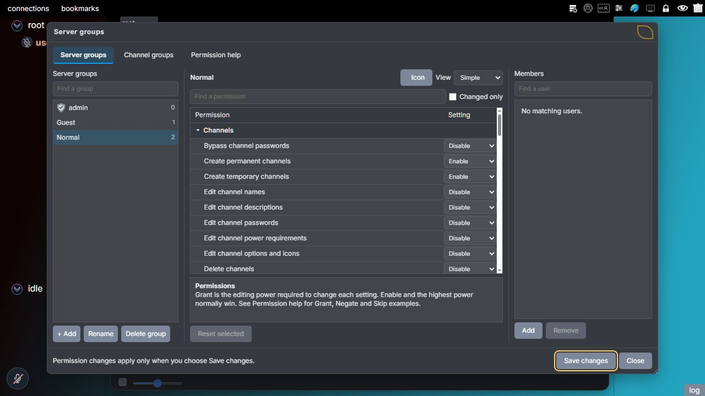
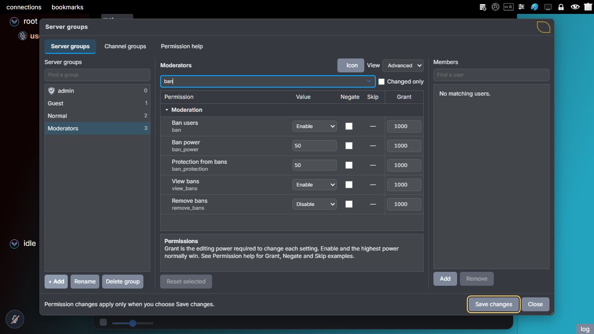
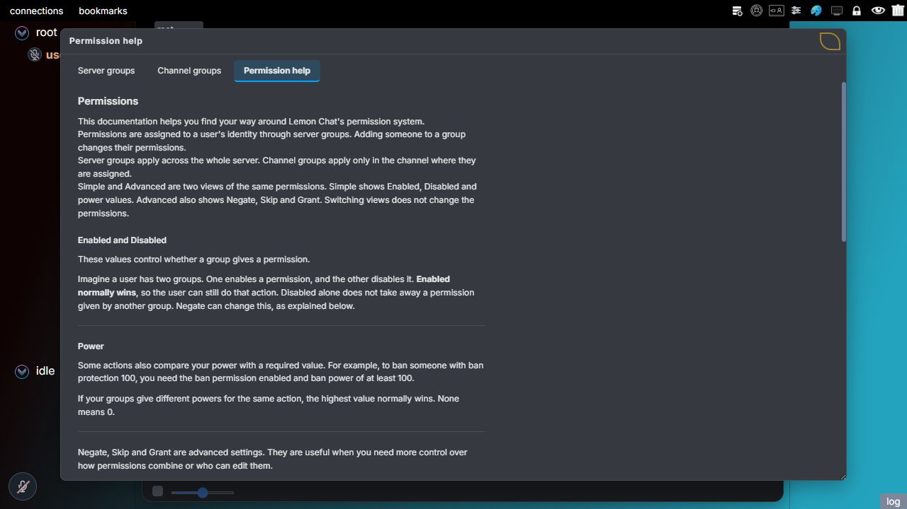
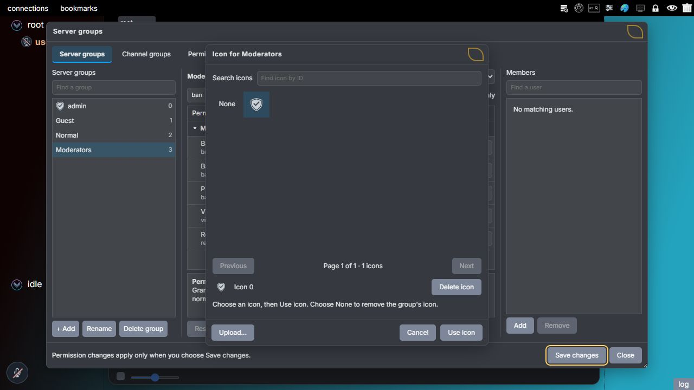
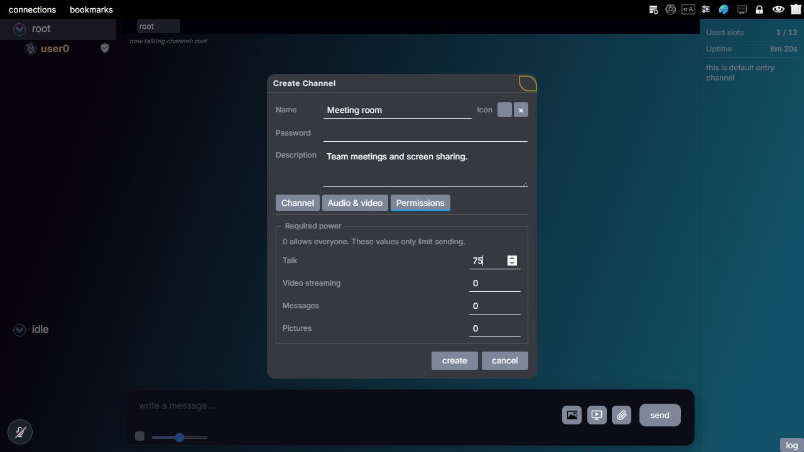
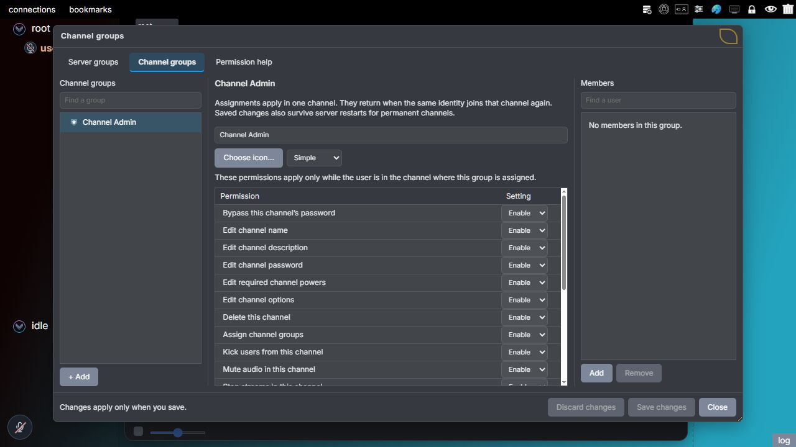

# Permissions

Lemon Chat uses groups to control which actions users can perform. Each group has permissions for actions such as creating a channel, sending files or banning a user. Assigning a group gives the user its permissions.

This guide explains the permission system through the choices an administrator makes. For exact field names, saved values and complete tables, use the [permission reference](permission-reference.md).

There are server groups and channel groups. Server groups apply across the server. A channel group is assigned in a particular channel and gives rights there.

Assignments belong to the user's **identity**, which the client saves and uses when connecting. Changing a display name keeps the same identity and groups. Connecting with a different identity does not keep them, even when the display name is the same.

The server checks permissions when it receives a request. The client also uses them to show the available controls, but hiding a button is not the check that enforces the rule.

## Enabling groups

The group system is controlled by `is_permission_system_enabled` in `server_settings.json`. Set it to `true` to use groups. Stop the server before editing the file and start it again afterward; this setting cannot change while the server is running.

With the setting at `false`, the client hides group and icon controls and the server stops applying group permissions. The saved groups remain in the settings file. Admin access then comes from the admin password, while server settings control what other users can do.

Admins can open **Server groups** from server settings in every theme. Hybrid V1 and Hybrid V2 also have shortcuts in the toolbar, local settings and user menus. A theme changes where the controls appear; it does not change the permission checks.



*Choose a group on the left. **Simple** view shows its action and power settings in the middle, while **Members** lists identities assigned to that group. Use **Save changes** after editing permissions.*

Permission edits stay in the editor until **Save changes** is selected. The client then sends them to the server to be applied and saved. Accepted edits affect connected users. Group management permissions cover these changes without giving access to other server settings.

Creating, deleting or renaming a server group, selecting its icon and changing memberships send requests immediately. Once accepted, those changes already affect the running server. **Save changes** keeps them after a restart; closing the window does not undo them.

## Guest and group presets

A new server starts with Admin, Normal and Guest groups. Guest is assigned automatically when an identity has no other server group. Assigning another group removes Guest, and removing the last assigned group restores it. The same rule applies when a saved user reconnects.

You cannot delete the automatic Guest group or add and remove its members by hand. You can change its name, icon and permissions. It starts without an icon. Its saved ID identifies it, so the server does not replace an existing group to create Guest.

Normal can be assigned, edited or deleted. Additional groups are created from a **preset**, which supplies their starting permissions:

| Preset | Starting permissions |
| --- | --- |
| Guest | View public server information and connection duration, create temporary channels, and send pictures and files. Cannot view saved contacts, use offline messages, or contact idle users. |
| Normal | Guest's permissions, plus permanent channel creation, viewing group permissions and saved contacts, offline messages, and contacting idle users. |
| Moderator | Normal's permissions, plus viewing client details, group members and bans; moving users; channel kicks; temporary mutes; stopping streams; server kicks; and bans. Powers and protection for these moderation actions start at 50. |
| Admin | All group actions and powers of 1000. Creating a group from this preset does not give its members full server admin access. |

After creation, the saved permission values determine what a group allows. Its name and original preset do not override later edits. A group created from the Guest preset is therefore an ordinary group, not another automatic Guest group. New groups start without icons.

With groups enabled, Guest's permissions decide what new users can do. Group permissions control temporary channel creation. The older temporary channel checkbox is used only when groups are disabled. Server switches still decide whether features such as idle mode and offline messages are available.

## How permissions combine

### Enable and Disable

Each action in a group is set to **Enable** or **Disable**. The server combines that value with the same action in the user's other groups:

| Choice | Meaning |
| --- | --- |
| **Enable** | Allow this action through this group. Saved as `grant`. |
| **Disable** | Do not allow this action through this group. Saved as `deny`. Another group's Enable can still allow it. |

Normally, Enable in any assigned group allows the action. Disable means that this particular group does not allow it; another group's Enable can still allow it.

For example, if one group enables **Ban users** and another disables it, the combined result allows banning. The separate ban power check must still pass.

Each permission is combined separately, so one group can allow kicking and another can allow banning. Guest does not take part while another server group is assigned.

**Negate** changes how conflicting values are combined. It is explained below after the normal power rules.

### Power and protection

Some actions also require enough **power**. For actions against another user, the server compares the acting user's power with the other user's **protection**. The power must be equal to or greater than the protection, and the action itself must be enabled.

For example, a user has ban protection 100 and is not a full server admin. A moderator with **Ban users** enabled and ban power 75 cannot ban them. Raising that power to 100 meets the requirement. Disabling **Ban users** in all the moderator's groups prevents the action even with power 100.

The moderator's own ban protection is used when someone tries to ban the moderator. It does not add to their ban power.

When several groups provide power, the highest value normally applies. Values are not added. For example, powers 50 and 25 give power 50, not 75.

### Admins and server settings

Full server admins can use all permissions. Disable does not restrict them. With groups enabled, membership in the built-in **Admin** group gives full server admin access. Its ID is `0`; it cannot be deleted and its permissions cannot be edited. Entering the admin password also gives admin access.

A new group created with the **Admin preset** is different. It starts with all group actions enabled and powers of 1000, but its members do not become full server admins. Giving a group the name Admin or giving someone power 1000 does not change this. When groups are disabled, the built-in Admin membership no longer gives admin access; the admin password is required.

The built-in Admin group starts with a grey shield icon. You can change its icon or choose **None**, then select **Use icon**. Save changes to keep the choice after a restart. Existing saved icon choices remain in use.

Server settings still control shared features. For example, permission to view server information does not reveal fields the admin has hidden.

## Negate, Skip and built-in help

The Advanced view adds **Negate**, **Skip** and **Grant** to the permission editor. Negate and Skip change how group values combine. Grant controls who can edit a permission row, as explained in the next section.

Switching to Simple view keeps these values. **Permission help**, beside the Server groups and Channel groups tabs, opens examples without discarding unsaved edits.



*Choose **Advanced** in **View**, then search for a permission such as `ban`. Here the Moderator preset gives ban power 50. The dash in **Skip** means these particular rows have no channel equivalent; it is not an unchecked Skip option.*



*Open **Permission help** at the top of the group window when you need an explanation while editing. Scroll in that tab for the Negate, Skip and Grant examples.*

### Negate: use the lowest marked value

**Negate** changes which values the server uses when combining groups. With no Negate values, it uses the highest ordinary value. Once any values have Negate, it uses the lowest of those marked values instead.

For example, talk powers 50 and 10 normally give a result of 50. Marking 10 with Negate makes the result 10. This allows one group to limit a power that another group would otherwise raise.

The result comes from the marked values even when they are higher. If the only marked value is 75 and the ordinary value is 50, the result is 75. Group order has no effect, and Negate does not change the sign of a number.

For action permissions, Disable is lower than Enable. **Disable + Negate** therefore blocks an ordinary Enable. Both server groups and channel groups can use Negate.

For example, a Listener channel group has talk power 10 with Negate. The channel requires talk power 20. The user cannot speak there, even if a server group gives them talk power 50. Leaving that channel removes the Listener group's effect.

Power 0 does not stop speech in a channel that also requires 0. Use a positive channel requirement or a temporary mute to stop speech. Lowering a protection value makes it easier for other users to act on that user.

### Skip: keep the server result

**Skip** prevents a channel group from changing a particular server permission. The server still combines all the user's server groups for that permission, then keeps that result when the user enters a channel.

For example, server talk power is 75 with Skip. The channel group has talk power 10 with Negate. The result stays 75. The channel's required talk power still applies: if it is 80, the user cannot speak.

Skip is available only for server permissions that have a matching channel permission. It does not stop other server groups from taking part in the calculation.

### Using both options

Negate and Skip apply at different parts of the calculation. Negate selects which server group values produce the result; Skip prevents the channel group from changing that result.

For example, one server group gives talk power 50 and another gives talk power 10 with Negate and Skip. Negate produces a server result of 10. Skip then keeps it at 10 in the channel.

Without Skip, the active channel group takes part in the same calculation: use the highest ordinary value, or the lowest value marked with Negate if any exist.

### Who can change these options

Full server admins are not restricted by Negate or Skip. Only full server admins can add these options, change permissions in groups that use them, delete those groups, or change their memberships. The usual group management checks still apply to renaming a server group or changing its icon.

Negate and Skip start unchecked, including when loading old groups without these options. Groups that do not use them follow the usual management checks.

### How these options are saved

The settings file stores these options in `permissions.flags`. For example:

```json
{
    "talk_power": 10,
    "edit_channel_description": "deny",
    "flags":
    {
        "talk_power":
        {
            "negate": true,
            "skip": true
        },
        "edit_channel_description":
        {
            "negate": true
        }
    }
}
```

Channel groups accept Negate only. The server rejects unknown permission names, values other than `true` or `false` for these options, and Skip on permissions with no channel equivalent. A server action with options must also have an explicit action value. An omitted channel action means Disable.

Old settings without these options keep their previous behavior. When groups change, the server recalculates the user's audio, picture, message and video powers. It also checks whether current streams are still allowed.

## Grant: required permission editing power

Each permission row has a **Grant** value. This is the minimum **Permission editing power** needed to change that row. It allows different rows in the same group to require different editing power.

For example, the manager has editing power 50:

1. The picture permission has Grant 25. The manager has enough editing power to change it.
2. The ban permission has Grant 75. The manager cannot change it because 50 is below 75.
3. If the ban permission had Grant 50, the manager would have enough editing power. Equal values are enough.

The manager must also pass the group editing checks. Being allowed to perform an action, such as banning, does not by itself allow editing that action's permission.

Grant applies to editing the row. It does not limit the power that can be entered on that row. The row's own value determines whether the action is allowed and what power it provides. Assigning the group to a user requires separate permission.

The **Grant** number is also different from the word `grant` saved for an action. The number controls who can edit a row. The saved word `grant` means the action is set to Enable.

### Where editing power comes from

Server groups provide `permission_edit_power`. Channel groups cannot provide it. New presets start with these values:

| Preset | Permission editing power |
| --- | --- |
| Guest | 0 |
| Normal | 25 |
| Moderator | 50 |
| Admin | 1000 |

These are starting values. A custom group's name does not change the check. Existing groups without `permission_edit_power` have value 0.

A row without a saved Grant value uses **1000**. An admin must lower it before a manager with less power can edit the row. Grant 0 still requires the relevant editing permission and enough group management power.

### Other checks still apply

Editing server group permissions requires `edit_group_permissions`. Editing channel group definitions requires `edit_channel_groups`. A **definition** is the saved name, icon and permissions of a channel group, shared by its assignments.

Group protection and member protection still apply. Managers cannot edit the permissions of their own server group or give others permissions they do not have. Only full server admins can edit permissions containing Negate or Skip. A request can include unchanged locked rows together with an allowed change.

To change a Grant value, the editor needs power at least as high as both its old value and its new value. For example, changing Grant from 75 to 25 still requires editing power 75. Lowering Grant in the same request cannot make an otherwise refused edit allowed.

New group definitions keep Grant 1000 unless their creator has editing power 1000 or full server admin access. Full server admins can change these limits. The built-in Admin group's permissions remain fixed.

### Saving Grant values

Grant values are whole numbers from 0 to 1000. They are saved in `permissions.grants`, using the action or power name. They control edits to that group; they do not become powers of its members.

The server rejects unknown or duplicate names, invalid values, and channel entries for permissions that channel groups cannot use. Missing entries mean 1000.

Use **Save changes** to apply and save permission edits in either group editor. **Reset selected** restores the saved value, Grant, Negate and Skip for that row. **Changed only** shows rows with unsaved changes to any of these values.

## Connection duration

**View connection duration** allows users to see how long another user's current session has been connected. Guest has this permission by default. The value appears as **Connected for** in the profile panel and in **Client Info**.

To restrict it, set **View connection duration** to Disable in the relevant server group. As with other actions, Enable from another group can still allow it unless Negate changes the result.

The time starts with the session and does not reset when the user changes channels. The browser updates it every second without another server request, using seconds, minutes, hours and days. It displays 30 days as one month.

Disconnecting clears the saved reading in the client. If permission is removed, the client hides the value and ignores replies it was waiting for. This permission does not allow viewing IP addresses, identity or last activity. Those have separate permissions.

### Choosing icons

In the server group editor, choose **Icon** beside the group's name. In the channel group editor, choose **Choose icon…**. Both open a window with search by icon ID and 80 images per page. Select an image to preview it, then select **Use icon**. **Cancel** keeps the previous icon. To remove a group's icon, select **None**, then **Use icon**.



*Selecting the shield previews icon 0. **Use icon** applies the selection; selecting **None** first removes the group's icon instead.*

**Delete icon** deletes the shared image from the server after confirmation. Other groups and channels using that image also lose it. **Delete group** removes the group and its memberships.

The server's administration log is in the **log** tab in server settings.

## Complete permission reference

The [permission reference](permission-reference.md) contains every server and channel permission, every power and protection field, the saved JSON values, compatibility notes and the relevant source files. The practical examples remain in this guide.

## Channel requirements

Channels can require a minimum power to speak, send text, send pictures or share video. Each requirement is checked separately. All four start at **0** and accept whole numbers from 0 to 1000.

These values are in the **Permissions** tab of the channel properties. The name, password and description remain above the **Channel**, **Audio & video** and **Permissions** tabs. Switching tabs keeps entered values, and **Create** or **Save** applies them together. Editing a channel keeps its existing requirements unless they are changed.

For example, set required talk power to 75. A user with talk power 25 or 50 cannot speak. A user with power 75 or 100 can speak. Changing the message or picture requirement does not change who can speak.



*This example limits speaking in the meeting room while leaving the other three required powers at 0. Select **create** for a new channel, or **save** when editing an existing one, to submit the values.*

A requirement of 0 allows any power value, but other permissions and server or channel switches can still stop the action. A temporary mute also stops speech.

### Who can change requirements

Full server admins can change these requirements. Groups can also allow this through **Edit channel powers**.

The owner of a temporary channel can edit its requirements and starts with channel power 1000. These rights apply while the owner is in that channel. With groups enabled, the owner receives Channel Admin there. The assignment disappears when the temporary channel is deleted. It gives no permission in other channels or in server settings.

The owner's powers still follow the group combination rules. For example, a server group with talk power 10 and Negate can reduce the owner's talk power below 1000. Temporary ownership is not full server admin access.

### When a requirement changes

The server keeps the user's current talk, message, picture and streaming powers in memory. It recalculates them after group changes. This lets it check audio and video without reading every group for each packet.

Raising a requirement affects connected users immediately. If a user no longer has enough talk power, the server stops their audio and clears queued WebSocket audio in the affected channel. Audio already sent cannot be taken back. Lowering the requirement lets the user start speaking again.

Streaming power is checked when a screen share or video starts and while its packets are sent. Losing enough power stops the stream, including its sound, and informs viewers. Microphone and separate music audio use talk power instead. Watching an allowed stream does not need streaming power.

Text messages and edits are checked when received. Pictures are checked after upload, before being sent to other members. A permission change during a picture upload therefore affects whether it is sent.

These four requirements do not control private messages, private pictures or ordinary file attachments. Those have their own settings and permissions. Server music bots use their audio controls.

### Saved channel requirements

Channels save these fields: `required_talk_power`, `required_message_power`, `required_picture_power` and `required_stream_power`. Missing values mean 0.

When groups are disabled, the server ignores these requirements and the client hides the Permissions tab. Audio, video and upload settings still apply.

## Channel groups

A channel group gives an identity permissions in a particular channel. Its editing and moderation rights apply while the user is there, alongside the user's server group permissions. This allows someone to manage one channel without giving them the same rights across the server.

Open **Server settings > Server groups > Manage groups**. At the top of the window, select **Channel groups** beside **Server groups**.



*The **Channel groups** tab edits permissions that apply in an assigned channel. It is separate from the server group list and from the channel's required-power fields.*

### Assigning a channel group

The server includes a group called **Channel Admin**. It starts with channel powers of 1000 and a shield icon. You can change or remove its icon, but cannot delete this built-in group. You can create custom channel groups with their own names, icons, permissions and powers.

With groups enabled, creating a channel assigns its creator Channel Admin there. To assign someone a group in another channel:

1. Have the user join that channel, or move them there if you have permission.
2. Open that user's menu and select **Set channel group**.
3. Select Channel Admin or a custom group. The same controls can remove an assignment.

Each identity can have one channel group per channel. It can have different groups in different channels.

A user without full server admin access cannot change their own channel group or a full server admin's channel group. They also cannot assign actions or powers beyond their own rights in that channel. The temporary channel owner's Channel Admin assignment cannot be changed while they own that channel, even by a full server admin.

### Leaving and returning

Leaving a channel removes that channel group's active permissions and icon. The assignment remains saved, so it applies again when the user returns with the same identity. Permanent channel assignments survive a server restart. Temporary channel assignments disappear when the channel is deleted.

Server groups continue to apply in every channel. Normally, the higher server or channel power applies to a channel action. Negate and Skip can change that calculation as explained above.

Channel powers do not increase server kick power, ban power, power to move users between channels, or power to manage server groups.

### Names and icons

In the client list, country flags appear at the right. Channel group icons appear next to them, followed by server group icons. Long names and extra icons may be shortened with `...`.

Client details list **Channel groups** and **Server groups** separately. The connected member management panel requires `view_group_members`. Names and icons beside online users remain visible to people who can see those users.

### Creating and editing channel groups

The server permissions `create_channel_groups`, `edit_channel_groups` and `delete_channel_groups` are separate. None of them allows assigning a group; that needs `assign_channel_groups`.

A channel group cannot let its members create group definitions or change server settings. A group manager cannot give actions or powers beyond their own server permissions. Group protection limits which definitions and assignments they can change. Grant values also limit which permission rows they can edit.

Channel groups can allow these actions:

- Edit the assigned channel's name, description, password, required powers and other options.
- Delete that channel, if deleting each child channel is also allowed.
- Assign or remove other users' channel groups there.
- Kick users from the channel, mute their audio or stop their streams there.
- Enter that channel without its password.

Editing and moderation rights supplied by a channel group apply while the user is present in the assigned channel. Server group rights still apply across the server. Password entry permission is also checked when joining, using the saved identity assignment.

A channel kick moves a user to root without disconnecting them. Moving a user to a chosen channel always needs server group permissions and powers. Channel Admin does not allow moves between channels, server kicks or bans.

Server kicks, bans, moves, server icon uploads, and creating or editing group definitions are not channel group actions. The server rejects these fields in channel group permissions and leaves them out of saved channel definitions.

### Channel permission reference

The [channel permission tables](permission-reference.md#complete-channel-action-list) list all channel actions, powers, protection fields and their saved format.

## Changing channel type

Open **Channel Properties > Channel > Channel type** to change an existing channel between permanent and temporary. This keeps the channel and its members in place.

Changing type requires **Edit channel options**. Making it permanent also requires **Create permanent channels**. Making it temporary also requires **Create temporary channels** and **Delete channels**, because leaving will delete it.

Before making a channel temporary, join it. You become its owner and cannot already own another temporary channel. Root, channels with children, and channels with music bots cannot become temporary.

Making a temporary channel permanent removes temporary ownership. With groups enabled, the owner's Channel Admin assignment remains.

Use **Save server settings** to save the configuration. Temporary channels are not included. A request that does not specify a type keeps the current type. When connected to an older server, the selector is read-only.

## Bypass channel passwords

**Bypass channel passwords** allows joining a password protected channel without supplying its password. The server checks this permission against the user's identity when they try to join.

A server group can allow this across the server. A channel group can allow it only for its assigned channel. The built-in Channel Admin group enables it by default.

For a channel group, the server uses the identity's saved assignment before entry. The user does not have to be inside the channel for this check. That group's editing and moderation rights apply once the user is in the channel.

Server group rights apply across the server. Bypassing the password still leaves the channel's user limit in place for users without full server admin access.

Negate and Skip follow the same rules as other channel permissions.

## Moderation and reserved slots

The **Channel actions** menu contains moves, channel kicks, temporary microphone and MP3 mutes, stream stops, and channel group assignments. It is opened from a user's menu and shows the actions allowed by your permissions.

A channel kick returns the user to root. A temporary mute follows the identity in that channel until the chosen duration ends, even if the user reconnects. Restarting the server removes temporary mutes.

**Server moderation** in local settings opens the ban, emoji and icon controls available through your groups. Viewing bans and removing bans are separate permissions. IP addresses are hidden unless you have `view_ip_addresses`. Each ban has an ID, so you can remove it without knowing the address. Removing a ban saves immediately.

### Music bots

Creating bots, deleting bots, uploading songs, deleting songs and controlling playback are separate permissions. Playback controls are play, pause and next song.

The server checks upload permission before accepting data and again before adding the processed song. It also checks that the upload still belongs to the identity that started it.

### Reserved slots

**Reserved slots** keeps part of the server's connection capacity for identities with `use_reserved_slots`. These places are taken from the total client limit rather than added to it.

For example, a server with 20 total slots and 2 reserved slots has 18 places available to ordinary users. The other 2 places require permission. The total stays 20.

Set Reserved slots to 0 to disable this feature. It is also ignored when groups are disabled. Assign the allowed identities before the ordinary slots fill up. When all ordinary slots are occupied, a new client without a reserved slot cannot connect just to enter an admin password.

## Checks when changing groups

A user who is not a full server admin cannot:

- Manage the built-in Admin group or change an admin's memberships.
- Change their own memberships.
- Edit permissions of a group they belong to, or delete that group.
- Assign or edit a group to give actions or powers they do not have.
- Increase another user's powers beyond their own.
- Remove a user's last group if the resulting Guest permissions would give rights the manager does not have.
- Change a group or user whose protection is higher than the manager's management power.

Group protection is compared with **group management power**. When a manager sets or assigns group protection, the maximum is their management power, not their own protection value.

Edits and deletions check current members as well as proposed values. Saved memberships are checked too. Disconnecting therefore does not remove this protection.

Changing full server settings, clearing logs and deleting saved identities require full server admin access. There are no separate group permissions for those actions.

## Updates and denied requests

Accepted membership and permission changes update the affected users' rights and controls. The server checks permission again for each protected request. It does not send group permission values to a user who cannot view them.

If a user loses admin access, the client stops using its old admin rights immediately while waiting for updated values. When other viewing permissions are removed, the client clears the restricted information it has stored. Information already seen or messages already sent cannot be taken back.

When a permission check fails, the server sends `access_denied` with the message **Insufficient permissions.** The client shows the message. It also plays the corresponding sound if local sound effects are enabled. Invalid request fields can be rejected separately without this message.
