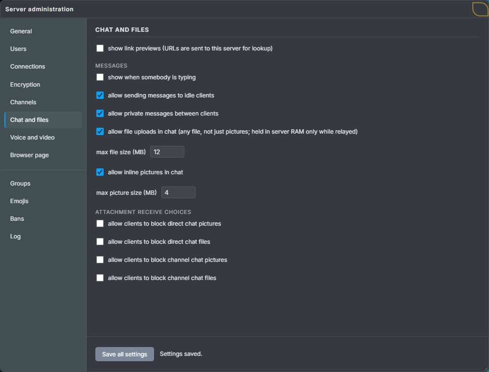
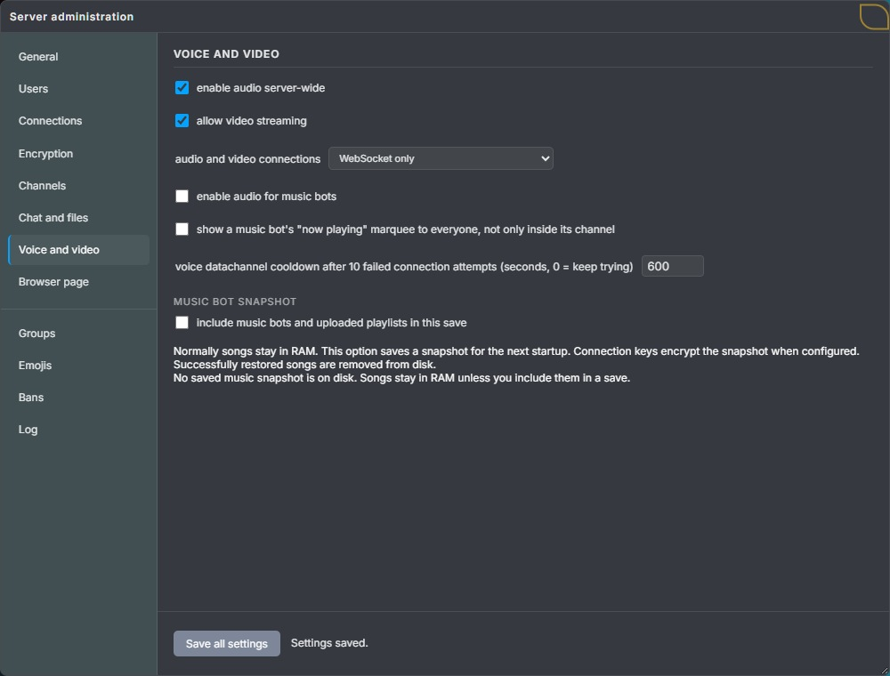
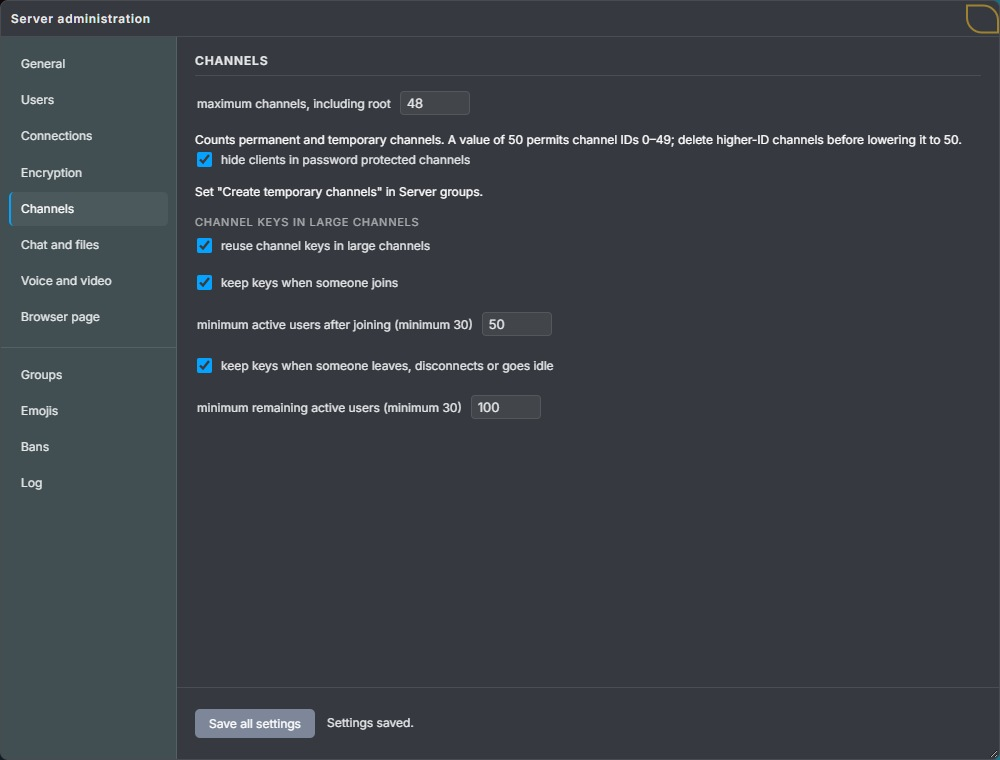
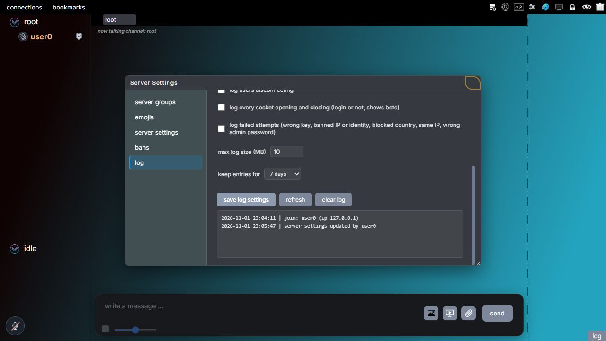
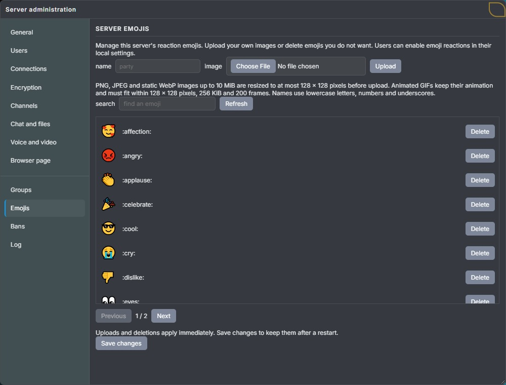

# Server settings

Server settings control which features Lemon Chat offers and the limits that apply to everyone connected. This includes audio and video, uploads, connection methods and user limits.

The server saves these settings in `server_settings.json`. Many can also be changed through the administration window while the server is running.

Local client settings work within the server's rules. A user can choose WebRTC for audio, for example, only when the server allows it.

## Opening and saving settings

For the first login, follow [Administration](administration.md#open-the-admin-settings-with-the-password). It shows the admin-password button, the initial password-change prompt and how to reach the connected administration window.

1. Connect to the server.
2. Click the **lock icon in the upper toolbar** to open **Admin Password**, enter your admin password in the **password** field, and select **send**. The [illustrated login steps](administration.md#open-the-admin-settings-with-the-password) show the icon and dialog.
3. Open **Server administration** and choose the page for the options you need.
4. Change the options, then select **Save all settings** in the fixed footer.

The footer saves changes across all eight settings pages. Groups, emojis and log settings keep their own save controls.

Once the server accepts the changes, it applies them and sends the relevant rules to connected clients. These controls work while the server is running.

Saving records the configuration in `server_settings.json`, including permanent channels, icons, groups, custom emojis, bans and identities according to the storage settings.

Temporary channels are not saved. Channel maintainers are chosen again after a restart.

Ports and the maximum number of clients are set during setup or in the settings file. To edit the file, stop the server, make the changes, then start it again. Connection passwords can also be replaced live as described below.

## Serving the browser client while running

Suppose Alice wants to stop offering the browser download while keeping her current chat open. Under **Server administration → Browser page**, she unchecks **serve client.html** and chooses how HTTP should be disabled before saving:

- **Stop HTTP completely** closes the built-in HTTP listener. A direct request to that port fails to connect. A proxy such as Funnel may show its own error page because its backend is unavailable.
- **Serve a blank page** keeps the HTTP listener open and returns an empty page. It does not send the client or embedded connection details.

Chat uses its own WebSocket listener, so both choices leave chat connections running. Alice can enable the page again from her existing client. The port and webroot remain the ones configured at startup; enabling a busy port fails and keeps the previous settings. First-time setup also asks which disabled behavior to use.

If Alice enables **embed connection details**, each new download includes the current connection ports and typed connection passwords. Anyone who can download that page can read those passwords. Turning embedding off removes those details from subsequent responses; public client policy and theme defaults can still be supplied. It cannot erase a page or password someone downloaded earlier.

These changes alter responses in RAM. They do not rewrite `client.html` on disk.
When a browser accepts gzip, the server sends a compressed response to reduce
the download size. Other clients receive ordinary HTML. Both responses contain
the same current connection details.

Release builds cache the original page and a gzip copy in RAM. Changing the
embedded settings replaces the gzip copy; downloads already in progress finish
using their original copy. Debug builds read and compress the current file per
request. Nothing compressed is saved to disk, and no extra compression tool is
needed when building or running the server.

Responses use `Cache-Control: no-store` and `Vary: Accept-Encoding`. The server
only serves `/` and `/client.html`, so its settings and saved songs are not
exposed as HTTP files.

## Keeping music bots for a restart

Suppose Alice has a music bot with three uploaded songs and wants that playlist back after restarting. Uploads and playback normally stay in RAM. Selecting **Save all settings** also saves the music bots and their uploaded playlists by default. Under **Voice and video**, Alice can turn off **include music bots and uploaded playlists in this save** to save settings without updating the saved music. The checkbox keeps her choice after saving.

The server collects the bot names, permanent channels, playlist slots, song names, uploaded MP3 bytes and paused state into one snapshot. It writes a separate `music-bots-<random>.bin` file beside `server_settings.json`, which stores only the file reference. A later save that includes music replaces that snapshot and removes the previous copy. No snapshot file is created when there are no bots. Incomplete uploads must finish before a music save, and a snapshot's playlist data is limited to 1 GiB.

If there are no bots in RAM but an older saved playlist is still on disk, a music save keeps
that copy and reports that there is nothing to save. Use **Clear from disk** to remove it.

Preparing a snapshot needs additional RAM for the serialized playlist and encrypted output. Saving a large playlist can temporarily delay server work while that consistent snapshot is prepared and written. It is an explicit operation, not an automatic background save.

On restart, the server loads the complete snapshot into RAM and keeps the saved file on disk.
If the server crashes or restarts again, it can restore the same saved songs and playlists.
Later playlist changes stay in RAM until Alice saves music again. Playback resumes from the
restored playlist; the current position inside a song is not saved. Disabling music audio does
not prevent restoration into RAM.

To remove the saved copy, Alice selects **Clear from disk** and confirms. The server overwrites
the file's contents, flushes those writes, then deletes the file. Songs already in RAM remain
available. Saving settings again with music included creates a new saved copy.
Overwriting cannot guarantee removal from SSD storage, filesystem snapshots or backups.

### Encryption on disk

If Alice has configured connection password keys, the server encrypts the snapshot in RAM with those keys' cipher types before writing it. A fresh random salt derives new storage keys for each save, and HMAC-SHA256 authenticates the file before restoration. There is no plaintext song temporary file. Without connection password keys, an explicitly saved snapshot contains plaintext song data with a corruption checksum.

Restoration needs the passwords and types used **when the snapshot was saved**, in their original order. Changing connection passwords without saving music again leaves the existing snapshot encrypted with its original keys. These passwords are already stored in the server configuration; snapshot encryption does not protect against someone who can read both the snapshot and that configuration.

### When restoration fails

If Alice restarts with different keys, the server keeps the snapshot and shows a restoration warning in server settings. She can supply the original typed passwords and select **Retry restoration**, or explicitly choose **Clear from disk**. Recovery passwords are used only for that attempt and do not replace connection passwords or get saved to the settings file. Leaving the recovery list empty retries with the current server keys.

Wrong keys, damaged data, unavailable channels, insufficient client slots or insufficient RAM leave the saved file in place. Restoration rolls back partially created bots. A failed snapshot cannot be overwritten until the failure is resolved or the saved file is explicitly deleted. To save other settings in the meantime, turn off **include music bots and uploaded playlists in this save**; the saved music remains on disk. The delete button asks for confirmation because unrestored songs would be lost. Songs already in RAM remain available.

Restoration does not delete or rewrite the saved file, and the same playlist cannot be restored
twice during one server run. If **Clear from disk** cannot overwrite, flush or delete a file,
the server reports the failure so Alice can correct the permissions and try again.

## Changing connection encryption while running

When you want one password to use AES and another to use ChaCha20, choose each cipher in the first-time setup. Clients must enter matching passwords and cipher types in their connection window. The [encryption guide](encryption.md#43-choosing-the-ciphers-and-number-of-keys) explains the choices and shows a configuration example.

The browser administration window exposes these settings under **Server administration → Encryption**. Saving applies them to new connections immediately and persists them in `server_settings.json`:

| Field | Accepted values | Default |
| --- | --- | --- |
| `keys` | Password strings (legacy AES), or objects with `type` and `password` | No passwords |
| `session_cipher` | `aes256`, `chacha20`, `camellia256`, `twofish256`, `serpent256`, `trivium80` | `aes256` |
| `dh_exchange_count` | Integer 1–4, fresh exchanges per login | 2 |
| `session_encryption_layer_count` | Integer 1–8, separately derived session keys per direction | 2 |
| `is_random_cipher_layer_enabled` | Boolean; adds one randomly selected cipher layer | `false` |

First-time setup uses AES-256, two DH exchanges and two session encryption keys per direction
without asking for these values. Every connection establishes session keys, even without connection
passwords. You can change these settings later under **Encryption**.

The number of exchanges and keys are separate choices: more exchanges increase login work;
more keys increase work on every message. The optional random cipher adds one encryption key
per direction on top of the configured count.

Suppose Alice and Bob are chatting with one DH exchange and an AES connection password. Alice changes the DH count to 2 and saves. Their existing connections keep their negotiated keys. Carol connects afterward and performs two fresh exchanges. A login that has already received its policy finishes with that policy, even if Alice saves another change meanwhile.

To change the passwords too, Alice selects **replace the connection passwords when saving**, adds the complete new list with each cipher, then saves. An empty replacement list removes the password requirement. Leaving the checkbox off preserves the existing list. The server never sends existing password text back to the administration window.

Each chat socket captures its password keys when it opens. Alice and Bob therefore keep working with their old snapshots, while Carol's new socket uses the replacement list. Queued messages retain their original snapshot until sent or cancelled. For audio and video, the server removes the sender's password layers and adds the receiver's layers; channel encryption stays intact. Reconnecting requires the current passwords. A successful save also refreshes embedded browser connection details when that feature is enabled.

Only an authenticated administrator can change these settings. The server validates the complete update before applying it. If the file cannot be saved, it restores the previous settings. The administrator password is separate and already has its own live change control.

Old clients are accepted only with the legacy one-exchange, one-layer AES policy and no random layer. Update those clients before using the new defaults or other settings. The native desktop client supports the new connection encryption; its current server information panel is read-only, so use the browser administration window for these edits.

## Usage and public information

The server reports its current usage on **Server administration → General**:

- **Occupied slots:** how many client places are in use.
- **Uptime:** how long the server has been running.
- **RAM usage:** how much memory the server process is using.
- **Received and sent bytes:** data transferred over WebSocket and WebRTC during this server run.

The byte counters measure traffic on the chat connections. Traffic from other programs and the HTTP server is outside those counters.

While the tab is visible, the browser requests new readings about every five seconds. A reading shown as **Unavailable** was not supplied by the server; it is not a measurement of zero. RAM usage is displayed here, but cannot be limited from this tab.

Some server information can also be shared with users. The admin chooses separately whether to show a banner, uptime, occupied and total slots, and the public settings list. The root channel displays the shared information, with **server info** in its menu opening the public settings.

Hiding the public list does not stop clients from receiving the settings they need for their connection and permissions. The admin's RAM and data transfer readings are not included in that public list.

## Available controls

| Page | Settings |
| --- | --- |
| General | Current usage, server banner and information shared with users. |
| Users | Country flags, showing the admin flag, renaming, and icon or avatar size limits. |
| Connections | Reserved slots, country restrictions, multiple users from one IP address, simultaneous logins, reconnect behavior, replacing an existing connection, and checks that a connection is still active. |
| Encryption | Connection passwords and ciphers, DH exchanges, session encryption, and minimum RSA identity key size. |
| Channels | Maximum channel count, temporary channels, hiding members of password protected channels, and channel-key reuse after members join or leave. |
| Chat and files | Typing indicators, messages to idle users, direct messages, link previews, file and picture uploads, size limits, and whether users may block incoming attachments. |
| Voice and video | Audio, video, music bot audio, connection methods, connection cooldown, scrolling song names, and saving or restoring music bots and playlists. |
| Browser page | Serving the browser client, behavior when HTTP is disabled, and embedded connection details. |

For example, if people should attach documents to a conversation, open **Chat and files**, enable **allow file uploads in chat**, and choose the maximum file size. Select **Save all settings** after reviewing the values.

*This example allows file uploads up to 12 MB. The file limit and the picture limit are separate controls; the displayed values are example settings.*

### Maximum channel count

Suppose you want a server with root and four discussion channels. Set **maximum channels, including root** to **5** under **Channels**, then save. Root uses one place; each permanent or temporary channel uses another. Once all five places are occupied, the server rejects another creation request with a message explaining that the maximum channel count has been reached. This applies to admins too.

The server allocates an array with exactly the configured number of channel slots. With a count of 5, the valid IDs are 0 through 4. Deleting a channel frees its slot for reuse; it does not renumber the other channels.

Suppose you now want to lower that count to 3. Channels with IDs 3 and 4 would fall outside the smaller array, so the server rejects the save while either exists. Delete those channels first, then save 3. Deleting only channels 1 and 2 is insufficient: the IDs that remain must fit, regardless of the total number of channels. This also applies to temporary channels. The server never silently removes or renumbers channels to make a reduction fit.

Raising the count allocates more slots immediately after a successful save; restarting is unnecessary. A failed allocation or save keeps the previous array and count. Both growth and shrinkage preserve the retained channels and their members.

The setting accepts whole numbers from **1 to 2147483647**, subject to available memory and the platform's allocation size. The upper value comes from the channel-ID format; it is not a promise that a machine can allocate that many channels. **100 is the default, not a fixed capacity.** A count of 1 allows only root. Setup asks for this count, and the settings file stores it as `"max_channel_count": 5`. Older files without the field use 100. Invalid file values or saved channel IDs outside the configured array stop startup with an explanation; invalid live updates leave the current settings unchanged.

### Blocking incoming attachments

Attachment receive settings decide whether users may block incoming pictures or files on their own devices. Enabling one of these options makes the corresponding local choice available to users.

For example, allowing clients to block direct pictures lets one user turn that block on while another leaves it off. The server option allows the choice; it does not block pictures for everyone.

These choices apply to new transfers. They do not remove pictures or files already received.

### Link previews

Link previews are looked up by the server. When the feature is enabled, the client sends the posted URL separately for that lookup. The server can therefore read the URL even though the chat message containing it is encrypted.

## Audio and video connections

Audio and video can use WebSocket or WebRTC DataChannel. The server's connection selector decides which of these methods clients may use:

- **WebSocket only**
- **WebRTC only**
- **WebSocket and WebRTC (clients choose)**

This choice applies to audio and video. The main chat connection always uses WebSocket.

*Find **audio and video connections** under **Voice and video**. Here the server allows both audio and video, using WebSocket only. Select **Save all settings** to apply your selection.*

Choosing **WebSocket only** allows audio and video without WebRTC. The client opens separate audio and video WebSockets at the same server address and port as the main chat connection.

With both methods allowed, the browser tries the user's preferred method first. If it has not connected after about ten seconds, it also tries the other method.

The server forwards packets between clients using either method. Users on WebRTC and WebSocket can therefore hear each other and watch the same video. Each connection ends at the server, so users do not exchange their IP addresses through WebRTC.

The [WebRTC guide](webrtc.md) explains the DataChannel design, the built-in Violet STUN service, and why clients do not exchange IP addresses. For an HTTP tunnel such as Tailscale Funnel, use **WebSocket only**. See the [selfhosting guide](../selfhosting-tools/README.md) for ports and commands.

The server and the channel must both allow audio before users can send audio. The same rule applies to video.

Video streaming is off in the server's default settings. The browser's **Create Channel** dialog also starts with **Enable Streaming** off, so enable streaming on both the server and the channel. A channel can have only one screen share or video stream at a time.

## Connection handling

### Login and identity options

**Maximum simultaneous logins** limits the number of login calculations running at once. It accepts 1 to 64 and defaults to 4. The total client limit is separate, so a server with room for 100 connected clients can process four new logins at a time.

**Minimum RSA key size** sets the minimum accepted size of a client's identity key. A separate option decides whether the server tells a rejected client which size is required.

**Fast reconnect** lets a returning client resume a session that the server still has open. The client must use the same identity and prove again that it holds the private key.

A successful reconnect keeps the client ID, channel, name, groups and roles, but establishes new connection keys. Any upload on the old connection is stopped and must be sent again.

The browser retries temporary connection failures for up to 60 seconds, with a short pause between attempts. Every attempt must pass the server's normal login checks. A session that has already ended cannot be resumed; if the server accepts a fresh login instead, the browser clears the old chat state and reconnects normally.

Fast reconnect is off by default.

**Identity takeover** lets a new connection replace an existing connection using the same identity. It also requires proof of the private key. The old session closes and the replacement begins as a new login in root. This option is off by default.

Fast reconnect therefore continues a session, while takeover replaces it. If neither is allowed or succeeds, the identity must wait for its earlier session to end or time out before connecting again.

Allow multiple clients from the same IP address when several people share an internet connection or when testing several clients on the server computer.

### Checking whether a connection is still active

Suppose someone is uploading a picture on a slow connection. Each valid upload chunk reaching the server proves that their connection is still active, just as a chat message or a dedicated keep-alive message does. The server refreshes its activity timestamp after decrypting and validating a message from the current authenticated connection. Malformed messages and messages belonging to a replaced session do not refresh it.

For example, with idle mode disabled, a client sends a valid upload chunk 70 seconds after its last keep-alive. The server starts its 80-second inactivity allowance again from that chunk. Without this rule, it could disconnect an active uploader only ten seconds later. When idle mode is allowed, the allowance is 150 seconds so idle clients can use their slower keep-alive interval.

**Disconnect clients when keep-alive messages time out** enables this inactivity check. It is on by default and can be changed while the server runs. Clients still send dedicated keep-alives during quiet periods; those replies also measure round-trip time. The browser likewise treats any valid decrypted server message as evidence that the server is reachable, instead of waiting only for a keep-alive reply.

**Additional WebSocket ping check** is a separate connection check. It is off by default. Changing one of these options does not change the other.

### Sharing files over a slow connection

When an upload fills the browser's outgoing buffer beyond 64 KiB, the browser waits before sending the next file chunk. It checks for room again every 25 milliseconds. Chat and keep-alive messages can still be queued while the upload waits. A chunk already handed to the socket cannot be overtaken, so this pacing keeps the upload backlog small rather than removing network delays. If no room becomes available within two minutes, the upload stops and can be retried.

The server also allows an outgoing socket to make no progress for up to two minutes before closing it. This replaces the former ten-second transport cutoff and is separate from the inactivity setting above. A permanently blocked socket must eventually close: once part of a WebSocket frame has been sent, the server cannot safely discard the rest and continue with another message. Outgoing queue limits still apply, and a slow recipient's file transfer can be cancelled separately without ending their chat session.

On Windows, the receive thread checks for transport cancellation once a second so a silent peer cannot leave a timed-out connection occupying a slot.

When investigating another disconnect, enable **log users disconnecting** in the server settings and check the server log alongside the browser's connection log. With that option enabled, the server records transport causes such as a stalled outgoing socket, a queue limit, a failed send, or a peer closure. The browser records the WebSocket close code, reason and whether the close was clean.

These diagnostics identify the observed failure; an abnormal close alone cannot establish whether an ISP, Funnel, or the remote browser caused it.

### Waiting after failed WebRTC connections

The server counts failed WebRTC connection attempts for each client. After ten failures, **Voice datachannel cooldown after 10 failed connection attempts** determines how long that client must wait before trying again. This limits the repeated setup work when a connection cannot be established.

The default wait is 600 seconds, or ten minutes. Setting it to 0 removes the waiting period. A successful connection resets the failure count.

### Tailscale Funnel

Tailscale Funnel mode uses the local Tailscale installation to forward public HTTPS and WSS connections to Lemon Chat. It is enabled by choosing Funnel during setup or setting `is_tailscale_funnel_enabled` in the settings file. The default is off, and changing the file requires a restart.

Tailscale must already be installed, running and signed in. At startup, Lemon Chat asks it to forward these public connections:

| Public connection | Local destination |
| --- | --- |
| HTTPS on port 443 | `http_port` |
| WSS on `wss_port` | `websocket_port` |

The startup summary prints the public addresses after checking both routes. If the check fails, Lemon Chat ignores forwarded IP headers for that run.

If the computer is renamed in Tailscale, old routes can still use its previous hostname. Lemon Chat adds routes for the current hostname when the old routes are already public and point only to the same local page and chat ports. It keeps the old routes. Routes pointing elsewhere, private paths and ports held by foreground Tailscale commands are left unchanged and reported as conflicts.

With Funnel enabled and verified, a WebSocket connection from `127.0.0.1` can provide one client IP address in the `X-Forwarded-For` header. This header lets the local proxy report the original user's address. Connections from other addresses cannot use it. Local connections without the header are still accepted, and plain WS access remains available.

Use Funnel's HTTP proxy mode. Programs on the server computer must be trusted because local connections can provide this header. See the [Funnel instructions](../selfhosting-tools/README.md#client-ip-addresses).

## Channel keys in large channels

The server chooses one available client in each channel to be its **maintainer**. It chooses at random from available **channel admins**, server admins, and the owner of that temporary channel, with equal priority for these roles. If none are available, it chooses at random from the other members. That client creates the channel encryption keys, keeps a copy and sends a separate encrypted copy to every other member who is not idle or a music bot.

Normally this work is repeated when someone joins or leaves. In large channels it can delay messages, so the server can allow existing keys to be kept after a membership change. A new member still receives their own encrypted copy.

The [channel guide](channels.md#the-channel-maintainer) explains who can be chosen and how clients request a replacement when keys do not arrive.

| Setting | Default |
| --- | --- |
| Reuse channel keys in large channels | On |
| Keep keys when someone joins | On, with at least 50 active users after the join |
| Keep keys when someone leaves, disconnects or enters idle mode | On, with at least 100 active users after the change |
| Smallest allowed minimum | 30 active users |

Idle users and music bots are not counted. Below the relevant minimum, new keys are required. A new maintainer's client automatically generates new channel keys and sends them to the other members, including after an arrival causes a regular member to be replaced by someone with one of those roles. Saved changes to these rules are sent to connected clients immediately.

For example, 101 active users are in a channel. A user who is not the maintainer leaves and 100 remain. With the default settings, the remaining users can keep the same keys. If another user leaves and 99 remain, new keys are required. If the maintainer leaves, new keys are required regardless of the number of users.

Keeping keys has these effects:

- A new member who obtains earlier data encrypted with those keys may be able to read it.
- A former member who obtains later data encrypted with those keys may be able to read it until the keys change.

Leaving a channel stops the server from sending that channel's messages to the user. See [Encryption](encryption.md) for the different keys and what they protect.

## Other administration tabs

**Groups** opens the window for permissions, memberships and server icons directly. Its member list includes saved identities as well as connected users.

**Bans** manages blocked users or addresses. **Emojis** manages the reaction images available on this server.

**Log** controls which administration events are recorded and how much history is kept. Log entries stay in RAM. Logging settings are saved, but the entries themselves are not written to the settings file.

*Use **save log settings** for the Log page's options and **refresh** to fetch current events. This example has an empty log.*

Defaults in this guide apply when no saved value replaces them. An existing server uses its saved configuration.

## Setup questions and their prerequisites

When setting up a simple chat, you may choose not to save client identities on the server. The wizard then skips the saved-user list, last-seen times and offline messaging, and saves those options as disabled. Saving an identity in a browser is a separate choice: it lets that browser reuse its identity after reopening the page, even when the server does not keep a saved profile.

If you enable server identity storage, the next relevant choice is whether to expose the saved-user list. Only after enabling that list does setup ask about last-seen times and offline messages. Without the list, users cannot obtain offline recipients' public keys through the normal contact workflow. When groups are disabled, these questions explicitly refer to password admins, because ordinary users cannot use those features in that mode.

Setup asks about voice chat, music-bot audio and video before asking how audio and video should connect. Music-bot audio is independent of voice chat: you can disable microphones while keeping music playback. If all three features are disabled, the transport question is skipped and WebSocket is selected for any later activation. Funnel, Cloudflare Tunnel and ngrok select WebSocket automatically. For an existing WireGuard setup, the wizard asks for the WebRTC UDP range only when WebRTC is enabled.

## Optional groups and permissions

Server groups, group icons and group permissions can be enabled or disabled together. The first setup question saves this choice as `is_permission_system_enabled` in `server_settings.json`. Older files without the field keep groups enabled.

With the value `false`, the client hides the group window, group symbols and icon controls. Group permissions and powers do not apply. Server settings still apply. Managing the server requires the admin password; saved Admin group membership does not give admin access in this mode.

Groups, icons and assignments remain saved. To use them again, stop the server, change the value to `true`, and restart it. This setting is not available in the browser and cannot change while the server runs.

## Group permissions

Select **Server administration → Groups** to open the group editor. Groups use their own controls and save buttons. Server groups apply across the server. Channel groups apply only in the channel where they are assigned.

Use the [Permissions guide](permissions.md) when you want to create a group, assign members or understand Enable, Disable, power, Negate, Skip and Grant. Use the [permission reference](permission-reference.md) for every accepted field name, saved value and compatibility note.

Under **Appearance** in local settings, **hide server icons in the channel list** hides server group and custom channel icons on that device. It does not change group membership or permissions.

## Server reaction emojis

The server supplies the emojis that users can attach to messages as reactions. These can be text symbols or uploaded images, and appear in the client's emoji selection window.

Full server admins manage this list through **Server administration → Emojis**. Groups can also give other users **Upload emojis** or **Delete emojis** separately. Those users reach the available controls through **Server moderation** in local settings.

The emoji feature also works when groups are disabled. In that mode, managing emojis requires password admin access.

*Open **emojis** to name and upload a reaction image or search the existing list. After changing the list, scroll down to **Save changes** to keep it after a restart.*

### Default emojis

Without a saved list, the server starts with 30 standard Unicode emojis displayed as text symbols by the client. They can be deleted from the list in the same way as uploaded images.

Once a list is saved, the server uses it instead of the defaults. Saving an empty list therefore keeps the list empty after a restart.

### Upload limits

For a still image, select a PNG, JPEG or WebP file up to 10 MiB. The client prepares it for upload with a maximum size of 128 by 128 pixels and 30,000 bytes. Animated WebP is not supported.

For animation, select a GIF. It keeps its animation and must already fit these limits: 128 by 128 pixels, 256 KiB and 200 frames. A frame is one image in the animation.

MiB and KiB are file size units: 1 MiB is 1,048,576 bytes and 1 KiB is 1,024 bytes.

Emoji names, such as `coffee`, must contain 1 to 32 lowercase letters, numbers or underscores. The server supports up to 256 emojis, with search and pages in the admin list.

### Saving and deleting emojis

Uploads and deletions affect connected clients immediately. Select **Save changes** to keep them after a restart. The server stores the list in the `emojis` array in `server_settings.json`, separately from group icons.

Clients receive names, permanent IDs and any Unicode symbols. They download image data when needed and keep a local copy for the current server.

Deleting an emoji removes it from the selection window. Earlier reactions keep their counts and show the locally stored image or saved name. Uploading a new image does not replace those earlier reactions.

### Using reactions

Enable **emoji reactions** in local settings. Select a chat message to open the available reply and reaction controls.

Reaction details are sent inside the encrypted channel or private message. The server supplies the emoji list and images, but does not read the encrypted reaction contents.

## Relevant source files

- [Loading, defaults and saving](../server-source-code/main/core/server_settings.c)
- [Admin settings requests](../server-source-code/main/msg/client/client_msg_server_settings.c)
- [Settings and public information sent to clients](../server-source-code/main/msg/server/server_msg_server_settings.c)
- [Settings tab behavior](../client-source-code/client-development/browser/main/scripts/app/server/server-settings-tab.js)
- [Usage readings and public server information](../client-source-code/client-development/browser/main/scripts/app/server/server-info.js)
