# Themes in Lemon Chat

## 1. Choose a theme

If you want different colors or a different arrangement of the chat controls, open the **Theme** button in the chat toolbar and choose a theme. The change appears immediately. The button's position and appearance depend on the current theme and panel layout.

Your choice is saved in the browser. When you open the client again, it uses your saved theme instead of the server's suggested theme. Without a saved choice or a server suggestion, the client uses **Default** on a computer and **Mobile** on a detected touch device.

When setting up the server, choose a default theme for desktop browsers and another for mobile browsers.
The mobile list contains only themes marked for mobile use. The browser detects a touch device and uses the mobile default.
These defaults apply even if automatic connection is disabled.

The choices are saved in `server_settings.json`: `default_theme` for desktop and `default_mobile_theme` for mobile.
To change them after setup, edit those values and restart the server. Users who already saved a theme keep their own choice.

On a computer, you can choose any of the twelve themes below, including the themes designed for phones. On a detected touch device, the menu shows only the six themes marked for mobile use. These have a small phone symbol in the menu.

The Android app's simple mode uses **Bluebell**. Its advanced mode uses a saved mobile theme other than Bluebell, or **Mobile** if there is no such saved choice.

## 2. See the available themes

These pictures show the same demonstration chat in different themes. The names and messages are examples.

### 2.1. Themes for computers

| Theme | Preview |
| --- | --- |
| **Default**<br>Dark panels with a red-to-blue background. | 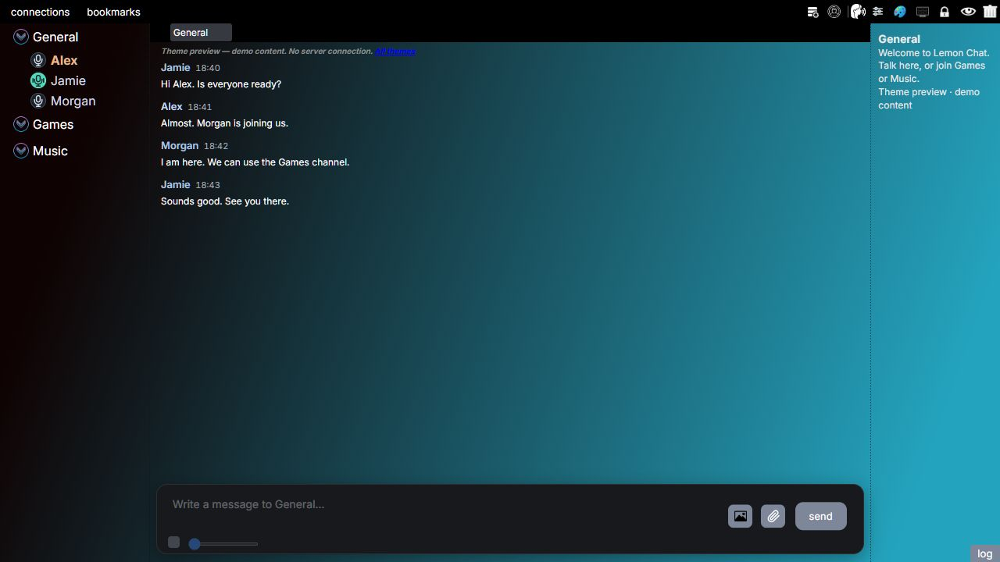 |
| **Hybrid-v1**<br>Light gray and blue panels. | 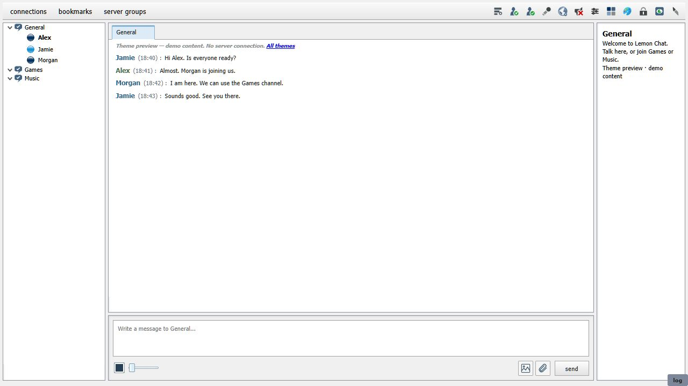 |
| **Hybrid V2**<br>Dark panels with green text and borders. | 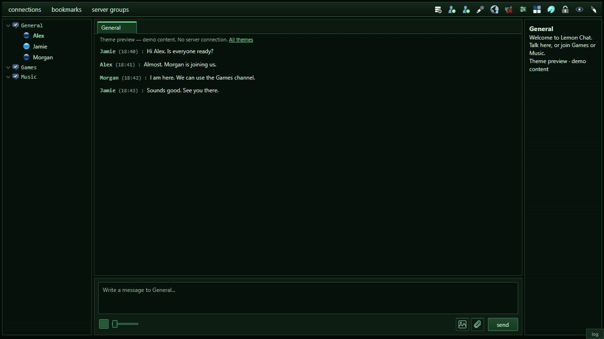 |
| **Aero**<br>Light panels with blue borders and glossy buttons. | 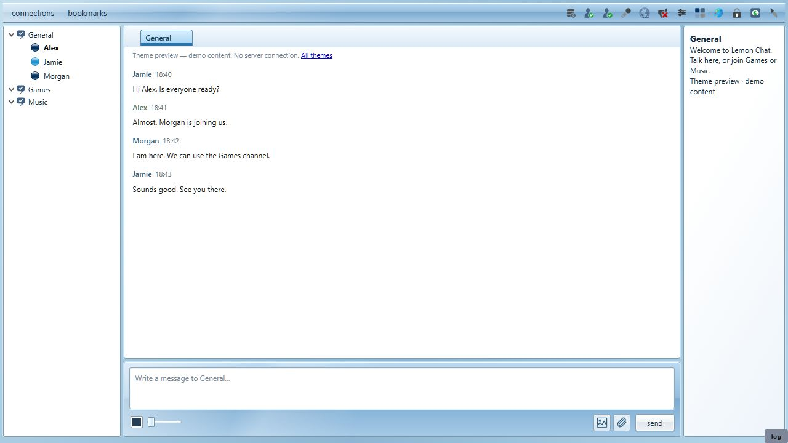 |
| **Ozone**<br>Dark, partly transparent panels with colored light effects. | 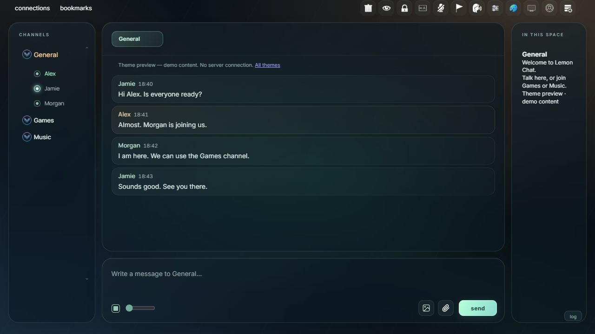 |
| **Termix**<br>Dark blue panels with a separate list of people beside the chat. | 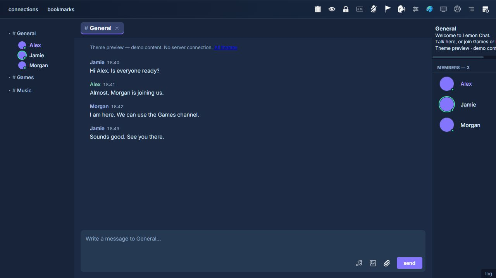 |

Ozone can also change the mouse cursor and draw a light around it. The **theme cursor** option in local settings controls this effect.

### 2.2. Themes for phones

These themes are also available on a computer.

| Theme | Preview |
| --- | --- |
| **Mobile**<br>A dark theme with controls arranged for a touch screen. | 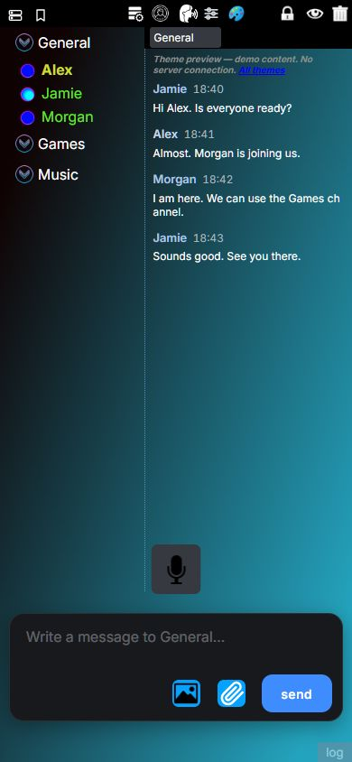 |
| **Pocket**<br>Light panels with green-blue buttons and a compact layout. | 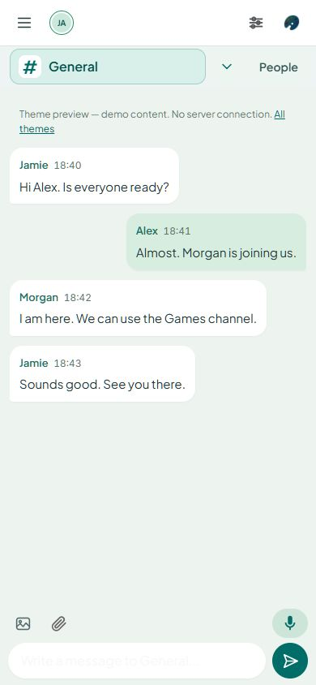 |
| **Simpledark**<br>Dark panels with a row of people's pictures above the chat. | 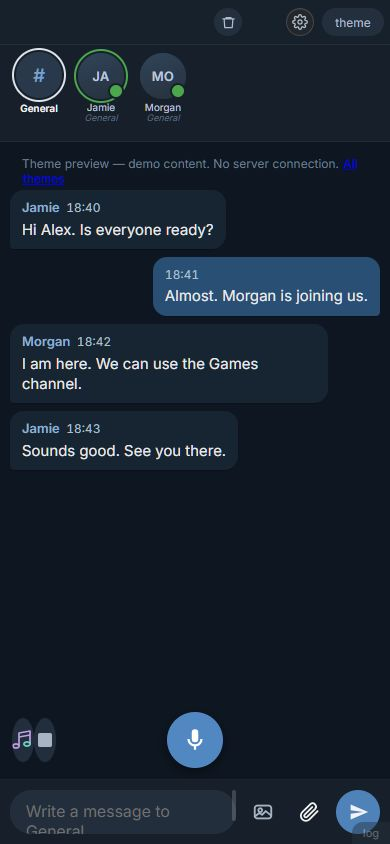 |
| **Bluebell**<br>A dark blue and purple background with rounded controls. | 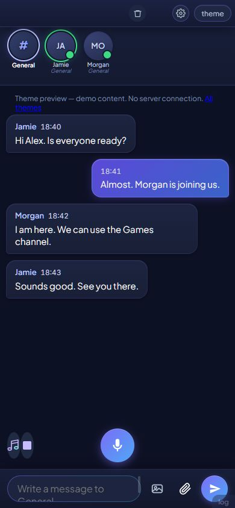 |
| **Mono Light**<br>White and light gray panels, with a switch between people and chat. | 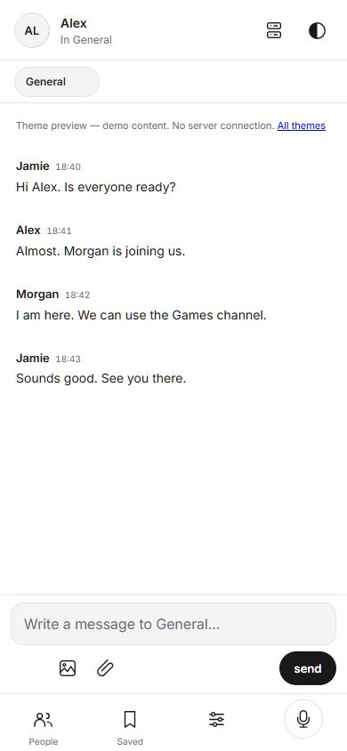 |
| **Mono Dark**<br>The same layout as Mono Light, with dark panels and light text. | 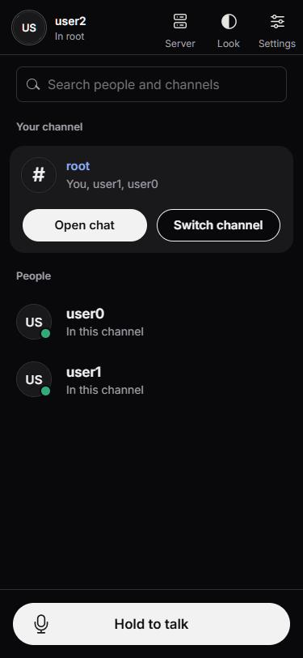 |

Some themes place controls elsewhere or hide them. For example, Pocket hides the administrator password and server settings buttons. To use those controls on a computer, switch to Default. Changing themes does not change your permissions.

## 3. Create a theme

Suppose you want to keep Default's layout but change some colors to green. You can add a theme called **Mint** and keep Default available in the menu.

The browser client's source files are in `client-source-code/client-development/browser/main`. A theme contains CSS: rules which tell the browser how to draw the page. The `.style` files in the `styles` directory contain these rules. The build combines them with `template.html` into `client.html`.

### 3.1. Add the colors

Create `styles/theme-mint.style` inside that `main` directory:

```css
:root
{
    --set-panel: #173a32;
    --set-text: #e7fff5;
    --set-accent: #65d6ad;
    --set-accent-text: #10281f;
}

html
{
    background-image: linear-gradient(135deg, #102820, #28614f);
}

#communication-system-head-menu
{
    background-color: #102820;
}
```

This changes the page background and toolbar to green. The names beginning with `--set-` supply colors to settings and other panels that use them. They do not change every color in Default; some parts have their own color rules.

### 3.2. Include the new file

Open `main/template.html`. Near the top, find the existing theme `<style>` blocks. Add this block after them and before `<style id="style-layout">`:

```html
<style id="style-theme-mint" class="style-theme-html-element" media="(max-width: 1px)">
/* @@INCLUDE: styles/theme-default.style @@ */
/* @@INCLUDE: styles/theme-mint.style @@ */
</style>
```

The first include supplies Default's complete appearance. The second include adds your changes. Keep this order so your rules can replace the earlier rules. Without the Default include, this small example would contain only a few color rules and would be missing the rest of the theme.

The class lets the theme switcher find this block. The `media` value keeps it disabled until selected. When you choose Mint, the client enables this block and disables the other theme blocks.

### 3.3. Add Mint to the menu

In the same file, find `<div id="choose-theme-button-list">`. Add this button inside it, beside the existing theme buttons:

```html
<button type="button" class="choose-theme-item" data-name="mint" data-mobile="false">Mint</button>
```

The `data-name="mint"` value must match the end of `id="style-theme-mint"`. **Mint** is the name the reader sees in the menu. The existing theme switcher handles selection and saving; this example needs no JavaScript changes.

Keep `data-mobile="false"` while the theme uses Default's computer layout. Setting it to `true` would make the choice available on touch devices and add the phone symbol. It would not rearrange the page for a small screen; the theme's CSS must do that.

## 4. Build and check the theme

Open a terminal in `client-source-code/client-development/browser`.

On Windows, run:

```powershell
.\build.bat --unminified
```

On Linux or macOS, run:

```sh
sh build.sh --unminified
```

The scripts offer to download missing build tools. `--unminified` keeps the generated page readable. The result is `client-source-code/client.html`; the builder also updates `buildresult/client.html` when that output directory exists. See [Building](building.md#browser-client) for the other build options.

Open the rebuilt client, connect to a server and choose **Mint** from the Theme menu. Check the chat, channel list and settings. Text should be readable, and buttons should remain visible and usable. Resize the window to check a smaller screen too.

Reload the page to check that Mint remains selected. Switch back to Default to compare the colors. Make further changes in the source `.style` file and rebuild; editing the generated `client.html` would lose those changes on the next build.

## 5. Rearrange the panels

On a computer, you can also move the sections of the chat window.
For example, if you want the channel and user list on the right, you can move it there without changing the theme.
The pictures below use **Default**.

**1. Click the `layout` button in the toolbar.**
Some themes show it as a small screen icon. Its tooltip says it rearranges the panels.
Blue outlines appear around the panels, and the button changes to **lock layout**.

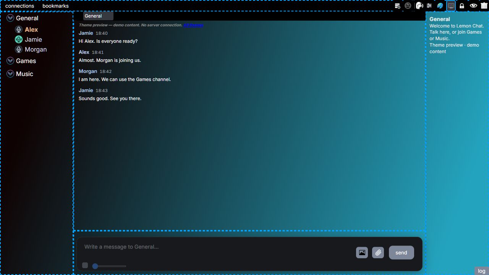

**2. Drag the channel and user list from the left to the right.**
Hold the mouse button on an empty part of that panel, move it past the other panels, then release.
The other panels move aside as you drag.

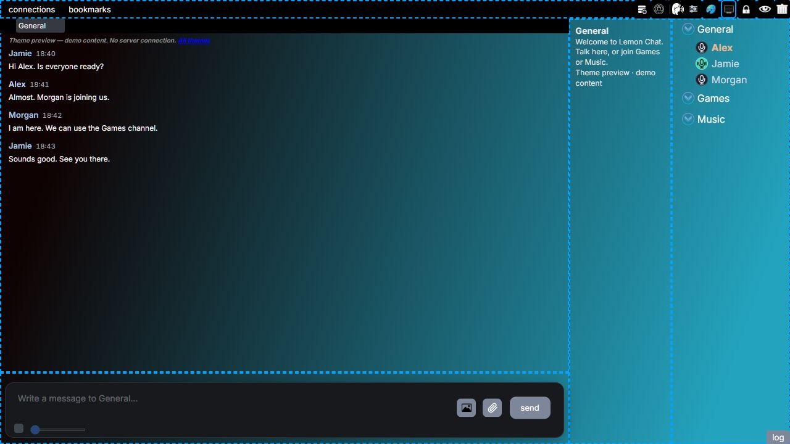

**3. Click `lock layout` when you are finished.**
The blue outlines disappear. Here is the same theme with the channel and user list on the right:

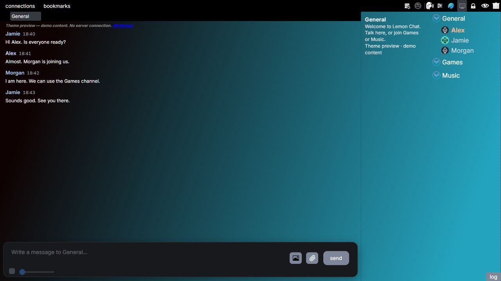

You can also move the conversation, channel information, message input and toolbar.
The arrangement is saved in your browser. Panel rearranging is available on computers;
touch devices use the arrangement provided by their theme.
