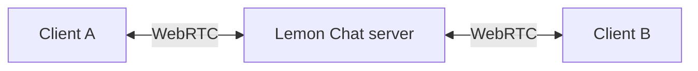

# WebRTC in Lemon Chat

## How it was developed

Development of Lemon Chat started with WebSocket support for chat. Each web client used it to connect to the server.

WebRTC was added later for voice. Lemon Chat used its **DataChannel** feature with the server acting as the second peer. This allowed, and still allows, the DataChannel to work essentially as a UDP WebSocket.

Voice is sent in small packets. With the UDP-based audio DataChannel, a lost packet does not have to delay the packets that follow it. Regular WebSocket uses TCP, which sends missing data again before delivering later data. This difference was useful for live voice, where waiting for old sound delays the conversation.

The web client prepared and encrypted its own audio packets, then sent them through the DataChannel. This is still how it works. Lemon Chat uses WebRTC to carry those packets rather than using WebRTC's built-in audio tracks.

Video uses another DataChannel inside the same WebRTC connection, with the same approach of preparing and encrypting the video in the client. It also uses DataChannel packets rather than WebRTC's built-in video tracks.

Support for audio and video over regular WebSocket was added later. This made WebRTC optional. The server can now offer WebSocket only, WebRTC only, or both. The main chat connection continues to use WebSocket in all three cases.

## The STUN server and Violet

WebRTC needs to find an address and port through which the client and server can reach each other. Lemon Chat runs a **STUN server** to help with this. It uses the included **Violet** library and starts it on **UDP port 3478**, on the same computer as the chat server.

The client sends a request to the STUN server, which replies with the IP address and port from which the request arrived. This matters when a router gives the computer one address on its local network but uses another address on the internet. WebRTC uses the reply when checking how to connect.

In the normal setup, the browser contacts STUN using the Lemon Chat server's hostname and port 3478. The server's own WebRTC library contacts it locally at `127.0.0.1:3478`.

Because Lemon Chat runs this service itself, the setup does not depend on a public STUN server run by another company.

STUN helps establish the connection. The conversation itself travels through Lemon Chat's audio and video DataChannels, not through STUN requests.

## Each WebRTC connection ends at the server

The server is the second peer for every client using WebRTC. Each of these connections contains two DataChannels: one for audio and one for video. When a client sends packets, the server receives them and forwards a separate copy to each user who should receive them.

This is why **Lemon Chat does not use peer-to-peer connections between users**. The browser's `RTCPeerConnection` object represents a connection to the server.

The addresses exchanged during setup stay between that client and the server. Other clients receive the conversation through their own server connections, so they do not receive each other's WebRTC addresses. The person hosting the server can still see the addresses that connect to it.

The main WebSocket remains open alongside WebRTC. It carries chat messages and requests such as joining a channel or starting a video stream. It also carries the information needed to set up WebRTC.

## How the WebRTC connection is opened

1. The client logs in through the main WebSocket connection.
2. When WebRTC is needed, the client asks the server to create a WebRTC connection.
3. The server and client exchange descriptions of the connection and possible addresses through that WebSocket. In the code, these are called **SDP descriptions** and **ICE candidates**.
4. WebRTC checks which address and port combination works. STUN helps with address discovery during this setup.
5. Once connected, the DataChannels carry the audio and video packets. Chat and control messages continue to use the main WebSocket.

The server uses the included **libdatachannel** library for the WebRTC connection. Violet supplies the STUN service used during setup.

## What the DataChannels carry

Both DataChannels carry packets prepared by Lemon Chat, including its encryption. They provide different delivery rules for audio and video:

| DataChannel | Delivery rule |
| --- | --- |
| Audio | Packets can arrive out of order. Lost packets are not sent again. |
| Video | Packets are delivered in order, but attempts to deliver a packet are limited to 250 milliseconds, or one quarter of a second. An undelivered packet can then be dropped. |

For example, when audio packets 1, 2 and 3 are sent and packet 2 is lost, the receiver can continue with packet 3. It does not have to wait for another copy of packet 2.

The DataChannels are carried by **SCTP** inside the WebRTC connection. **DTLS** encrypts that connection, and **UDP** carries it over the network. Of these three protocols, DTLS is the one that adds an encryption layer.

## WebSocket audio and video were added later

The later WebSocket support added a separate connection for audio at `/audio` and another for video at `/video`. Both use the same server address and port as the main chat WebSocket. The client requests access through its logged-in chat connection before opening these extra connections.

As a result, audio and video can work without a separate UDP connection or extra forwarded ports. They can also use the HTTP tunnels described in the [selfhosting guide](../selfhosting-tools/README.md).

The WebSocket connections keep TCP's delivery rules: missing data is sent again and later data waits for it. The WebRTC audio DataChannel continues to use the rules described above.

The server forwards the same kind of audio and video packets through either method. This allows a WebRTC user and a WebSocket user to hear each other and watch the same video.

## WebRTC is optional today

The admin chooses which methods the server offers for audio and video:

| Server setting | What clients use |
| --- | --- |
| **WebSocket only** | Audio and video use WebSocket. Clients do not need WebRTC. |
| **WebRTC only** | Audio and video require a working WebRTC connection. |
| **WebSocket and WebRTC (clients choose)** | Each client can choose its preferred method. |

The main chat connection uses WebSocket in all three cases. Audio and video must also be enabled on the server and in the user's chat channel.

*In **Server Settings → server settings**, scroll to **voice and channels** and choose **audio and video connections**. This example uses WebSocket only. Select **save server settings** at the bottom of the tab to apply the choice.*

When both methods are allowed, the browser tries the user's preferred method first. After about ten seconds without a connection, it also tries the other method. If the preferred connection becomes available later, the client returns to it.

Video follows the current audio connection choice, using its own DataChannel or `/video` WebSocket.

For example, a user prefers WebRTC, but their network blocks the required UDP traffic. With both methods allowed, their client can use WebSocket instead. Other users can continue using WebRTC. With WebRTC only allowed, that user needs a working WebRTC connection for audio and video; text chat can still work.

The saved setting names are `is_audio_over_websocket_allowed` and `is_audio_over_webrtc_allowed`. Although the names contain `audio`, the choice applies to video too. See [Server settings](server-settings.md#audio-and-video-connections).

## Ports and hosting

UDP port 3478 is for STUN. The server also needs reachable UDP ports for the WebRTC DataChannel connections. Opening only the STUN port does not make the audio and video connections reachable.

The project's WireGuard setup uses a configured public address and a fixed UDP port range. Updated clients skip STUN discovery in that mode. The [WireGuard guide](../selfhosting-tools/wireguard/README.md) explains which addresses and ports to configure.

The current server starts Violet even when **WebSocket only** is selected. That setting changes which method clients use for audio and video; it does not stop the STUN listener. A WebSocket-only setup does not need to forward the STUN or WebRTC UDP ports.

## WebRTC encryption and WSS

Lemon Chat encrypts user audio and video with the channel keys before sending it to the server. WebRTC adds DTLS encryption around its connection. The server removes the connection protection and forwards the content while it remains encrypted with the channel keys.

For WebSocket, `ws://` has no TLS layer and `wss://` adds TLS. Choosing WebSocket instead of WebRTC does not remove Lemon Chat's content encryption.

WSS protects the WebSocket on which it is used. If chat uses WSS and voice uses WebRTC, the chat connection's TLS is not another layer around the voice packets. Those packets have WebRTC's DTLS layer outside Lemon Chat's own encryption.

The [encryption guide](encryption.md#audio-and-video-connections) explains which keys protect audio and video, what the server decrypts, and how the receiving client reads the packets.

## Relevant source files

- [Violet STUN startup](../server-source-code/main/main.c)
- [Server WebRTC connection and audio DataChannel](../server-source-code/main/audio_webrtc.c)
- [Server video DataChannel](../server-source-code/main/video_webrtc.c)
- [Audio delivery between clients](../server-source-code/main/core/audio_channel.c)
- [Video delivery between clients](../server-source-code/main/core/video_channel.c)
- [Browser audio connection choice and retries](../client-source-code/client-development/browser/src/scripts/app/audio-transport.js)
- [Browser video connection choice](../client-source-code/client-development/browser/src/scripts/app/video-transport.js)
- [Browser STUN configuration](../client-source-code/client-development/browser/src/scripts/app/dispatch.js)
- [Browser WebRTC setup](../client-source-code/client-development/browser/src/scripts/app/voice.js)
