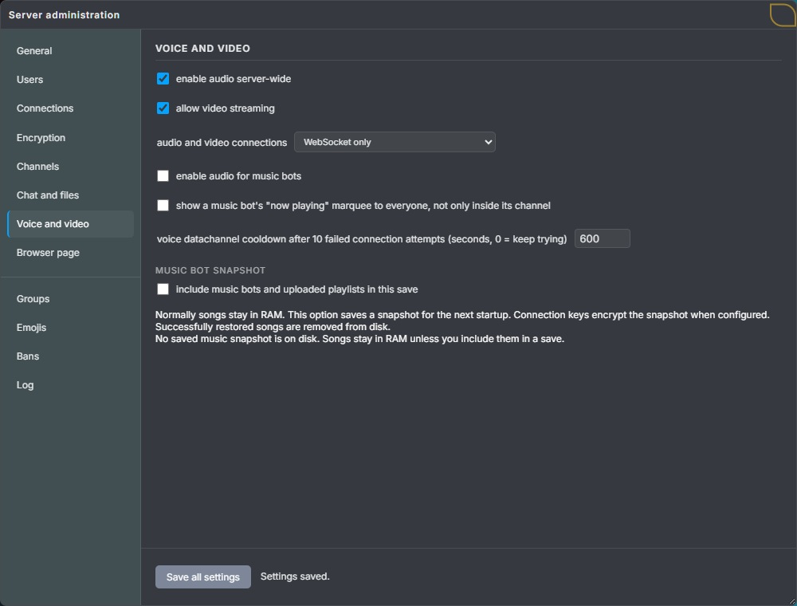
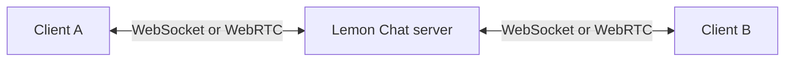

# Audio and video connections

Lemon Chat always uses WebSocket for its main chat connection. Audio and video can use WebSocket, WebRTC DataChannel, or either method according to the server setting. Both methods connect each client to the Lemon Chat server, which forwards the packets to the other users.

## Choosing a connection method

| Server setting | What clients use |
| --- | --- |
| **WebSocket only** | Audio and video use WebSocket. Clients do not need WebRTC. |
| **WebRTC only** | Audio and video require a working WebRTC connection. |
| **WebSocket and WebRTC (clients choose)** | Each client can choose its preferred method. |

Audio and video must also be enabled on the server and in the user's channel.

*In **Server Settings → server settings**, scroll to **voice and channels** and choose **audio and video connections**. This example uses WebSocket only. Select **save server settings** at the bottom of the tab to apply the choice.*

When both methods are allowed, the browser tries the user's preferred method first. After about ten seconds without a connection, it also tries the other method. If the preferred connection becomes available later, the client returns to it. Video follows the current audio connection choice.

For example, a user prefers WebRTC, but their network blocks the required UDP traffic. With both methods allowed, their client can use WebSocket instead while other users continue using WebRTC. With WebRTC only allowed, that user needs a working WebRTC connection for audio and video; text chat can still work.

The saved setting names are `is_audio_over_websocket_allowed` and `is_audio_over_webrtc_allowed`. Although the names contain `audio`, the choice applies to video too. See [Server settings](server-settings.md#audio-and-video-connections).

## How traffic reaches other users

The server is the second endpoint for every client. Users do not make peer-to-peer connections to each other.

When a client sends audio or video, the server receives it and forwards a separate copy to each user who should receive it. Other clients do not receive that user's WebRTC addresses. The person hosting the server can still see the addresses that connect to it.

The main WebSocket remains open when WebRTC is active. It carries chat messages, channel requests and the information needed to set up WebRTC.

## WebSocket audio and video

WebSocket audio uses a separate connection at `/audio`, while video uses `/video`. Both use the same server address and port as the main chat connection. The client requests access through its logged-in chat connection before opening them.

This method works without a separate UDP connection or WebRTC port range. It can also use the HTTP tunnels described in the [self-hosting guide](../selfhosting-tools/README.md).

WebSocket uses TCP. When a packet is lost, TCP sends it again before delivering later data. This is reliable, but a delayed packet can also delay live audio or video behind it.

## WebRTC audio and video

Lemon Chat uses WebRTC DataChannels as a low-latency transport. It does not use WebRTC's built-in audio or video tracks. The client prepares and encrypts Lemon Chat audio and video packets, then sends those packets through two DataChannels in one connection to the server.

The audio DataChannel does not wait for a replacement when a packet is lost. For example, if packets 1, 2 and 3 are sent and packet 2 is lost, the receiver can continue with packet 3. This avoids delaying a live conversation for old sound.

| DataChannel | Delivery rule |
| --- | --- |
| Audio | Packets can arrive out of order. Lost packets are not sent again. |
| Video | Packets are delivered in order, but an attempt is limited to 250 milliseconds. An undelivered packet can then be dropped. |

The DataChannels use SCTP inside the WebRTC connection. DTLS protects that connection, and UDP carries it over the network.

## STUN and Violet

WebRTC needs to find an address and port through which the client and server can reach each other. Lemon Chat runs its own STUN service using the included Violet library. It listens on UDP port 3478 on the same computer as the chat server.

The browser normally contacts STUN through the Lemon Chat server's hostname and port 3478. The server's WebRTC library contacts it locally at `127.0.0.1:3478`. STUN helps establish the connection; conversation packets do not travel through STUN requests.

## Opening a WebRTC connection

1. The client logs in through the main WebSocket connection.
2. The client asks the server to create a WebRTC connection.
3. They exchange SDP descriptions and ICE candidates through the main WebSocket.
4. WebRTC checks which address and port combination works. STUN helps discover the address during this step.
5. The DataChannels carry audio and video. Chat and control messages continue through the main WebSocket.

The server uses the included libdatachannel library for WebRTC. Violet supplies the STUN service.

## Ports and hosting

UDP port 3478 is for STUN. The server also needs reachable UDP ports for its WebRTC DataChannel connections. Opening only the STUN port is not enough.

The project's WireGuard setup uses a configured public address and a fixed UDP port range. Updated clients skip STUN discovery in that mode. The [WireGuard guide](../selfhosting-tools/wireguard/README.md) explains which addresses and ports to configure.

The server currently starts Violet even when **WebSocket only** is selected. A WebSocket-only setup does not need to forward the STUN or WebRTC UDP ports.

## Encryption and WSS

Lemon Chat encrypts audio and video with the channel keys before sending it to the server. WebRTC adds DTLS protection around its connection. The server removes that connection protection and forwards the content while it remains encrypted with the channel keys.

For WebSocket, `ws://` has no TLS layer and `wss://` adds TLS. Choosing WebSocket instead of WebRTC does not remove Lemon Chat's content encryption.

WSS protects the WebSocket on which it is used. If chat uses WSS and voice uses WebRTC, the chat connection's TLS is not another layer around the voice packets. Those packets have WebRTC's DTLS layer outside Lemon Chat's own encryption.

The [encryption guide](encryption.md#audio-and-video-connections) explains which keys protect audio and video, what the server decrypts and how the receiving client reads the packets.

## Relevant source files

- [Violet STUN startup](../server-source-code/main/main.c)
- [Server WebRTC connection and audio DataChannel](../server-source-code/main/audio_webrtc.c)
- [Server video DataChannel](../server-source-code/main/video_webrtc.c)
- [Audio delivery between clients](../server-source-code/main/core/audio_channel.c)
- [Video delivery between clients](../server-source-code/main/core/video_channel.c)
- [Browser audio connection choice and retries](../client-source-code/client-development/browser/src/scripts/app/audio-transport.js)
- [Browser video connection choice](../client-source-code/client-development/browser/src/scripts/app/video-transport.js)
- [Browser STUN configuration](../client-source-code/client-development/browser/src/scripts/app/dispatch.js)
- [Browser WebRTC setup](../client-source-code/client-development/browser/src/scripts/app/voice.js)
